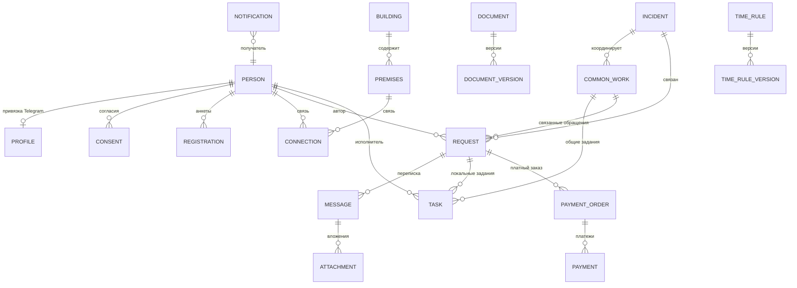
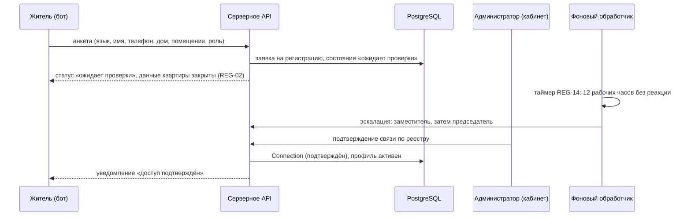
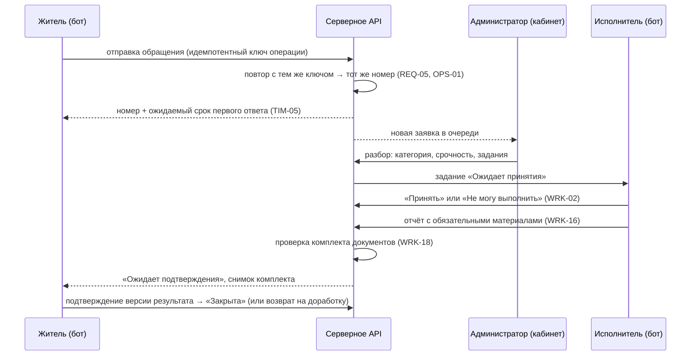
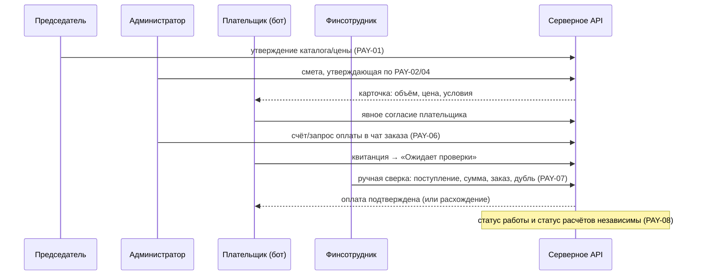

# HLD: Система ОСИ ЖК «Мунар Тау»

Версия: 1.0 (черновик для согласования). Дата: 16 октября 2026 года.

Автор: Stuart (роль архитектор).

Основание: [требования v1.1](requirements-v1.md), [модель процессов v1.1](request-lifecycle.md), [матрица прав (проект)](access-matrix.md), [ADR-001](decisions/001-telegram-auth.md), [ADR-002](decisions/002-admin-cloudflare-pages.md), [вопросы к архитектуре](architecture-questions.md). Идентификаторы требований (REG, REQ, WRK, PAY, TIM и т. д.) в этом документе ссылаются на спецификацию v1.1; идентификаторы переходов (FLOW) — на модель процессов.

Статус: согласован (16 октября 2026 года). Документ фиксирует высокоуровневую архитектуру и явные развилки; решения, помеченные «открыто», требуют согласования до реализации затронутых процессов (порядок — в [вопросах к архитектуре](architecture-questions.md)). Допущения раздела 7 и инлайн-допущения подтверждены как стартовые значения реализации (протокол — в [LLD](lld/README.md)).

## 1. Сводка

Система обслуживает одно ОСИ (~45 трёхэтажных домов, ~600 квартир, коммерческие помещения, паркинги, кладовки): приём и сопровождение обращений жителей, задания исполнителей, общие аварии, платные работы с ручной сверкой оплат Kaspi, регулярные работы, публикации и документы, информационные опросы и инициативы, отчётность, декларативные регламенты времени, журнал действий и резервное копирование.

Каналы: жители и исполнители работают в Telegram-боте; администраторы и председатель — в веб-кабинете (статическое SPA на Cloudflare Pages, ADR-002) и получают уведомления в Telegram. Вся бизнес-логика, проверка полномочий, хранение и фоновые процессы — на общем серверном ядре (направление ARC-02: Supabase PostgreSQL + Auth + закрытое Storage + общая серверная логика + очередь с фоновым обработчиком). Рабочая серверная среда планируется в Казахстане; полное решение о рабочем размещении — отдельный ADR (открыто, ARC-02/ARC-03). Пилот ведётся в облаке на реальных данных ограниченного круга участников — решение пользователя от 16 октября 2026 года, уточняющее ARC-03; отдельная среда разработки остаётся на вымышленных данных. На пилоте технический администратор получает средство эмуляции ролей: проверку бота и кабинета под всеми ролями пользователей через тестовые персоны (решение пользователя от 16 октября 2026 года).

HLD задаёт: границы компонентов, концептуальную модель данных, модель доступа, потоки файлов и событий, стратегию согласованности и повторов, безопасность, наблюдаемость, эксплуатацию и поставку, декомпозицию на вертикальные срезы. Детальные схемы базы и контракты API — следующий уровень (LLD).

## 2. Цели

- Один раз зарегистрированная жителем проблема сопровождается до проверенного результата: очередь администратора, задания исполнителей, приёмка автором (WRK-01–08, FLOW-01–04).
- Управляемый доступ: роль + область домов + связь с помещением + участие в обращении + аудитория данных + состояние процесса + срок полномочий (ROL-01, раздел 1 матрицы прав).
- Раздельные аудитории переписки и документов («Жителю» / «Внутреннее», финансовая аудитория) с проверкой на сервере, включая прямые ссылки на файлы (MSG-01–03, PAY-08).
- Декларативные регламенты времени без правки кода, с версионированием и действием по истечении (TIM-01–07).
- Журналирование значимых действий с разделением областей чтения (AUD-01–02).
- Эксплуатация пилота: ручные полные копии, RPO/RTO ≤ 24 ч, пробное восстановление до запуска (OPS-03).

## 3. Не-цели (вне объёма)

- Счётчики, регулярные начисления, квитанции и задолженность по взносам (SCP-03).
- Автоматические резервные копии и периодические проверки восстановления (SCP-03; после пилота переводятся в автоматический режим по OPS-03).
- Жалобы на председателя, сценарий «Запросить документ», email-резервирование уведомлений, автоматическая проверка квитанций, юридически значимые голосования (SCP-04).
- Интеграция с Kaspi по API (PAY-06), встроенная электронная подпись (WRK-17), антивирусная проверка вложений на пилоте (FIL-03).
- Несколько ОСИ и выбор получателя между ОСИ (раздел 2 требований); юридические лица и их представители (REG-12).
- Доступ к техническим панелям Supabase как «кабинет» (AUTH-01).

## 4. Контекст

Сейчас обращения поступают бессистемно через WhatsApp без номеров и контролируемых сроков. Система заменяет это управляемым процессом с номерами, состояниями и эскалациями. Реализация не начата (`source` пуст): HLD пишется для greenfield.

Принятые рамки: вход сотрудников — Telegram OIDC через Supabase Auth с TOTP для привилегированных ролей (ADR-001, AUTH-01–07); на пилоте TOTP не включается — вход только Telegram OIDC для всех ролей (решение пользователя от 16 октября 2026 года); админка — статика React + Refine Core + Ant Design на Cloudflare Pages без Pages Functions (ADR-002); рабочее направление серверной части — Supabase PostgreSQL, Auth, закрытое Storage, общая серверная логика бота и кабинета, очередь с фоновым обработчиком, серверная среда в Казахстане (ARC-02); пилот — облачная схема на реальных данных ограниченного круга участников (решение пользователя от 16 октября 2026 года, уточняющее ARC-03).

## 5. Требования

### 5.1. Функциональные требования

Полный перечень — в спецификации v1.1; здесь — блоки, определяющие архитектуру:

| Блок | Содержание | Влияние на архитектуру |
| --- | --- | --- |
| Регистрация и реестр | REG-01–14, IMP-01–13: анкеты, приглашения (72 ч), споры, 4 типа объектов, Excel-импорт со строгим шаблоном | Модель лиц/объектов/связей, пакетный импорт с полной валидацией до сохранения |
| Обращения | REQ-01–10: приём, черновики, идемпотентная отправка, категории, срочность | Жизненный цикл по модели процессов, серверная проверка переходов |
| Переписка | SHR-01–04, MSG-01–03: каналы «Жителю»/«Внутреннее», совместный доступ | Раздельные аудитории на уровне сообщений и вложений |
| Работы | WRK-01–18, JOB-01–06: задания, общая работа, визиты, отчёты, документы работ, регулярные задания | Отдельные агрегаты «задание», «общая работа», «документ» с собственными состояниями |
| Аварии | EMG-01–07: возможная/подтверждённая авария, инцидент с охватом и адресными обновлениями | Инцидент как отдельный агрегат; массовые адресные рассылки |
| Платные работы | PAY-01–12: каталог (утверждает председатель), сметы, несколько платежей, ручная сверка Kaspi, возвраты | Независимость статуса работы и расчётов; финансовая аудитория |
| Публикации и документы | PUB-01–03, DOC-01–03, FIN-01–04: объявления, отключения, документы с версиями и аудиториями, финансовые отчёты с основаниями | Версионирование документов, аудитории, регламент публикаций |
| Опросы и инициативы | POL-01–02, IDEA-01–03, MOD-01–03 | Уникальность ответа на человека, модерация без редактирования чужого текста |
| Отчётность | REP-01–05: отчёты по ролям, Excel-выгрузки без персональных данных | Экспорт с журналированием; отдельный экспорт персонального реестра (IMP-05) |
| Регламенты | TIM-01–07: графики, сроки, эскалации, правовые границы | Версионированные настройки + планировщик фоновых задач |
| Персональные данные и аудит | PRV-01–03, FIL-01–03, AUD-01–02 | Согласия, запросы удаления, лимиты файлов, append-only журнал |
| Доступ и вход | ROL-01–06, AUTH-01–07, CMP-01–02 | PDP на сервере, TOTP после пилота (на пилоте вход только Telegram OIDC), сеансы 12 ч / 30 мин бездействия, отзыв полномочий |
| Эмуляция поддержки (пилот) | решение пользователя от 16 октября 2026 года: техадминистратор проверяет бота и кабинет под всеми ролями пользователей | тестовые персоны, симулятор диалогов бота, эмуляция ролей кабинета, аудит эмуляции, исключение тестовых данных из KPI |

### 5.2. Нефункциональные требования

**Согласованные ограничения** (из требований, обязательны):

| Ограничение | Значение | Источник |
| --- | --- | --- |
| RPO / RTO | ≤ 24 ч / ≤ 24 ч; пробное восстановление до запуска пилота | OPS-03 |
| Сеанс кабинета | ≤ 12 ч, завершение после 30 мин бездействия, ручной выход; после пилота для привилегированных отсчёт — от подтверждения TOTP | AUTH-06; на пилоте без TOTP |
| Второй фактор | после пилота: TOTP для председателя, техадминистратора и администраторов с финансовыми правами / экспортом реестра / управлением регламентами; на пилоте не включается | AUTH-02–03; решение пользователя от 16 октября 2026 года |
| Вложения | ≤ 20 МБ на файл, ≤ 10 файлов на сообщение, без антивируса на пилоте | FIL-01, FIL-03 |
| График обработки | ежедневно 08:00–20:00 Asia/Almaty (декларативно), первый ответ сотрудника — 2 рабочих часа | TIM-05 |
| Эскалация без реакции | 12 рабочих часов на каждом этапе (администратор → заместитель → председатель) | REG-14 |
| Приглашение | одноразовое, 72 ч | REG-03 |
| Резервные копии пилота | вручную ежедневно + перед обновлениями, зашифрованное хранилище в Казахстане отдельно от сервера, хранение 7 дней | OPS-03 |
| Масштаб | ~45 домов, ~600 квартир; KPI: ≥ 100 подтверждённых жителей и ≥ 30 завершённых обращений за 3 месяца | раздел 2, KPI-01–02 |
| Языки | русский и казахский (меню и уведомления двуязычные) | UI-02 |

**Цели, не утверждённые** (архитектуре поручено их предложить — раздел 5 [вопросов к архитектуре]; значения ниже — предложения для утверждения, не обязательства):

| Параметр | Предложение для пилота | Основание предложения |
| --- | --- | --- |
| Задержка интерактивных операций API | p95 ≤ 500 мс на серверную операцию без учёта Telegram | UX кабинета и бота; нагрузка мала |
| Подтверждение приёма команды бота | ≤ 2 с (номер/статус после сохранения) | REQ-03, OPS-01 |
| Пик одновременных пользователей | 50–100 сессий; рассчитан на всплеск при аварии (массовая рассылка по ~45 домам) | EMG-06, KPI-01 |
| Отправка аварийной рассылки | старт в течение 1 мин, полное прохождение по лимитам Telegram с учётом повторов | EMG-06; лимиты Bot API |
| Доступность | не устанавливается на пилот; известные зависимости: Telegram, Supabase, Cloudflare (сбой = организационный приём по OPS-01) | OPS-01, OPS-02 |

Утверждение этих целей — обязательный шаг до приёмочных тестов производительности; они не подменяют норматив первого ответа сотрудника (2 рабочих часа по TIM-05).

## 6. Ограничения

- Вход сотрудников — Telegram OIDC через Supabase Auth; секреты (Client Secret OIDC, токен бота, service-role key) только на сервере; self-hosted Supabase Auth ≥ v2.196.0 (ADR-001).
- Кабинет — статические файлы на Cloudflare Pages, без Pages Functions и SSR; клиентские переменные Vite считаются публичными (ADR-002).
- Привилегированные действия (финансы сотрудников, экспорт персонального реестра, регламенты, права сотрудников, перенос привязки Telegram) — только в веб-кабинете; сервер применяет ограничение независимо от интерфейса (AUTH-03). Гейт «Telegram + TOTP» для этих действий вводится после пилота: на пилоте вход в кабинет — Telegram OIDC для всех ролей (решение пользователя от 16 октября 2026 года).
- Рабочая среда — в Казахстане; пилот — в облаке на реальных данных ограниченного круга участников (решение пользователя от 16 октября 2026 года, уточняющее ARC-03). Копии пилота — в зашифрованном хранилище в Казахстане (OPS-03). Защитные меры раздела 15 применяются в пилоте без ослаблений.
- Полномочия проверяются сервером на каждом защищённом запросе; вход не выдаёт роль; отзыв прав прекращает операции из открытого сеанса (AUTH-01, матрица раздел 1).
- Эмуляция ролей на пилоте — только для технического администратора и только под тестовыми персонами; эмуляция идёт через те же API и проверки PDP, а все действия журналируются с указанием реального актора и эмулируемой персоны (AUD-01).
- Журнал действий не редактируется сотрудниками (AUD-01); защита от инфраструктурного доступа и сроки хранения журнала — на детализацию (AUD-01, AUTH-07).
- Telegram не гарантирует доставку (NTF-02: ошибки доставки фиксируются; пользователь может заблокировать бота); при недоступности системы — организационный приём по телефону/лично с последующим внесением (OPS-01).
- Нормативные сроки и юридические процедуры Казахстана не задаются разработчиком; правовые регламенты хранят источник и границы, обычная настройка не может их нарушить (TIM-07).
- Серверный стек зафиксирован ADR-003 (принят 16 октября 2026 года): TypeScript и Supabase Edge Functions; состояние диалогов и очередь — в PostgreSQL, обработчики по расписанию. Рабочая среда — self-hosted Supabase в Казахстане; провайдер отложен до этапа развёртывания и не блокирует проектирование.

## 7. Допущения

- `[согласовано 16.10.2026]` Кабинет обращается к данным только через собственный серверный API (Supabase Auth — только для получения сеанса); прямых запросов браузера к PostgREST/Storage нет. Тогда RLS — второй рубеж, а не единственный механизм доступа.
- `[согласовано 16.10.2026]` Бот получает события Telegram через webhook с проверкой `secret_token`; long polling — резервный режим.
- `[согласовано 16.10.2026]` Нормализация телефонов реестра — до формата E.164; точные правила фиксирует контракт импорта (IMP-09 оставляет это открытым).
- `[согласовано 16.10.2026]` Очередь задач и исходящих уведомлений — на таблицах PostgreSQL (outbox + `SKIP LOCKED`) без внешнего брокера на пилоте.
- `[согласовано 16.10.2026]` Одно ОСИ в одной БД; изоляция по домам реализуется областью полномочий, а не мультитенантностью на уровне схемы.
- `[согласовано 16.10.2026]` Часовой пояс системы для регламентов — Asia/Almaty (без перехода на летнее время); данные времени хранятся в UTC.

## 8. Драйверы архитектуры

1. **Разграничение доступа как ядро.** Модель прав с шестью измерениями (матрица раздел 1) и запрет раскрытия внутренних/финансовых данных — главная сложность; ошибка = утечка персональных данных.
2. **Управляемые процессы, а не чат.** Состояния и переходы нормативны (модель процессов); недопустимые переходы запрещены сервером, история сохраняется.
3. **Декларативность времени.** Тайминги, графики, эскалации и сводки настраиваются без релиза, с версионированием и «уже запущенные сроки сохраняют правила» (TIM-01–04).
4. **Согласованность и идемпотентность.** Повторная отправка не создаёт дубль (REQ-05, OPS-01); одновременные несовместимые действия разрешаются одним применением (FLOW-01).
5. **Малый масштаб, высокая требовательность к приватности.** ~600 квартир — нагрузка не проблема; проблемные области — доступ, аудит, восстановление, размещение данных.
6. **Зависимость от внешних сервисов.** Telegram (канал доставки, вход), Supabase, Cloudflare — каждый сбой имеет согласованную организационную компенсацию (OPS-01–02, EMG-02).

## 9. Целевая архитектура

```mermaid
graph TD
    R[Жители и исполнители] -->|Telegram| TG[Telegram Bot API]
    A[Администраторы и председатель] -->|HTTPS| CF[Cloudflare Pages: статика кабинета]
    CF -->|HTTPS, Bearer JWT| API
    TG -->|webhook, secret_token| BOT

    subgraph SRV[Серверная среда: пилот — облако, реальные данные ограниченного круга / рабочая — Казахстан]
        BOT[Адаптер бота]
        API[Серверное API: домены + PDP]
        WRK[Фоновый обработчик: TIM-планировщик, уведомления, импорт, напоминания о копиях]
        SB[Supabase: Auth Telegram OIDC (TOTP после пилота), PostgreSQL, Storage]
    end

    BOT --> API
    API --> SB
    BOT -->|отправка сообщений| TG
    API -->|подписанные URL| CF
    WRK --> API
    SRV -->|ручные полные копии, шифрование| BKP[Хранилище копий в Казахстане]

    API -.->|ошибки доставки| NTF[Журнал доставки: NTF-02]
```

Принципы:

- **Один серверный API.** Бот и кабинет — два интерфейса над одним ядром; бизнес-правила и проверки полномочий существуют в одном месте. Канонический пример: AUTH-03 запрещает privileged-действия из бота не отдельной проверкой бота, а свойством API.
- **PDP (точка принятия решения о доступе) внутри API.** Каждый защищённый вызов оценивает полномочия по шести измерениям; deny-by-default.
- **Фоновый обработчик** владеет всем, что происходит «само»: таймеры TIM, эскалации, напоминания, дайджесты 20:00, повторные доставки, контроль возраста копий. Он не меняет состояния, которые по модели процессов может менять только человек (например, не «закрывает» заявки и инциденты по таймеру — только напоминает и эскалирует: FLOW-03, WRK-07, EMG-05).
- **Supabase** — PostgreSQL (данные), Auth (сеансы по ADR-001), Storage (закрытые бакеты). Секреты и service-role — только на сервере; в браузере — publishable key (ADR-002).
- **Границы каналов:** бот — действия жителя/исполнителя и уведомления со ссылками; кабинет — все действия сотрудников, включая привилегированные (UI-01, AUTH-03).
- **Средство эмуляции (пилот):** техадминистратор проверяет бот и кабинет под всеми ролями через тестовые персоны; эмуляция потребляет тот же серверный API и тот же PDP — отдельного «обходного» контура нет.

## 10. Компоненты

### 10.1. Адаптер бота

- **Ответственность:** приём событий Telegram (webhook), нормализация в команды/диалоги бота, отправка уведомлений с учётом лимитов и повторов, сценарии жителя и исполнителя (анкета, заявка, подтверждение, отчёт, оценка).
- **Интерфейс:** webhook → внутренние вызовы API; исходящие вызовы Telegram Bot API. Webhook подтверждён ADR-003; long polling — резервный режим.
- **Зависимости:** серверное API; Telegram Bot API.
- **Ключевые решения:** адаптер не содержит бизнес-правил; идемпотентность по `update_id` Telegram (повтор доставки webhook не создаёт дубль обращения — REQ-05, OPS-01). Ошибки сохранения файла не блокируют регистрацию заявки (FIL-02): номер выдаётся, вложение помечается неполным.

### 10.2. Веб-кабинет (админка)

- **Ответственность:** реестры, очереди, классификация, назначения, документы, финансы, права сотрудников, регламенты, журнал, экспорт; привилегированные действия (AUTH-03).
- **Интерфейс:** HTTPS REST/JSON к серверному API; вход «Войти через Telegram» (ADR-001); TOTP для привилегированных ролей — после пилота (AUTH-02), на пилоте вход только Telegram OIDC.
- **Технологии:** React + Refine Core + Ant Design, Vite, статика на Cloudflare Pages (ADR-002); SPA-маршрутизация для прямых ссылок.
- **Ключевые решения:** в сборке нет персональных данных и секретов; сервис работает на мобильном телефоне для приёма/назначения/ответа/смены статуса (UI-01), таблицы и массовые действия — для большого экрана.

### 10.3. Серверное API (ядро)

- **Ответственность:** все домены (реестр, обращения, работы, аварии, документы, финансы, публикации, опросы, отчёты, регламенты, уведомления, аудит, файлы, импорт/экспорт), проверка переходов (FLOW-01), PDP, выдача подписанных URL, идемпотентность.
- **Интерфейс:** REST/JSON, версия `/v1`; внутренние события — через outbox.
- **Технологии:** TypeScript и Supabase Edge Functions (ADR-003, принят 2026-10-16); рабочая среда — self-hosted Supabase в Казахстане, совместимость с self-hosted Functions проверяется при развёртывании (ADR-003).
- **Ключевые решения:** единая транзакционная БД; недопустимое действие отклоняется с объяснением и актуальным состоянием (FLOW-01); при одновременных несовместимых действиях применяется одно, второй участник получает обновление карточки.

### 10.4. PDP — сервис авторизации

- **Ответственность:** решение «можно ли субъекту S выполнить действие D над объектом O» по модели: роль + область домов/объектов + связь с помещением + участие в обращении + аудитория данных + состояние процесса + срок полномочий (ROL-01, матрица раздел 1). Включает: совмещение ролей председателя с запретами ROL-02d, конфликт интересов CMP-02, временные полномочия ROL-03, отзыв полномочий с немедленным эффектом (ROL-04, AUTH-01).
- **Интерфейс:** библиотека/модуль ядра, вызывается каждым обработчиком; решения журналируются при экспортах и privileged-действиях.
- **Ключевые решения:** deny-by-default; отдельно от аутентификации; TOTP (после пилота) не выдаёт полномочий (AUTH-02); RLS в PostgreSQL — второй рубеж `[согласовано 16.10.2026]`, полная модель в RLS не строится.

### 10.5. Фоновый обработчик

- **Ответственность:** планировщик регламентов TIM (напоминания, эскалации, передача споров REG-14, дайджест NTF-01 без пустых сообщений, напоминания WRK-07, напоминание о возрастe копий OPS-03); диспетчер уведомлений с повторами и фиксацией ошибок доставки (NTF-02); обработка импорта/экспорта; слежение за расписанием копий.
- **Интерфейс:** потребление outbox + таблицы задач в PostgreSQL.
- **Ключевые решения:** единица планирования — версия правила TIM (TIM-04: запущенные сроки живут по прежней версии); вне графика отсчёт приостанавливается (TIM-05, REG-14); планировщик только напоминает и эскалирует, человекоподобные действия за сотрудников не имитирует.

### 10.6. Supabase (PostgreSQL, Auth, Storage)

- **Ответственность:** хранение (единая схема), аутентификация сотрудников (Telegram OIDC custom-провайдер; TOTP после пилота; сеансы AUTH-06), закрытые бакеты вложений и документов.
- **Ключевые решения:** self-hosted Auth ≥ v2.196.0 (ADR-001); Storage выдаёт файлы только по короткоживущим подписанным URL после серверной проверки аудитории; бакеты разделены по аудиториям (жительские/внутренние/финансовые/служебные) — защита прямых ссылок (сценарий «внутреннее вложение по прямой ссылке — доступ запрещён», модель процессов раздел 8).

### 10.7. Эксплуатационные средства

- **Ответственность:** ручное резервное копирование (база + вложения), шифрованное хранилище в Казахстане, реестр копий (дата, состав, результат), пробное восстановление до запуска (OPS-03); мониторинг (выбор открыт, OPS-02).
- **Ключевые решения:** копия без файлов не считается полной; при пропуске/ошибке уведомляется только основной техадминистратор (специальное правило OPS-03).

### 10.8. Средство эмуляции ролей (пилот)

- **Ответственность:** проверка техническим администратором сценариев бота и кабинета под всеми ролями (собственник, проживающий, исполнитель, администратор, председатель) без привлечения реальных жителей: (а) симулятор диалогов бота в кабинете, исполняющий ту же логику сценариев, что и webhook-адаптер; (б) вход в кабинет под эмулируемой ролью с тестовой областью. Дополнительно тестовые персоны можно привязывать к реальным вторичным Telegram-аккаунтам техадминистратора для сквозных проверок настоящей интеграции.
- **Интерфейс:** `/v1/emulation` — управление тестовыми персонами, старт/остановка эмулированного сеанса, транспорт симулятора диалогов.
- **Зависимости:** серверное API, PDP, диспетчер уведомлений (уведомления тестовых персон направляются во «входящие» симулятора, а не в Telegram).
- **Ключевые решения:** эмуляция выполняется только под тестовыми персонами с флагом `is_test` — тестовые и реальные данные не смешиваются; все действия журналируются с указанием реального актора и эмулируемой персоны (AUD-01); тестовые аккаунты исключаются из KPI-01–02 и операционных отчётов (KPI-01); эмуляция не расширяет собственные полномочия техадминистратора — PDP оценивает права эмулируемой роли, а привилегированные инфраструктурные операции в эмуляции недоступны; эмулированный сеанс живёт внутри сеанса техадминистратора с сохранением пределов AUTH-06. Просмотр данных реального пользователя в целях поддержки остаётся отдельным механизмом ROL-06 и в эмуляцию не входит.

## 11. Модель данных (концептуально)

Полная схема — LLD. Ключевые агрегаты и связи:



Сущности и смысл:

| Сущность | Ключевые атрибуты | Комментарий |
| --- | --- | --- |
| Person | id, ФИО, нормализованный телефон (уникальный, IMP-09), статус | Только физлица v1 (REG-12); совпадение ФИО/телефона не объединяет людей (IMP-07) |
| Profile | id, person_id, telegram_user_id (уникальный), язык, флаг тестовой персоны | Связывание по проверенным сервером идентификаторам (ADR-001); смена username не меняет права; тестовые персоны исключаются из KPI-01–02 и операционных отчётов |
| Building | id, тип (дом/паркинг), обозначение | Паркинг может обслуживать несколько домов (REG-11) |
| Premises | id, building_id, тип (квартира/коммерческое/место/кладовка), номер, подъезд/этаж (необязательно), статус | Уникальность: родитель + тип + номер (REG-11, IMP-07) |
| Connection | id, person_id, premises_id, роль, основание, даты начала/прекращения, подтверждение | Отдельно по каждому объекту (REG-12, REG-13); основание стартового импорта — «исходный реестр ОСИ» (IMP-12) |
| Registration | id, person_id, объект, роль, состояние (REG-02), проверяющий | Предварительные профили без Telegram — REG-09 |
| Invite | id, создатель, объект, роль, срок 72 ч (TIM), использование | Одноразовое (REG-03, REG-13) |
| Request | id, номер, вид (заявка/вопрос/жалоба), категория, срочность, состояние, автор, ответственный, источник | Состояния и переходы — модель процессов разделы 3–4; способ закрытия и версия результата хранятся отдельно |
| Message | id, request_id, канал («Жителю»/«Внутреннее»), автор | Аудитория неизменяема после отправки (MSG-03) |
| Attachment | id, сообщение/карточка, путь в Storage, размер, тип | Лимиты FIL-01; неполное вложение помечается (FIL-02) |
| Task | id, request_id или common_work_id, исполнитель, состояние, срок, зависимости | Переходы — модель процессов раздел 5 |
| CommonWork | id, состояние (агрегированные) | Завершение не отправляет обращения на подтверждение автоматически |
| Incident | id, номер, состояние, охват (дома/паркинги/зоны), ответственный, прогноз | Переходы — модель процессов раздел 6; частичное восстановление не завершает |
| Document / DocumentVersion | id, тип, аудитория, дома, версия, файл, состояние (черновик/на проверке/возвращён/проверен) | Версии не перезаписываются (WRK-17–18, FIN-02–03) |
| ServiceCatalogItem | версия, цена, единица, условия, утвердивший | Утверждает только председатель (PAY-01); согласованная цена заказа не меняется задним числом (PAY-02) |
| PaymentOrder / Payment | заказ: плательщик, согласованная сумма, состояние; платёж: сумма, квитанция, состояние сверки | Несколько платежей и частичная предоплата (PAY-05); сверка вручную (PAY-07) |
| TimeRule / TimeRuleVersion | ключ, вид (рабочее/правовое), версия, параметры, срок действия | TIM-01–07; правовые границы не обходятся настройкой (TIM-07) |
| Notification | id, получатель, событие, канал, состояние доставки, ошибка | Ошибки важной доставки видны администратору (NTF-02) |
| Consent | id, person, дата, версия условий, цель | PRV-01 |
| AuditLog | id, актор, действие, сущность, старое/новое значение, время, признак и объект эмуляции | Append-only; области чтения по AUD-02; записи под эмуляцией хранят реального актора и эмулируемую персону |
| ImportBatch | id, файл, состояние, ошибки (лист/строка/поле/причина), результат | Валидация до единого сохранения (IMP-01–03) |

Правила целостности, вытекающие из требований: номер обращения уникален и не переиспользуется (REQ-05); телефоны уникальны после нормализации (IMP-09); ключи уникальности помещений — по REG-11; журнал не имеет UPDATE/DELETE (AUD-01); состояния меняются только разрешёнными переходами с записью автора, времени, причины (FLOW-01).

## 12. API и контракты

### 12.1. Группы REST API `/v1`

Полные контракты — LLD. Границы на HLD-уровне:

| Группа | Назначение | Основные потребители |
| --- | --- | --- |
| `/v1/registrations` | анкеты, приглашения, споры о доступе | бот, кабинет |
| `/v1/registry` | лица, объекты, связи; импорт/экспорт реестра | кабинет |
| `/v1/requests` | обращения, сообщения по каналам, участники, статусы | бот, кабинет |
| `/v1/tasks` | задания, общая работа, приёмка | бот, кабинет |
| `/v1/incidents` | аварии, охват, обновления | кабинет |
| `/v1/documents` | документы работ и публикации, версии, проверки | бот, кабинет |
| `/v1/payments` | каталог, сметы, заказы, платежи, квитанции, сверка | кабинет (бот — уведомления и отправка квитанции плательщиком по PAY-06) |
| `/v1/publications` | объявления, отключения, отчёты работ, финансовые отчёты | кабинет |
| `/v1/polls`, `/v1/initiatives`, `/v1/moderation` | участие и модерация | бот, кабинет |
| `/v1/reports` | отчёты REP-01–05, Excel-выгрузки | кабинет |
| `/v1/regulations` | правила TIM, версии, границы | кабинет (AUTH-03) |
| `/v1/notifications` | настройки уведомлений, ошибки доставки | бот, кабинет |
| `/v1/files` | выдача подписанных URL после проверки аудитории | бот, кабинет |
| `/v1/audit` | чтение журнала по областям (AUD-02) | кабинет |
| `/v1/admin` | роли, полномочия, области, сроки, сеансы, восстановление доступа | кабинет (AUTH-03) |
| `/v1/ops` | резервные копии, статус копий | кабинет техадминистратора (AUTH-07) |
| `/v1/emulation` | тестовые персоны, эмулированные сеансы, транспорт симулятора бота (пилот) | кабинет техадминистратора |
| `/bot/webhook` | приём событий Telegram (`secret_token`) | Telegram |

Аутентификация: кабинет — Bearer JWT Supabase; проверка полномочий — PDP на каждом вызове (AUTH-01). Бот — аутентификация webhook (`secret_token`) + проверка `telegram_user_id` → профиль; привилегированные операции API для бота не существуют (AUTH-03).

### 12.2. События (outbox)

| Событие | Источник | Потребители | Назначение |
| --- | --- | --- | --- |
| `request.created` | API | диспетчер уведомлений | номер и срок первого ответа автору, очередь админу (REQ-03, WRK-01) |
| `task.assigned` / `task.reported` | API | диспетчер уведомлений | исполнитель/админ (WRK-02, WRK-06) |
| `timer.fired` | планировщик | API | напоминания, эскалации, передачи по TIM/REG-14 |
| `incident.confirmed` / `incident.updated` | API | диспетчер адресных рассылок | аудитория по затронутым объектам без дублирования (EMG-06) |
| `payment.confirmed` | API | диспетчер уведомлений | плательщику (PAY-07) |
| `digest.daily` | планировщик | диспетчер уведомлений | сводка 20:00 Asia/Almaty, пустые не отправляются (NTF-01) |

Доставка уведомлений — at-least-once с дедупликацией по id события; результат и ошибка фиксируются (NTF-02). Согласование остаётся видимым в карточке независимо от уведомлений (FLOW-03).

## 13. Интеграции

| Система | Направление | Протокол | Обработка сбоя |
| --- | --- | --- | --- |
| Telegram Bot API | вход + выход | HTTPS (webhook / sendMessage) | повторы с backoff по 429; ошибки доставки в NTF-02; полная недоступность — принятый риск, уведомления не гарантируются (NTF-01); приём заявок дублируется организационно (OPS-01) |
| Telegram Login / OIDC | вход сотрудников | OIDC через Supabase custom-провайдер `custom:telegram` | вход зависит от Telegram; процедура восстановления по AUTH-04–05 |
| Supabase (PG/Auth/Storage) | внутренняя | SQL / HTTPS | RPO/RTO ≤ 24 ч; ручные копии; организационный приём при простое (OPS-01, OPS-02) |
| Хранилище копий (Казахстан) | выход | S3-совместимое `[согласовано 16.10.2026]` | шифрование, отдельный доступ основного/резервного техадминистратора (OPS-03) |
| Kaspi | нет интеграции | вне системы | счёт направляет сотрудник, квитанцию возвращает плательщик, сверка вручную (PAY-06–07) |
| Cloudflare Pages | раздача статики | HTTPS | недоступность кабинета не блокирует бот; проблемы сообщаются техадмину (OPS-02) |
| Excel | файлы импорта/экспорта | файлы строгого шаблона (IMP-06) | валидация до сохранения; ошибки блокируют весь импорт (IMP-02) |

Внешние интеграции не добавляются автоматически (ARC-02); Google Docs/Sheets не являются зависимостью (IMP-04).

## 14. Ключевые потоки

### 14.1. Регистрация собственника и эскалация



### 14.2. Обращение: от отправки до приёмки



### 14.3. Платная услуга: согласование и ручная сверка



Отдельного описания заслуживает авария: инцидент создаётся администратором/дежурным (EMG-03), адресные обновления идут по затронутым объектам (EMG-06), частичное восстановление не завершает инцидент (EMG-05); диаграмма состояний — в модели процессов, HLD её не дублирует.

## 15. Безопасность

- **Аутентификация.** Сотрудники: Telegram OIDC → Supabase Auth (custom-провайдер, ADR-001); TOTP для AUTH-02 — после пилота, на пилоте вход только Telegram OIDC для всех ролей (решение пользователя от 16 октября 2026 года); сеанс ≤ 12 ч, бездействие 30 мин, ручной выход (AUTH-06); обновление токенов не продлевает пределы. Жители/исполнители: идентификация по Telegram с проверкой сервером; вход не выдаёт роль. Webhook бота защищён `secret_token`.
- **Авторизация.** PDP в ядре: роль, область, связь с помещением, участие, аудитория, состояние, срок (ROL-01). Deny-by-default. Отзыв полномочий действует на следующий запрос из открытого сеанса (AUTH-01, ROL-04). Совмещённые роли и конфликт интересов — правилами PDP (ROL-02d, CMP-02). RLS — второй рубеж `[согласовано 16.10.2026]`.
- **Привилегированные действия.** Только веб-кабинет: финансовые операции сотрудников, экспорт персонального реестра, регламенты, права сотрудников, перенос привязки Telegram (AUTH-03); API не предоставляет этих операций боту. Гейт «Telegram + TOTP» вводится после пилота; на пилоте эти действия доступны после входа Telegram OIDC — принятый риск однокомпонентного входа при ограниченном круге сотрудников.
- **Эмуляция (пилот).** Доступна только техническому администратору, только под тестовыми персонами; эмулированный сеанс маркирован, действия атрибутируются реальному актору (AUD-01); уведомления тестовых персон не покидают симулятор; эмуляция не ослабляет проверки переходов (FLOW-01) и PDP — права оцениваются для эмулируемой роли. Доступ к данным реальных пользователей остаётся механизмом ROL-06 с причиной, составом и сроком.
- **Данные.** TLS на всех внешних каналах; шифрование хранения на уровне инфраструктуры (диск/Storage) `[согласовано 16.10.2026]`; копии — в зашифрованном хранилище (OPS-03). ИИН и паспортные данные не собираются (IMP-11). Персональные данные не попадают в URL, статические файлы и журналы сборки (ADR-002). Пилот в облаке обрабатывает реальные данные ограниченного круга участников (решение пользователя от 16 октября 2026 года): полный набор мер этого раздела действует с первого дня, состав данных минимизируется до необходимого для пилота, согласия оформляются по PRV-01 до обработки.
- **Файлы.** Закрытые бакеты по аудиториям; выдача короткоживущих подписанных URL после серверной проверки; прямые ссылки на внутренние вложения не работают (модель процессов раздел 8); проверки размера/формата (FIL-01), антивирус не заявлен (FIL-03).
- **Секреты.** Токен бота, OIDC Client Secret, service-role key — только на сервере; в браузере publishable key (ADR-001, ADR-002). Хранение секретов на сервере — env/secret-файл вне репозитория `[согласовано 16.10.2026]`, способ фиксируется в ADR-003.
- **Аудит.** Append-only журнал: права, исполнители, состояния, сроки, цены, документы, финансовые решения, экспорты, поддержка (AUD-01); области чтения по AUD-02; защита от инфраструктурного администратора — открытая тема (AUD-01, AUTH-07).
- **Угрозы и меры:** IDOR по номерам обращений/файлов — PDP + подписанные URL; эскалация через самостоятельный выбор роли — роли не выбираются при регистрации (ROL-01); утечка через внутреннюю переписку — раздельные каналы и аудитории (MSG-01–03); фишинг от имени бота — официальный бот, названия/кнопки без секретов; дублирование квитанций — ручная сверка с проверкой повторного использования (PAY-07); потеря доступа председателя/техадминистратора — процедуры AUTH-04–05 (на пилоте восстановление — перенос привязки Telegram через кабинет с журналированием; TOTP-факторы вводятся после пилота).

## 16. Надёжность и восстановление

- **Цели:** RPO ≤ 24 ч, RTO ≤ 24 ч (OPS-03). На пилоте — ручные полные копии (база + вложения) ежедневно и перед обновлениями, хранение 7 дней, зашифрованное хранилище в Казахстане отдельно от сервера; фоновый обработчик контролирует возраст последней пригодной копии и напоминает (ручной режим не отменяет RPO). При пропуске/ошибке — уведомление только основному техадминистратору (специальное правило OPS-03).
- **Обязательное условие запуска:** пробное восстановление полной копии в отдельной среде с фиксацией возраста копии, длительности и результата (OPS-03).
- **Согласованность и повторы:** изменения состояния — в транзакциях PostgreSQL с проверкой текущего состояния (FLOW-01); идемпотентные ключи: `update_id` Telegram, ключ операции клиента, пакет импорта; уведомления — outbox с повторами и фиксацией ошибок (NTF-02).
- **Деградация:** недоступность системы → организационный приём по телефону/лично с последующим внесением (OPS-01); вне графика/дежурства бот сообщает об отсутствии немедленной обработки и показывает аварийный телефон (TIM-05, EMG-02).
- **Что не гарантируется:** доставка Telegram (блокировка бота пользователем, сбой Telegram — NTF-01/02); доступность Cloudflare/Supabase (мониторинг и уведомления — OPS-02, выбор инструмента открыт).

## 17. Масштабируемость

Расчётная нагрузка пилота мала: ~600 квартир, ≥ 100 активных жителей (KPI-01), десятки сотрудников. Одного экземпляра API и одного фонового обработчика достаточно `[согласовано 16.10.2026]`; узкие места:

- **Массовые рассылки** (авария на 45 домов): очередь в PostgreSQL + ограничение скорости отправки с учётом лимитов Telegram, повтор по 429; предложение — прохождение полной рассылки ≤ 15 мин (раздел 5.2, не утверждено).
- **Импорт реестра**: пакетная валидация в фоновой задаче (IMP-01–03), не блокирует интерактивные операции.
- **Рост после пилота**: вертикальное масштабирование сервера и PostgreSQL; при необходимости — вынос фонового обработчика во второй экземпляр (архитектура допускает, очередь с блокировками задач это позволяет).

Кэширование на пилоте не проектируется (данные малы, приватность важнее); запрет кэширования персональных ответов в браузере — по умолчанию.

## 18. Наблюдаемость

Инструмент мониторинга не выбран (OPS-02, OQ-14); ниже — предложение для утверждения.

- **Логи:** структурированные JSON с `request_id`, `telegram_update_id`, `actor_id`; уровни info/warn/error; персональные данные в логи не пишутся (ADR-002).
- **Метрики:** RED для API; глубина очереди уведомлений и возраст старейшей задачи; счётчики ошибок доставки (NTF-02); возраст последней копии (контроль RPO); доля необработанных webhook; тайминги планировщика TIM.
- **Проверки:** health-check API, БД, Storage, доступности бота; проверка должна быть независима от проверяемого компонента (OPS-02). Уведомление о проблемах — техадминистратору через Telegram; при недоступности самого Telegram уведомление не гарантируется (принято OPS-02).
- **Алерты (предложение):** возраст копии > 24 ч; очередь уведомлений > N минут; ошибки 5xx; недоступность БД/Storage/webhook.
- **Дашборд:** очередь, доставки, копии, состояния процессов (число просрочек по TIM).

## 19. Стратегия тестирования

- **Модульные:** переходы состояний (таблицы модели процессов), PDP (сценарии раздела 7 матрицы), расчёт рабочих интервалов TIM (REG-14: 12 рабочих часов вне графика приостанавливается), нормализация телефонов и валидация импорта (IMP-06–09).
- **Интеграционные:** транзакционность переходов и конфликты одновременных действий (FLOW-01); идемпотентность отправки (REQ-05, OPS-01); импорт «все или ничего» (IMP-02); выдача подписанных URL по аудиториям.
- **Сквозные:** приёмочные сценарии раздела 15.2 спецификации и раздела 8 модели процессов (включая: прямой доступ к внутреннему вложению запрещён; устаревший комплект не принимается; частичное восстановление не завершает инцидент). Сквозные проверки ролей и приватности выполняются в том числе средством эмуляции (раздел 10.8) без привлечения реальных жителей.
- **Безопасность:** сценарии матрицы раздел 7 (собственник не читает заявку арендатора; исполнитель не получает финансовый файл по прямой ссылке; отзыв полномочий запрещает следующий запрос из открытого сеанса; истёкшая поддержка закрывается); проверка отсутствия секретов и персональных данных в статической сборке (ADR-002).
- **Производительность:** после утверждения целей раздела 5.2 (нагрузочный тест массовой рассылки и пика обращений) — [вопросы к архитектуре](architecture-questions.md), раздел 5.
- **Восстановление:** пробное восстановление до запуска (OPS-03) как обязательная проверка.

## 20. Развёртывание и поставка

- **Среды:** `dev` (облако, вымышленные данные) → `pilot` (облако, реальные данные ограниченного круга участников; решение пользователя от 16 октября 2026 года, уточняющее ARC-03) → `prod` (серверная среда в Казахстане). Auth-среды разделены; callback URL и origins зарегистрированы отдельно для тестовой и рабочей сред (ADR-001). Разделение `dev`/`pilot` обязательно: вымышленные данные и отладочные аккаунты не попадают в пилотную среду.
- **Артефакты:** кабинет — статическая сборка Vite → Cloudflare Pages (ADR-002); серверное ядро — три функции-входа (`bot-webhook`, `api`, `jobs`) и общие модули ядра (ADR-003).
- **Миграции БД:** версионируемые скрипты; правило expand/contract для обратной совместимости с предыдущим релизом.
- **CI/CD (предложение):** lint → typecheck → модульные/интеграционные тесты → сборка → деплой кабинета (Pages) и сервера; preview-сборки кабинета не подключаются к рабочим данным и не получают производственных секретов (ADR-002).
- **Перед обновлением:** ручная копия базы и вложений (OPS-03).
- **Секреты:** вне репозитория; передача в среду — механизм ADR-003; личные данные не включаются в URL, сборки и журналы (ADR-002).

## 21. Миграция данных

Система создаётся с нуля; единственная миграция данных — первичное заполнение реестра:

- Excel приводится к строгому шаблону IMP-06 (листы «Здания и паркинги», «Помещения», «Лица», «Связи»; одна строка связи = один человек + одно помещение, IMP-08); валидация до единого сохранения, ошибки блокируют весь импорт (IMP-02); постоянные ID присваиваются при импорте и сохраняются в выгрузке (IMP-04, IMP-08).
- Стартовый импорт — только собственники-физлица (IMP-10), поля: ФИО + обязательный уникальный телефон (IMP-09, IMP-11), основание связи «исходный реестр ОСИ» (IMP-12). Импорт не выдаёт доступ автоматически — подтверждение администратором при регистрации (IMP-03, REG-01).
- После запуска реестр ведётся в кабинете с историей; Excel — для первоначальной загрузки и экспорта (IMP-04).

## 22. План отката

- **Код:** предыдущий артефакт серверного ядра и rollback Pages-деплоя кабинета; БД — миграции пишутся обратимо (expand/contract), откат — контрактная фаза.
- **Данные:** перед каждым обновлением — полная копия (OPS-03); при ошибочном изменении данных восстановление из копии учитывает RPO ≤ 24 ч и журналируется.
- **Кабинет:** статика откатывается независимо от сервера; серверные проверки прав делают недоступность старой статики безопасной (ADR-002).
- **Триггер отката:** блокировка основного сценария, потеря заявок, раскрытие чужих данных (критерии ACC-03).

## 23. Рассмотренные альтернативы

| Альтернатива | Почему отклонена |
| --- | --- |
| Хостируемый облачный Supabase за рубежом для рабочих данных | Требование размещения рабочих данных в Казахстане (ARC-02, ADR-002). Пилот в облаке — исключение с реальными данными ограниченного круга участников, принятое пользователем 16 октября 2026 года (уточняет ARC-03); для рабочей среды требование остаётся |
| Только BaaS (Supabase + RLS), без собственного сервера | Модель доступа из шести измерений, сложные переходы процессов, бот и фоновые таймеры требуют собственного серверного ядра; RLS не покрывает «состояние процесса + участие + аудитория» без недопустимой сложности |
| Микросервисы | Масштаб (~600 квартир) и одна команда не оправдывают распределённую систему; модульный монолит с чёткими границами доменов дешевле и безопаснее |
| Email/пароль как основной вход сотрудников | Отклонён в ADR-001 в пользу Telegram (сотрудникам не нужна дополнительная пара учётных данных) |
| SMS как второй фактор | Отклонено: выбран TOTP (AUTH-02) |
| Размещение админки на VPS вместе с сервером | Осталась технической альтернативой; выбрана Pages ради отдельного бесплатного хостинга статики (ADR-002) |
| Отдельный мобильный клиент | Вне объёма: жители и сотрудники на телефоне работают в боте и адаптивном кабинете (UI-01) |

## 24. Trade-offs

| Решение | Что даёт | Чем рискуем / что теряем |
| --- | --- | --- |
| Единое серверное ядро (монолит) + PDP | одна точка истины прав и переходов; проще аудит и тестирование | единая точка отказа; рост модуля требует дисциплины границ |
| PDP в приложении, RLS как второй рубеж | гибкая модель полномочий (роль+область+участие+аудитория+состояние+срок) | ошибка в ядре не удерживается RLS, если RLS не полон; нужна дисциплина «только через API» |
| Postgres-очередь (outbox) вместо брокера | транзакционность событий, минимум компонентов на пилоте | ограниченная пропускная способность; для массовых рассылок нужен контроль скорости Telegram |
| Статика кабинета на Cloudflare Pages | бесплатная раздача, простая поставка (ADR-002) | интерфейс хостится за рубежом; компенсация: данные — только через сервер в Казахстане, секретов в сборке нет |
| Ручная сверка оплат Kaspi | нет интеграции и её рисков (PAY-06) | человеческая ошибка сверки; обязательная проверка дублей вручную (PAY-07) |
| Ручные копии на пилоте | нет затрат на автоматизацию до MVP (SCP-03) | человеческий фактор угрожает RPO; контроль возраста копий обязателен (OPS-03) |
| Без антивируса (FIL-03) | проще пилот | вредоносные файлы возможны; проверки размера/формата/прав сохраняются |
| Telegram как единственный канал жителей | минимальный барьер входа (UI-01) | зависимость доступности и изменение политики Telegram; ошибки доставки фиксируются, но не устраняются (NTF-02) |

## 25. Риски и митигации

| Риск | Вероятность | Влияние | Митигация |
| --- | --- | --- | --- |
| Утечка внутренних/финансовых данных через прямой доступ к файлам | Средняя | Высокое | Бакеты по аудиториям, подписанные URL после PDP, сквозные проверки (раздел 19) |
| RPO/RTO не достигаются из-за человеческого фактора ручных копий | Средняя | Высокое | Контроль возраста копий фоновым обработчиком, реестр копий, пробное восстановление до запуска (OPS-03) |
| Открытые OQ блокируют реализацию процессов (финансы, споры, уведомления, хранение) | Высокое | Среднее | Порядок закрытия по [вопросам к архитектуре](architecture-questions.md), раздел 2–3; процессы не включаются без заполненных регламентов (TIM, OQ-04) |
| Единственный председатель/техадминистратор теряет доступ | Низкое | Высокое | AUTH-04–05: резервный техадминистратор, аварийное восстановление с журналированием; детали процедур — открытая детализация |
| Self-hosted Supabase требует эксплуатации без выделенного инженера | Среднее | Среднее | ADR-003 оценивает управляемость; минимальный мониторинг (раздел 18); SCP-03 не включает автоматизацию до MVP |
| Реальные персональные данные участников пилота обрабатываются в облаке за пределами Казахстана | Среднее | Среднее | Решение принято пользователем 16.10.2026; минимизация состава данных, полный набор защит с первого дня (раздел 15), согласия PRV-01, копии в Казахстане (OPS-03), перевод рабочей среды в Казахстан по ARC-02 |
| На пилоте привилегированные действия защищены только Telegram-входом, без второго фактора | Низкое | Среднее | Принятое решение пользователя 16.10.2026; ограниченный круг сотрудников, гейт «только кабинет» AUTH-03 действует уже на пилоте, журнал действий фиксирует операции; TOTP включается к рабочей среде (AUTH-02) |
| Смешение тестовых и реальных данных при эмуляции (искажение отчётов, случайные действия над реальными объектами) | Низкое | Среднее | Только тестовые персоны с флагом `is_test`, исключение из KPI-01–02 и операционных отчётов, аудит эмуляции с реальным актором, признак эмуляции виден в интерфейсе |
| Ошибки ручной сверки квитанций (дубли, неверное зачисление) | Среднее | Среднее | PAY-07: проверка принадлежности и повторного использования; исправление с сохранением прежней записи (PAY-10) |
| Массовая рассылка упирается в лимиты Telegram при аварии | Среднее | Среднее | Очередь + rate limit + повторы; предложение по времени прохождения в разделе 5.2 (требует утверждения и теста) |
| Смена условий Cloudflare/Supabase (тарифы, лимиты) | Низкое | Среднее | ADR-002 фиксирует проверку лимитов перед развёртыванием; перенос статики на VPS — запасной вариант |
| Смягчение правовой границы регламентов настройкой | Низкое | Высокое | TIM-07: правовые правила с источником и границами; обычная настройка отклоняется (сценарий модели процессов раздел 8) |

## 26. Открытые вопросы

Связь с OQ спецификации (полный перечень — раздел 17 требований):

| OQ | Тема | Влияние на архитектуру | Статус в HLD |
| --- | --- | --- | --- |
| OQ-01 | Юридические документы, статус домов | аудитории документов, маршрутизация | вне HLD, влияет на конфигурацию |
| OQ-02 | Справочник категорий и нормативы | конфигурация ОСИ, не структура | учтено: категории — данные, не код (REQ-09) |
| OQ-03 | Поля шаблона импорта, основания связей | контракт импорта (LLD) | каркас учтён (IMP-06–12) |
| OQ-04 | Остальные тайминги | параметры регламентов, не структура | учтено: TIM — данные |
| OQ-05 | Общий срок решения спора, календарь | параметр TIM | учтено |
| OQ-06 | Конфликт интересов председателя (прочие случаи) | правила PDP | учтено: CMP-02, ROL-02d в PDP |
| OQ-07 | Правило допуска при частичной предоплате, возвраты | финансовая модель | граница: PAY-05 хранит платежи по отдельности, правило — открыто |
| OQ-08 | Доставка счёта/квитанции плательщику без совместного доступа | контракт «карточки плательщика» | учтено: отдельная аудитория PAY-03/08 |
| OQ-09 | Реальные каталог и условия | данные, не код | учтено |
| OQ-10 | Опросы: отзыв связи, аудитория инициатив | правила участия | открыто, влияет на PDP опросов |
| OQ-11 | Обязательные уведомления и недоставка | типы уведомлений | каркас учтён (NTF-02, FLOW-03) |
| OQ-12 | Согласия, сроки хранения, форматы файлов | политика хранения и файлов | открыто; влияет на LLD хранения и удаление |
| OQ-13 | Механизм TOTP: область, срок, восстановление | детализация ADR-001 | для пилота закрыто — TOTP не включается, вход только Telegram OIDC (решение пользователя от 16.10.2026); механизм к рабочей среде остаётся открытым; каркас сеансов учтён (AUTH-06) |
| OQ-14 | Мониторинг, место копий, расписание | эксплуатация | предложение в разделах 16, 18; выбор инструмента открыт |
| OQ-15 | Формулы отчётности и KPI | расчёты отчётов | открыто |
| OQ-16 | Полная архитектура, API, модель, поставка | — | настоящий HLD — первый шаг; LLD далее |

Новые архитектурные вопросы, требующие решения (фиксируются как кандидаты в ADR/LLD):

| ID | Вопрос | Когда нужен |
| --- | --- | --- |
| AQ-01 | Серверный стек и среда (framework, хостинг в Казахстане, состав деплоймента) | закрыт: ADR-003 принят 16.10.2026 (TypeScript, Edge Functions, очередь в PostgreSQL); провайдер рабочей среды — к этапу развёртывания |
| AQ-02 | Механизм TOTP: где проверяется (бот/кабинет), срок подтверждения, восстановление единственного председателя | к рабочей среде (после пилота); на пилоте вход только Telegram OIDC (AUTH-02–04) |
| AQ-03 | Точный перечень действий, учитываемых как активность сеанса (AUTH-06: «определяется при проектировании сеансов») | при проектировании сеансов |
| AQ-04 | Выбор средства мониторинга и алертинга (OPS-02: независимо от проверяемого компонента) | до запуска пилота |
| AQ-05 | Провайдер зашифрованного хранилища копий и управление ключами (OPS-03) | до запуска пилота |
| AQ-06 | RLS как второй рубеж: состав политик (при сохранении PDP как основного механизма) | LLD |
| AQ-07 | Защита журнала от инфраструктурного администратора и срок хранения журнала (AUD-01, AUTH-07) | до запуска с реальными данными |
| AQ-08 | Состав привилегированных действий сверх AUTH-03 и срок подтверждения TOTP | к рабочей среде (после пилота) |
| AQ-09 | Судьба средства эмуляции после пилота (оставить как инструмент поддержки или отключить) и граница с поддержкой реальных пользователей по ROL-06 | решение после пилота |

## 27. Декомпозиция и следующие шаги

Вертикальные срезы (порядок соответствует зависимостям; каждый срез заканчивается проверяемым критерием из раздела 15.2 спецификации и раздела 8 модели процессов):

| Срез | Состав | Зависимости | Критерий проверки |
| --- | --- | --- | --- |
| VS-0 | Репозитории, CI, окружения, секреты, миграции | — | поставка пустого ядра и статики по разделу 20 |
| VS-1 | Вход и каркас доступа: Auth (Telegram OIDC), сеансы, PDP, аудит-скелет; TOTP-контур — после пилота; каркас эмуляции (тестовые персоны, эмулированные сеансы) | VS-0 | сценарии отзыва полномочий и входа (AUTH-01, ACC-01; AUTH-02–03 — в части, действующей на пилоте); эмулированные действия фиксируются в журнале |
| VS-2 | Реестр и регистрация: объекты, связи, анкеты, приглашения, Excel-импорт | VS-1 | сценарии REG/IMP (типы помещений, ошибка Excel блокирует импорт) |
| VS-3 | Обращения и переписка: жизненный цикл, каналы, вложения | VS-2 | основной маршрут и приватность (REQ, SHR, MSG; раздел 15.2) |
| VS-4 | Задания и общая работа: принятие, отчёты, приёмка, доработка | VS-3 | сценарии WRK/JOB (модель процессов раздел 5) |
| VS-5 | Регламенты и уведомления: TIM-движок, эскалации, дайджест, NTF-02 | VS-3 | сценарии TIM/NTF (задержки не обнуляются, пустая сводка не отправляется) |
| VS-6 | Платные работы: каталог, сметы, заказы, платежи, сверка | VS-4 | сценарии PAY (ручная сверка, независимость статусов) |
| VS-7 | Аварии и публикации: инциденты, адресные обновления, объявления, отключения | VS-5 | сценарии EMG/PUB (частичное восстановление, аудитория по объектам) |
| VS-8 | Документы, опросы, инициативы, отчётность | VS-4 | сценарии WRK-17–18, POL/IDEA/MOD, REP |
| VS-9 | Приватность, журнал, эксплуатация: согласия, удаление, бэкапы, восстановление | VS-1 | сценарии PRV/AUD/OPS; пробное восстановление (OPS-03) |

Каркас эмуляции вводится в VS-1 и расширяется вместе с ролями в VS-2–VS-8: по мере появления доменов средство эмуляции покрывает их сценарии, а проверка эмулированных ролей входит в критерии приёмки каждого среза.

Следующие шаги:

1. Согласовать настоящий HLD и [матрицу прав](access-matrix.md) (вопросы раздела 6 матрицы).
2. Закрыть блокирующие OQ в порядке [вопросов к архитектуре](architecture-questions.md): права → реестр → защита и восстановление → эксплуатация.
3. ADR-003: серверный стек и рабочая среда в Казахстане (AQ-01); детализация TOTP и восстановления к рабочей среде (AQ-02–03).
4. LLD: схема БД, контракты API, контракт импорта (OQ-03), реестр правил TIM с заполненными значениями.
5. Утвердить цели производительности раздела 5.2 и провести их проверку в VS-5/VS-7.
6. Запустить VS-0 → VS-1 → VS-2: первый сквозной сценарий «регистрация → обращение» (раздел 4 [вопросов к архитектуре](architecture-questions.md)).

## 28. Глоссарий

| Термин | Значение |
| --- | --- |
| ОСИ | Организация объединённых собственников имущества; обслуживает несколько домов |
| Обращение | Персональный запрос жителя (заявка на работу, вопрос, жалоба) с номером и жизненным циклом |
| Задание | Объём работы одного исполнителя с собственным состоянием и сроком |
| Общая работа | Набор заданий по одной проблеме для нескольких обращений |
| Инцидент | Отдельный учёт общей аварии с охватом и восстановлением |
| PDP | Точка принятия решения о доступе (policy decision point) — модуль проверки полномочий на сервере |
| Кабинет | Веб-интерфейс сотрудников (статическое SPA на Cloudflare Pages) |
| Регламент | Декларативное правило времени (график, срок, эскалация) с версиями |
| Помещение | Обобщённо: квартира, коммерческое помещение, парковочное место, кладовка |
| Связь | Отношение человека к помещению с ролью, основанием и сроками |
| Эмуляция | Режим пилота для техадминистратора: проверка бота и кабинета под всеми ролями через тестовые персоны с полным журналированием |

## Шаблоны сообщений Telegram (ADR-010, ADR-011)

Каталог `core/src/templates/catalog` содержит дефолты ru/kk, секции и
контракт переменных. `message_template(id,key,created_at)` идентифицирует
переопределение; `message_template_version(id,template_id,version,text_ru,
text_kk,buttons_ru,buttons_kk,use_default,reason,created_by,created_at)` хранит неизменяемую историю.
Уникальна пара `(template_id,version)`, активна максимальная версия.
Сброс и откат добавляют записи; удаление/редактирование истории запрещено.

API кабинета:

| Метод и путь | Назначение |
| --- | --- |
| GET `/v1/templates` | Каталог с текущей версией и дефолтами |
| GET `/v1/templates/:key/versions` | История с автором и причиной |
| POST `/v1/templates/:key` | Пара текстов, `rollback_to` либо `use_default`; причина, optional `base_version` |
| POST `/v1/templates/preview` | Валидированный предпросмотр ru/kk с примерами переменных |

POST требует Idempotency-Key. Конфликт версии возвращает 409; ошибки HTML,
переменных или отсутствующий язык — VALIDATION_FAILED. Права описаны в
матрице доступа. Запись версии и AUD-01 атомарна.

Webhook и эмуляция загружают один TemplateStore на вызов и передают его
через общие deps. Диспетчер загружает store на пакет, проверяет адресата,
выбирает язык, рендерит outbox `{template,vars}` и материализует notification.
Значения всегда экранируются; старые текстовые payload поддерживаются.
Дайджест использует уже материализованные элементы и полный шаблон сообщения;
при пересборке перед отправкой сохраняются дата окна и текущие настройки шаблона.
Между вызовами кэша нет; уже созданные notification не переписываются.

Единица каталога — полный ответ шага/варианта сценария или уведомление (ADR-011).
Редактор показывает сценарии, команду, два языка, подписи кнопок с фиксированными
действиями и полный предпросмотр на вымышленных примерах. Серверные списки и
история вставляются как доверенные блоки только после экранирования их данных.
Старые фрагменты скрыты из списка, история сохранена; неоднозначное наследование
переопределений требует ручной проверки. Версия атомарно включает текст и кнопки.

## Уточнение доступа к заданиям от 18.10.2026

По ROL-02e и [ADR-013](decisions/013-task-assignee-any-staff.md) `task.assignee_person_id` даёт любому действующему сотруднику право читать и выполнять конкретное задание независимо от роли и закреплённых домов. PDP проверяет действующие служебные полномочия при каждом запросе; право управления заданием определяется отдельно по прежней области администратора или полномочиям председателя. Списки заданий фильтруются до LIMIT с учётом личного назначения; уведомления перед доставкой используют ту же проверку.

## Уточнение управления сотрудниками (18.10.2026)

Актуальная модель — ROL-02f и [ADR-014](decisions/014-staff-role-management.md): служебная область временно всё ОСИ, назначение — перечень ролей, управление только вниз, наследование председатель → администратор → заместитель → исполнитель плюс duty/doc_reviewer/finance у заместителя и выше. Системные полномочия техадминистратора отдельны. Новая редакция заменяет прежние домовые ограничения и специальные переключатели в форме сотрудника; существующие окна действия назначений сохраняют силу. Аудит и ограничения конкретных объектов/жалоб/финансовой аудитории/собственной приёмки сохраняются.
