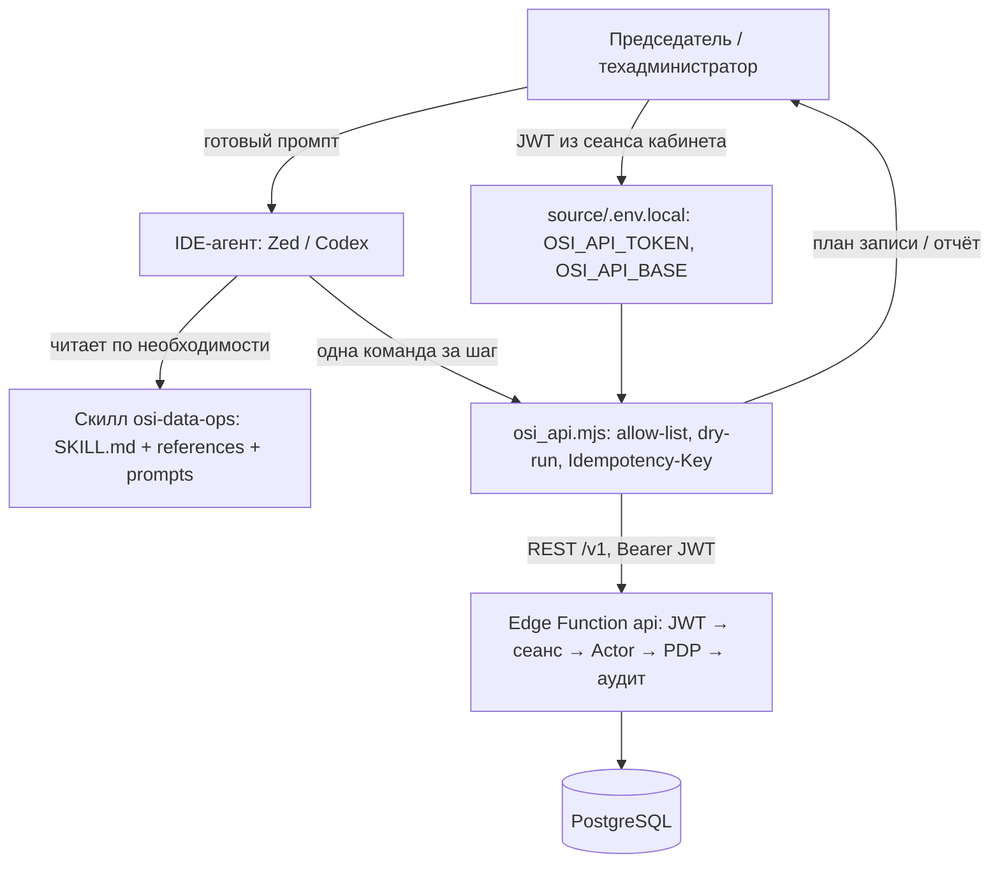

# Идея: скилл «операции с данными ОСИ» для IDE-агентов (Zed, Codex)

Статус: направление согласовано 25.10.2026, три решения пользователя: (1) делаем сразу чтение **и** запись; (2) границы доступа фиксируем дополнением черновика ADR-021; (3) целевые модели агента — лёгкие OpenAI-совместимые («DeepSeek Flash», «ChatGPT Sol»). Реализация не начата; первый шаг — дополнение ADR-021 и технический план `tasks/plan-agent-skill.md`.

## Постановка проблемы

Председателю и техническому администратору ОСИ нужны типовые операции с данными системы из среды, где они работают с ИИ-агентом (Zed, Codex), без ручного HTTP и SQL:

- быстро получать своды: просрочки обращений, загрузка исполнителей, анкеты на рассмотрении, недоставки уведомлений, здоровье ботов;
- выполнять точечные исправления данных с теми же гарантиями, что в кабинете: PDP, аудит, причина, идемпотентность, версионный конфликт 409;
- делать это безопасно: агент не должен уметь больше, чем его пользователь, и не должен обходить серверные проверки.

Кабинетный AI-ассистент (ADR-021) решает часть этой задачи внутри браузера. Данный скилл — тот же доступ к данным из IDE-агента, где человек сам ведёт диалог и лично подтверждает каждое действие.

## Связь с ADR-021 — один канал данных

Принципы унаследованы из ADR-021 без изменений:

- доступ к данным — только через существующий API `/v1` с JWT самого пользователя: полный конвейер JWT → профиль → сеанс → Actor → PDP → аудит;
- доступ к БД (psql, service-role, anon-key в обход API) — запрещён принципиально;
- нехватка разрезов закрывается новыми read-only агрегатными эндпоинтами API, а не расширением полномочий агента.

Отличие от кабинетного ассистента — контур записи: в IDE человек сам инициирует и подтверждает каждую операцию, поэтому запись вводится сразу (решение 25.10.2026), тогда как ассистент в кабинете остаётся read-only до зарезервированного среза S5. Ограничение среды сохраняется: пилот — только демо-стенд Frankfurt с вымышленными данными; реальные данные — после ИБ-анализа (провайдеры моделей IDE также обрабатывают данные вне Казахстана).

## Согласованные решения (25.10.2026)

| Решение | Содержание |
| --- | --- |
| Форма | Проектный навык `.agents/skills/osi-data-ops/`: работает в Zed и Codex через механизм `AGENTS.md` (обе IDE читают его напрямую из корня); IDE-специфики нет — только markdown и один скрипт |
| Канал | Единственный исполнитель — скрипт `scripts/osi_api.mjs` (Node ≥ 22, без зависимостей): allow-list эндпоинтов, dry-run для записей, авто `Idempotency-Key`, JSON-вывод |
| Чтение и запись | Оба контура сразу; запись — классы W1/W2 с подтверждением человека на каждое действие и обязательными атрибутами (причина, Idempotency-Key, expected_version где применимо) |
| Аутентификация | Личный JWT из сеанса кабинета (Telegram OIDC) → `source/.env.local` (`OSI_API_TOKEN`, `OSI_API_BASE`), файл не коммитится; всё журналируется личным именем пользователя (AUD-02) |
| Полномочия | Скилл не дублирует PDP: решает сервер; каталог операций лишь помечает ожидаемые роли и класс риска, чтобы агент предупреждал «вероятен FORBIDDEN — это нормально» |
| Эмуляция | Скилл не работает из эмулированного сеанса; привилегированные действия в эмуляции сервер отклоняет (правило проекта) |
| Модели | Архитектура рассчитана на лёгкие модели: прогрессивное раскрытие контекста, один шаг = одна команда, промпт-библиотека как основной интерфейс для непрограммиста |
| Среда | Пилот — демо-стенд (вымышленные данные); реальные данные — после ИБ-анализа, как в ADR-021 |

## Архитектура скилла

### Состав каталога

```
.agents/skills/osi-data-ops/
├── SKILL.md                     # ≤150 строк: триггеры, стоп-правила, дерево R/W/X, команды CLI
├── references/
│   ├── operations.md            # каталог: операция → метод/путь → роль → класс риска → промпт
│   ├── write-protocol.md        # причина, Idempotency-Key, expected_version, обработка 409/FORBIDDEN
│   ├── session-setup.md         # JWT из кабинета, .env.local, лимиты сеанса AUTH-06, отзыв сеанса
│   └── prompts/                 # R-*.md и W-*.md — готовые промпты председателя и техадмина
└── scripts/
    └── osi_api.mjs              # allow-list, dry-run, JSON-контракт {ok, data, error}
```

### Поток операции



### Контракт скрипта

```sh
node .agents/skills/osi-data-ops/scripts/osi_api.mjs whoami
# чтение: только allow-list эндпоинтов
node … osi_api.mjs get /v1/requests --query status=overdue --limit 20
# запись: без --apply печатает план (метод, путь, тело) и ничего не делает
node … osi_api.mjs write POST /v1/requests/:id/start-work --file body.json
node … osi_api.mjs write POST /v1/requests/:id/start-work --file body.json --apply
```

Гарантии скрипта: токен только из окружения (не в аргументах и логах); GET — только из allow-list; POST/PATCH/DELETE — только из allow-list записей; без `--apply` запись безопасна; `Idempotency-Key` генерируется автоматически и показывается в плане; для W2 без `--reason` — отказ; троттлинг под общий лимит API 100 запросов/мин на профиль.

## Перечень операций

Классы: **R** — чтение; **W1** — деловая запись по обычным правам роли; **W2** — привилегированная запись (причина + идемпотентность, вне эмуляции, chairman/administrator/tech_admin по действию); **X** — запрещено скиллом всегда. Пути — примеры из фактических таблиц маршрутов `source/functions/api/` (осень 2026); полный каталог по доменам составляется при реализации в `references/operations.md`.

### Чтение (R)

| Домен | Операции | Примеры путей |
| --- | --- | --- |
| Метаданные | кто я (роли, права), словари | `GET /v1/meta/me`, `/v1/meta/dictionary` |
| Обращения | списки с фильтрами, карточка, хронология, визиты | `GET /v1/requests`, `POST /v1/requests/search`, `GET /v1/requests/:id`, `GET /v1/requests/:id/timeline/:section` |
| Задания | списки и карточки, отчёты исполнителей, общие работы, шаблоны заданий с версиями и расписанием | `GET /v1/tasks/:id/reports`, `/v1/common-works`, `/v1/job-templates` (+`/:id/versions`, `/schedule`) |
| Реестр | здания, помещения, привязки, сотрудники, ошибки доставки | `GET /v1/registry/{staff,buildings,premises,connections}`, `/v1/registry/notification-failures` |
| Жители и анкеты | каталог анкет, журнал по человеку, поиск персон, приглашения | `GET /v1/registrations`, `/v1/registrations/journal`, `/v1/admin/persons-lookup`, `/v1/registrations/invites` |
| Опросы, инициативы, публикации, документы, отчёты, шаблоны | чтение по существующим правам (POLL/INITIATIVE/PUBLICATION/DOCUMENT/REPORT/TEMPLATE_ROUTES) | GET-эндпоинты соответствующих групп |
| Аудит | журнал действий с фильтрами | `GET /v1/audit` |
| Эмуляция | список тестовых персон | `GET /v1/emulation/persons` |
| Здоровье ботов | вебхуки, очередь, ошибки `bot_inbound` за 24 ч | `tools/scripts/check-bot-health.ts` (существующий, только чтение) |

### Запись (W1)

| Домен | Операции | Примеры путей |
| --- | --- | --- |
| Обращения | начать работу, уточнение, отложить, отклонить, итоговый ответ; правка карточки; визиты | `POST /v1/requests/:id/start-work`, `PATCH /v1/requests/:id`, `/v1/visits` |
| Задания | назначение и приёмка (не собственной работы), отчёты, проблемы, переходы общих работ, шаблоны заданий и запуск/повтор | `POST /v1/tasks/:id/reports`, `/v1/common-works/:id/transitions`, `POST /v1/job-templates/:id/run`, `POST /v1/job-runs/:id/retry` |
| Реестр | очередь строительства здания, привязка/отвязка связи (обязательная причина), правка помещения, удаление помещения в эмуляции | `POST/PATCH /v1/registry/{buildings,premises,connections}` |
| Регламенты TIM | правка длительностей/графика (каталог — только снимком) | `POST /v1/registry/time-rules/:key` |
| Опросы, инициативы, публикации, аварии | создание, закрытие, этапы, модерация — по серверным правам | эндпоинты POLL/INITIATIVE/PUBLICATION/INCIDENT_ROUTES |

### Запись (W2)

| Домен | Операции | Примеры путей |
| --- | --- | --- |
| Анкеты | approve/reject/clarify/manage, удаление анкеты, восстановление Telegram-привязки | `POST /v1/registrations/:id/{approve,reject,clarify}`, `/v1/registrations/:id/manage` |
| Сотрудники | назначение/снятие ролей только вниз по иерархии (ADR-014), отзыв сеансов | `POST/PATCH /v1/admin/assignments…`, `POST /v1/admin/sessions/:id/revoke` |
| Шаблоны сообщений | правка ru/kk (`settings.templates.edit`, причина обязательна) | TEMPLATE_ROUTES |
| Финансы FIN | выпуск/архив комплекта — только председатель | DOCUMENT/PUBLICATION_ROUTES |

### Запрещено (X)

- Прямой SQL/psql/migrations к любым средам, service-role, anon-key в обход API.
- Назначение/снятие chairman/tech_admin (запрещено и формой — ADR-014).
- Привилегированные действия из эмулированного сеанса.
- Массовые записи без построчного подтверждения; перенос реальных персональных данных в облачный прототип.
- Миграции, деплой, секреты — вне этого скилла (это про данные, не про код).

## Безопасность

- Структурная, а не промптовая: два заслона записи — allow-list скрипта и серверный конвейер (PDP + privileged-действия с причиной, идемпотентностью и повторной авторизацией).
- Подтверждение человека: агент обязан показать метод, путь, тело и причину и дождаться явного «да» до `--apply`; встроенное подтверждение команд в IDE содержательного подтверждения операции не заменяет.
- Токен: личный, короткоживущий в пределах сеанса (лимиты простоя и длительности AUTH-06), отзывается отзывом сеанса в кабинете; хранится только в `source/.env.local` (`.env*` не коммитится), в логи и аргументы не попадает.
- Инъекции из данных: прочитанные тексты (имена, содержания обращений) — недоверенный ввод; агент не исполняет инструкции из данных, числа в отчётах — только из JSON ответов API (принцип ADR-021).
- Массовые операции: построчно с подтверждением; предложение — серия ≤ 20 записей за один прогон без пересогласования (число фиксируется при реализации).
- Троттлинг: скрипт соблюдает лимит 100 запросов/мин на реальный профиль.

## Адаптация под лёгкие модели (DeepSeek Flash, ChatGPT Sol)

1. **Скрипт думает вместо модели.** Валидация, allow-list, идемпотентность, обработка 409 — в коде. Модель только выбирает операцию из каталога и заполняет флаги: слабые места лёгких моделей (составные команды, JSON-экранирование, курсоры) исключены из её зоны.
2. **Прогрессивное раскрытие контекста.** `SKILL.md` мал и стабилен; каталог операций, протокол записи и справка по домену подгружаются по одному разделу за раз — короткий контекст не переполняется.
3. **Один шаг = одна команда, явные STOP-правила.** Цепочки с интерполяцией, SQL и jq-пайплайны запрещены. Стоп-правила: `FORBIDDEN` → не повторять, объяснить пользователю; `409` → перечитать, показать свежую версию; не уверен → спросить.
4. **Промпт-библиотека — основной интерфейс.** Председатель не сочиняет промпт, а берёт готовый `R-*.md`/`W-*.md`: фиксированный формат «Цель / Команды / Проверки / Отчёт». Модель исполняет чек-лист, а не импровизирует.

## Альтернативы (и почему нет)

| Вариант | Почему нет |
| --- | --- |
| Прямой SQL/service-role из агента | Дублирует и обходит PDP, ломает принцип «один серверный API» (HLD §9); прямо запрещено ADR-021 |
| Отдельный прокси-сервис с API-ключами для IDE | Новый рантайм и новый секрет; локальный скрипт + личный JWT проще и полностью аудируется |
| Долгоживущий персональный API-токен на сервере | Новые контракты и ИБ-анализ; личный JWT из сеанса короткоживущий и отзываемый |
| Новые права/роли «для агента» | Против ADR-021: полномочия не расширяются, разрезы добираются read-only агрегатными эндпоинтами |
| Отдельный скилл на каждую IDE | Дублирование правил; единый проектный скилл уже поддержан механизмом `AGENTS.md` для всех сред |

## Риски

| Риск | Смягчение |
| --- | --- |
| Утечка токена с локальной машины (другие процессы, расширения IDE) | Короткий срок жизни сеанса, отзыв сеанса в кабинете, токен не в репозитории и не в логах |
| Слабая модель перепутает операцию или параметр | Allow-list, dry-run по умолчанию, построчное подтверждение, аудит как детектор постфактум |
| Prompt injection из данных ОСИ | Правила в SKILL.md, тесты на инъекцию при реализации (по образцу S2 ADR-021) |
| Массовые записи агентом | Построчное подтверждение, ограничение серии, W2-конвейер сервера |
| Каталог операций разойдётся с фактическим API | Подкоманда `check` скрипта — сверка allow-list с таблицами маршрутов; проверка при реализации |

## Этапы

- **S0** — дополнение черновика ADR-021 (контур IDE-скилла: чтение + запись с подтверждением человека) и план `tasks/plan-agent-data-ops.md`.
- **S1** — скилл + скрипт + каталог операций + промпты; проверки чтения на демо-стенде.
- **S2** — контур записи: dry-run → подтверждение → `--apply`; протокол W1/W2; кейсы 409/FORBIDDEN.
- **S3** — эксплуатация: наблюдения пилота; при нехватке разрезов — read-only агрегатные эндпоинты (принцип ADR-021).

S1 и S2 реализуются в одной ветке (решение 25.10.2026 — чтение и запись сразу), проверки раздельные.

## Не делаем (и почему)

- БД, миграции, деплой из скилла — скилл про данные, не про код.
- Новые полномочия, роли или обход PDP — гарантии только серверные.
- Серверный рантайм для IDE-агента — это ассистент ADR-021, здесь не нужен.
- Дублирование PDP в скрипте — решает сервер; скрипт делает гигиену (allow-list, dry-run, идемпотентность).
- Работа с реальными данными до ИБ-анализа — унаследовано из ADR-021.

## Открытые вопросы

- Механика явного подтверждения в конкретных IDE (агент показывает команду сам или это делает IDE) — проверить на Zed и Codex при реализации S1.
- Состав промптов R для пилота — короткое интервью с председателем до S1: какие своды нужны еженедельно.
- Число-лимит серии записей (предложено ≤ 20) — зафиксировать при реализации.
