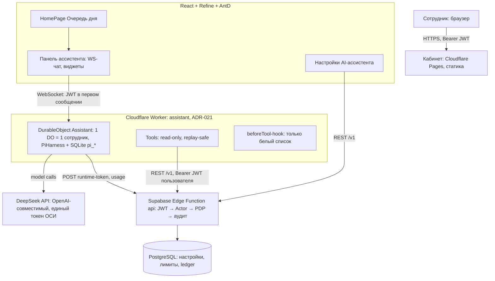
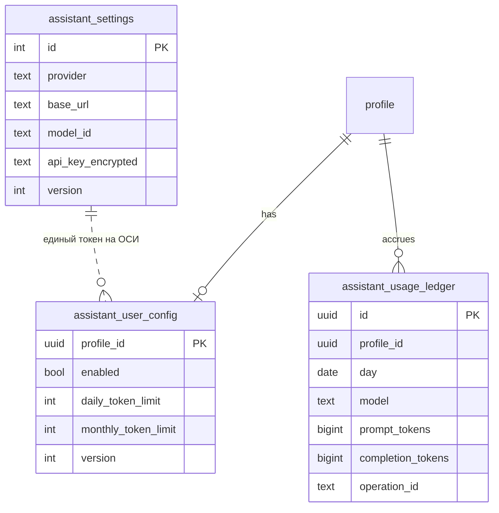
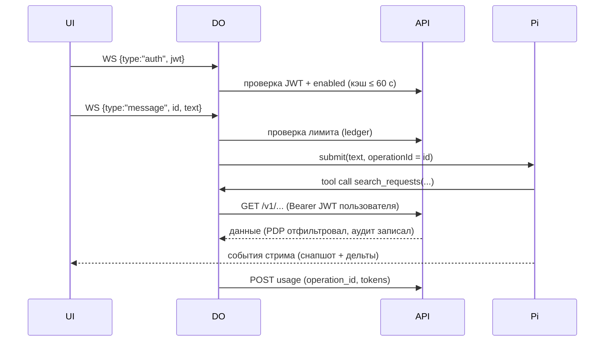

# Идея: AI-ассистент кабинета на Pi Durable

Статус: направление согласовано 25.10.2026 — два раунда челенжа, решения зафиксированы. План реализации — `tasks/plan-ai-assistant.md`, реестр — `tasks/todo-ai-assistant.md`. Перед реализацией среза S0 — ADR-021 (Cloudflare Worker в стеке, где серверный код по ADR-003 — Supabase Edge Functions). До реальных данных — отдельный ИБ-анализ и ADR.

## Постановка проблемы

Нужен AI-ассистент на главной странице кабинета, который:

- помнит пользователя, работающего с ним, и отдаёт информацию строго в рамках его роли;
- понимает контекст сообщения и отвечает либо списком сущностей с характеристиками и гиперссылками, либо сведениями по конкретной сущности;
- отвечает на свободные вопросы «кто что делает, кто как загружен» и даёт разные углы на данные (ядро — для председателя и администратора);
- строит визуальные графики и табличную аналитику динамики работы команды ОСИ и отдельных исполнителей;
- восстанавливается после сбоев;
- работает только через API системы (первый этап — только чтение);
- управляется из раздела «Настройки AI-ассистента»: выбор сотрудников, единый токен доступа к модели, лимиты токенов на пользователя.

## Что такое Pi Durable (проверено по документации, 25.10.2026)

Pi Durable — экспериментальный пакет Earendil для долгоживущих агентов. Cloudflare Agents SDK (≥ 0.30.0, поддерживает Pi 1.4) предоставляет `PiHarness` — запуск Pi-агента внутри Durable Object с SQLite-хранилищем: транскрипты, задачи и чекпоинты лежат в таблицах `pi_*`, пробуждение — по alarm, восстановление после краша/выселения/деплоя — с последнего чекпоинта. Пакеты: `agents`, `@earendil-works/pi-durable`, `@earendil-works/pi-ai`, `@earendil-works/chord`. Статус — beta: пин версий и изоляция за интерфейсом `ChatRuntime`, полноценный fallback заранее не строим.

Ограничения Pi Durable, принятые в расчёт: нет шага подтверждения (approvals) для tool-вызовов; сессии нельзя удалить; поток событий всегда начинается со снапшота; один вызов модели дольше 15 минут обрезается лимитом alarm.

## Согласованные решения (25.10.2026)

| Решение | Содержание |
| --- | --- |
| Ядро сценария | Свободные вопросы по сущностям + аналитика с разных углов. Первый пилот — председатель и администратор; исполнители позже (их сцена read-only не покрывает) |
| Провайдер | DeepSeek (OpenAI-совместимый API), **единый токен ОСИ** (BYOK отклонён — за сотрудников платит ОСИ). Конкретная модель — по качеству ru/kk при реализации S1 |
| Данные и пилот | На пилоте отправляются **все данные** провайдеру без редакции; пилот — **только демо-стенд** с вымышленными данными. После пилота — детальный ИБ-анализ (в т.ч. что DeepSeek — провайдер из КНР) и ADR до реальных данных |
| Память | Контекст «5:00 → 5:00» по Asia/Almaty: reset по alarm в DO, плюс ручное «Очистить» (пересоздание DO — полное удаление истории). Долгосрочной памяти нет |
| Настройки | `assistant.settings.edit` — председатель + техадмин, privileged, вне эмуляции, причина + Idempotency-Key. Per-user лимиты = контроль бюджета ОСИ |
| Аналитика | Доступ по существующему PDP (права `report.*`), без новых ограничений. **Фиксированные** агрегаты: загрузка по исполнителям, создано/закрыто по дням, просрочки по домам; расширение по живым вопросам пилота |
| Вывод аналитики | В чате виджетами из JSON инструментов: сначала таблицы (S4a), затем графики (S4b, `@ant-design/plots`). **Модель не генерирует HTML** (XSS: ответ модели — недоверенный ввод); числа только из API |
| Доступ к данным | БД агенту недоступна. Все данные — через `/v1` с JWT пользователя (полный конвейер PDP → аудит). Нехватка разрезов закрывается read-only агрегатными эндпоинтами API, не расширением полномочий агента |
| Инъекции | Read-only смягчает; в S2 — тесты на инъекцию из данных. Контур записи (будущее): каждое пишущее действие — только после явного подтверждения человека в UI; фиксируется в ADR-021 |
| Метрика пилота | 4 недели: ассистент остаётся, если ≥2 из 3–4 пилотных сотрудников имеют ≥2 сессии/неделю; иначе разбор «ценность или интерфейс» и выключение |
| Глубокие ссылки | Сейчас в кабинете из URL читается только фильтр (`/requests?state=new`); карточки по ссылке не открываются — в S2 добавляем `?id=<uuid>` |

## UX-прототип (25.10.2026)

Интерактивный прототип сохранён в [`prototypes/dashboard-library`](../../prototypes/dashboard-library/README.md) (архивная копия — `prototypes/dashboard-library-2026-10-25.zip`); описание, запуск и ограничения — в его README. Это UX-референс и источник компонентов, не готовая реализация бизнес-процессов.

- **Главная с ассистентом** — `dashboard-browser.html`: панель ассистента на главной странице — визуальный референс для среза S1 (чат-скелет).
- **Исчерпанный лимит** — `assistant-limit.html`: референс отказа по лимиту для среза S3 (расход и лимиты).
- Запуск: Node.js 22.12+, из папки прототипа `npm ci && npm run dev` (порт 8770). Без ключа ассистент отвечает фиксированным демо-ответом; для реальных ответов — `.env.local` со строкой `DEEPSEEK_API_KEY=...` (ключ остаётся на сервере прототипа, в клиентскую сборку не попадает).

Демо-сервер прототипа (учебная сводка, лимит 20 запросов на процесс) **не** воспроизводит production-авторизацию, персональные лимиты и исключение техадмина: заглушки API, демонстрационные роли и локальные ограничения в кабинет не переносить. Прототип библиотеки документов (`library-v3.html`) в той же папке — отдельная идея, к ассистенту не относится.

## Рекомендуемое направление

Ключевое решение — **безопасность структурная, а не промптовая**: инструменты агента ходят в существующий API `/v1` с JWT самого пользователя через полный конвейер (JWT → профиль → сеанс → Actor → PDP → аудит). Ассистент физически не видит больше, чем видит его пользователь, без дублирования PDP и без service-role ключей. Память и восстановление даёт Pi Durable в Durable Object (один DO на сотрудника).

### Компоненты

**Кабинет — панель ассистента (SPA).** Блок на главной странице («Очередь дня»): сворачиваемая панель/шторка, на мобильном — полноэкранный лист; очередь не заменяет. WS-соединение к Worker: `access_token` передаётся в первом сообщении, не в URL. Обновление токена — по `onAuthStateChange`. Ответ — безопасный Markdown; результаты инструментов клиент отображает виджетами (карточки-ссылки, таблицы, графики). Кнопки: «Очистить контекст», «Повторить» после сбоя, индикатор «в работе». Визуальный референс — прототип `prototypes/dashboard-library` (см. «UX-прототип»).

**Assistant Worker (новый воркспейс `source/assistant`).** Один Durable Object на сотрудника (`getByName(profile_id)`) — корневая сессия Pi живёт в SQLite DO, отсюда память диалога; несколько вкладок одного сотрудника подключаются к одному DO (fan-out событий). `PiHarness` в `Lifecycle`: хранение в `pi_*`-таблицах, компакция транскрипта, `submit(operationId = messageId)` — идемпотентность повторов клиента. Pi изолирован за интерфейсом `ChatRuntime` (пин версий, тестируемость). Инструменты — единственный путь к данным: read-only вызовы `/v1` с актуальным JWT пользователя, все `replay: "safe"`. Хук `beforeTool` блокирует вызовы вне read-only реестра. Секретов в DO нет: ключ DeepSeek берётся из API на старте и держится в памяти изолята. Сессии Pi удалить нельзя — «полная очистка истории» реализуется пересозданием DO по суффиксу-эпохе `assistant:<profile_id>:<epoch>`.

**Серверное API — новые эндпоинты** (functions/api, общий конвейер):

| Метод | Путь | Назначение | Право |
| --- | --- | --- | --- |
| GET/PUT | `/v1/assistant/settings` | Конфиг: единый токен провайдера, enabled и лимиты по сотрудникам | `assistant.settings.read/edit` (privileged, вне эмуляции, причина + Idempotency-Key) |
| GET | `/v1/assistant/settings/me` | Своё состояние: включён, остаток лимита | `assistant.use` |
| GET | `/v1/assistant/usage` | Расход токенов: свой / все (админ) | `assistant.usage.read` |
| POST | `/v1/assistant/runtime-token` | Выдача расшифрованного ключа провайдера держателю валидного JWT, аудит выдачи | `assistant.use` + enabled |
| POST | `/v1/assistant/usage` | Учёт расхода за operationId (идемпотентно) | сервисный секрет Worker (`X_ASSISTANT_SECRET`, по образцу `X_JOBS_SECRET`) |

Новые действия PDP: `assistant.use`, `assistant.settings.read/edit` (роли chairman/tech_admin), `assistant.usage.read`.

**Инструменты ассистента (read-only, `replay: "safe"`):**

| Инструмент | Источник (право) | Результат |
| --- | --- | --- |
| `search_requests` / `get_request` | обращения (`request.read`) | элементы с id, номером, видом, состоянием, адресом, просрочкой + `link` на карточку кабинета |
| `search_tasks` / `get_task` | задания (`task.read`, свои для исполнителя) | + исполнитель, срок, состояние |
| `list_incidents` / `get_incident` | аварии (`incident.read`) | + состояние, дома |
| `search_residents`, `list_connections` | реестр (`registry.read`) | с учётом is_test и области |
| `list_staff` / `get_staff` | сотрудники и роли (`staff.read`) | роли, полномочия |
| `workload_by_assignee`, `created_closed_by_day`, `overdue_by_building` | агрегатные read-only эндпоинты отчётного домена (права `report.*`) | готовые серии/таблицы для виджетов |

List-инструменты возвращают компактный контракт `{items, total, page}` с жёстким `page_size` (≤ 20) и абсолютными `link`. Тексты — один язык по `profile.language` (ru/kk), как в ботах. Если данных для разреза нет — ассистент отвечает «нет данных», не выдумывает (проверяется тестами).

### Модель данных (PostgreSQL)

- `api_key_encrypted`: Supabase Vault (при отсутствии на self-hosted — AES-GCM с ключом в секретах функций). API никогда не отдаёт ключ целиком в кабинет — только маску.
- `assistant_usage_ledger` — append-only, уникальность `operation_id` (идемпотентность учёта), суммы за день/месяц против лимитов. RLS: строка видна владельцу и privileged-ролям.
- История диалога не дублируется в Postgres — она в SQLite DO (`pi_*`). В БД — только настройки, лимиты и расход.

### Раздел «Настройки AI-ассистента»

Страница в группе «Настройки» навигации (по образцу `/templates`), доступ chairman/tech_admin: блок единого токена (провайдер, модель, ключ — ввод write-only, отображение маской `••••1234`, замена с причиной и Idempotency-Key, аудит) + таблица сотрудников (`staff.read`) с тумблером «Включён» (по умолчанию выключен у всех — натуральный kill switch) и дневным/месячным лимитом токенов (prompt + completion) на сотрудника.

`assistant.settings.edit` — privileged: только кабинет, вне эмуляции, повторная авторизация как у форм прав (AUTH-03). Отключение сотрудника закрывает его WS на следующем сообщении; расход не обнуляется.

### Ключевой поток: сообщение пользователя

### Восстановление после сбоев

| Сбой | Поведение |
| --- | --- |
| Выселение/краш/лимит CPU DO mid-run | alarm wake-up-задачи перезапускает объект, Pi продолжает с последнего чекпоинта |
| Деплой Worker mid-run | 30 с на завершение → рестарт и продолжение |
| Оборвался вызов модели | частичный ответ сохранён, вызов повторён |
| Read-only tool прерван | `replay: "safe"` → выполняется заново безвредно |
| Задача падает `restartLimit` раз | паркуется (`pending(): parked`), UI показывает «Повторить» (`session.retry()`) |
| Ошибка провайдера | `settings.retry` (maxRetries, backoff), `afterFailedRun: "keep"` — очередь не теряется, «Повторить» доступно |
| Обрыв WS у клиента | переподключение → свежий снапшот потока событий; повторная отправка сообщения гасится `operationId` |
| Отзыв роли сотрудника | следующий tool-вызов получает 401/403 от API — ассистент сообщает и прекращает |
| Наступило 05:00 Asia/Almaty | alarm в DO делает `reset()` — чистый контекст нового дня |

## Безопасность

- Ролевая видимость — через PDP: инструменты ходят в `/v1` с JWT пользователя; RLS — второй рубеж, как везде. Доступ к БД агенту не выдаётся принципиально.
- Секреты: ключ DeepSeek — Vault/шифрование в БД, выдача по аудируемому `runtime-token`, только в память DO, в SQLite (`pi_*`) не пишется, в браузер не отдаётся. Секреты Worker: `SUPABASE_URL`, JWKS (публичные), `CABINET_ORIGIN`; секреты функций — `X_ASSISTANT_SECRET`.
- Персональные данные → внешний LLM: на пилоте отправляются все данные, но пилот идёт **только на демо-стенде с вымышленными данными**. После пилота — детальный ИБ-анализ (провайдер DeepSeek находится в КНР; журналирование и обучение на данных — предмет анализа) и ADR до подключения реальных данных. Вариант на будущее — собственный vLLM в Казахстане.
- Графики и текст: модель не генерирует HTML; ответ — санитизированный Markdown, виджеты рендерит клиент из JSON инструментов.
- Эмуляция: ассистент выключен в эмулированных сеансах.
- Аудит: чтения через API проходят аудит-конвейер; выдача runtime-токена и изменение настроек — privileged-события журнала.
- Rate limits: общий лимит 100 запросов/мин на профиль распространяется на tool-вызовы; адаптер инструментов уважает 429 (backoff, повторы — средствами Pi).

## NFR и наблюдаемость

- Задержка первого токена — стримим события по WS («в работе» и частичный ответ видны сразу); остальное — провайдер.
- Масштаб: десятки сотрудников → десятки DO; ограничение — alarm ≤ 15 минут на один вызов модели (для коротких дежурных ответов неактуально).
- Наблюдаемость: ledger расхода (кто/сколько/какая модель), `onReport` → `task_parked` в UI/логи, Workers observability для DO, счётчики tool-вызовов (wrapTool с таймингом).
- Тесты: unit — гейт лимитов/включённости, адаптеры инструментов (фейки по образцу `core/testing`); jsdom — панель (подключение, виджеты, восстановление со снапшота); deno — новые эндпоинты; `schema-drift` покрывает новый SQL; интеграционные — только вручную по действующему правилу.

## Альтернативы (и почему нет)

| Вариант | Почему нет |
| --- | --- |
| Агентный цикл в Supabase Edge Functions, состояние в Postgres | Pi Durable требует JS-runtime с хранилищем изолята и alarm'ами; Edge Functions изолятны и не держат SQLite/жизненный цикл — пришлось бы писать свой harness, второй «долгоживущий» механизм вопреки ADR-003 |
| Ключи и LLM-вызовы напрямую из браузера | Секрет в браузере — прямое нарушение границ проекта; теряется серверный контроль лимитов |
| Агент ходит в БД/service-role напрямую | Дублирует PDP и аудит, ломает принцип «один серверный API» (HLD §9) |
| Модель рисует графики HTML/кодом | XSS (ответ модели — недоверенный ввод), галлюцинации чисел, чужие стили; виджеты из JSON дешевле и детерминированы |
| BYOK (личный токен у каждого) | Сотрудники ОСИ не покупают ключи; лимиты не защищали бы бюджет. Отклонено 25.10.2026 |
| Редакция персональных данных в пилоте | Отложена после пилота: на демо-стенде данные вымышленные; ИБ-анализ решит политику до реальных данных |

Trade-offs: новый runtime + ADR (потеря «всё в Supabase») ↔ durability/память/стриминг из коробки; состояние диалога в SQLite DO (вне Postgres-копий) ↔ проще и соответствует замыслу Pi, но бэкап диалогов отдельно не делается.

## Риски

| Риск | Влияние | Митигация |
| --- | --- | --- |
| Pi Durable/PiHarness — beta, API меняется | Среднее | Пин версий (`agents` ↔ Pi 1.4), интерфейс `ChatRuntime`, инструменты изолированы; fallback не строим заранее |
| Персональные данные у DeepSeek (КНР) | Комплаенс (после пилота) | Пилот только на вымышленных данных; ИБ-анализ + ADR до реальных данных |
| Стоимость токенов | Бюджет ОСИ | Единый токен + per-user лимиты + kill switch + ledger |
| DO недоступен (сбой Cloudflare) | Ассистент недоступен | Кабинет не блокируется; организационная компенсация — как OPS-01 |

## MVP (срезы)

1. **S0. Гейт и настройки:** ADR-021; миграции (settings/config/ledger); PDP-действия; эндпоинты; страница «Настройки AI-ассистента».
2. **S1. Чат-скелет:** Worker + DO + PiHarness + WS-панель; JWT-гейт и включённость; стриминг; DeepSeek; память 5:00→5:00.
3. **S2. Сущности и ссылки:** search/get-инструменты, виджеты, deep links `?id=`, тесты на инъекцию.
4. **S3. Расход и лимиты:** ledger, гейт до submit, панель расхода.
5. **S4a. Агрегаты и таблицы:** три агрегатных эндпоинта отчётного домена + инструменты + табличный виджет.
6. **S4b. Графики:** `@ant-design/plots` + chart-виджет из JSON инструмента.
7. **S6. Харденинг:** эпохи DO (полная очистка), kk-язык, алерты parked, retention, ИБ-чеклист.

Контур записи (подтверждение человеком, non-replay инструменты) — отдельный ADR после пилота.

## Не делаем (и почему)

- Ассистент в Telegram-ботах и для жителей — сначала опыт председателя и администратора в кабинете.
- Редакция персональных данных до ИБ-анализа (пилот — только вымышленные данные).
- Долгосрочная память и RAG по документам — YAGNI до запросов от пилота.
- Запись/редактирование — отдельный контур с подтверждениями (approvals в Pi Durable пока отсутствуют).
- Универсальный «свободный SQL/запросный» инструмент — риск отдать модели слишком много; фиксированные агрегаты, расширение по живым вопросам.

## Открытые вопросы

1. Конкретная модель DeepSeek (`deepseek-chat` / `deepseek-reasoner`) — выбрать при реализации S1 по качеству ru/kk и скорости.
2. Объём и порядок ИБ-анализа до реальных данных — после пилота (журналирование DeepSeek, training opt-out, резидентность, вариант vLLM в Казахстане).
