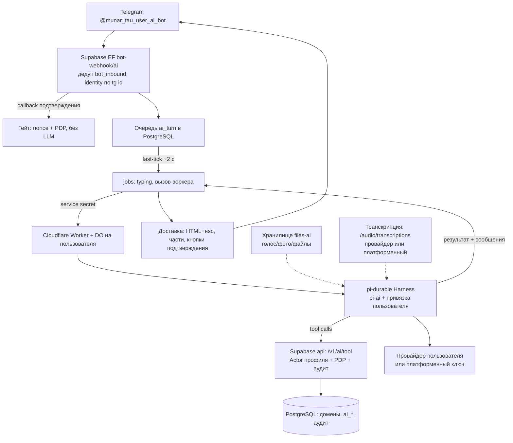

# Munar Tau User AI Bot — оценка и концепция

Статус: идея оценена и согласована с владельцем 25.10.2026. Материал сводит
оценку возможности, рассмотренные варианты и принятые решения; ADR и спеки
пока не создавались — по решению владельца всё сохранено здесь до отдельного
решения о старте.

## Problem Statement

How Might We: дать жителю ОСИ управлять теми же функциями, что и в жительском
боте, но свободным текстом в режиме диалога с AI-ассистентом — без меню и
кнопок навигации, на модели и провайдере по выбору пользователя, с сохранением
всех правил проекта (PDP, аудит, идемпотентность, шаблоны, ru/kk).

## Вердикт оценки

**Возможно, и архитектура проекта к этому хорошо подготовлена — но не «в лоб».**
Реально сделать за разумный срок: отдельный бот-чат, где LLM через tool calling
дергает те же домены core с тем же PDP/аудитом. Полный паритет «всё то же, что
у жительского бота» чистым текстом за один срез нереален: часть функций
(файлы, необратимые действия) в свободном тексте либо плоха, либо опасна.
Аудитория BYOK-бота — продвинутые пользователи со своим токеном; freemium
на платформенном ключе (решение владельца) расширяет её на всех желающих
в пределах лимита.

## Что работает на идею (факты)

Из репозитория:

| Факт | Следствие для AI-бота |
| --- | --- |
| Домены (`core/src/domains/*`) — порты + SQL-репозитории + сервисы с PDP и аудитом, общие для бота и кабинета (ADR-003) | LLM не нужен свой путь к данным: каждый инструмент = вызов существующего сервиса. Права и журнал достаются бесплатно |
| `bot_dialog_channel(bot, telegram_user_id)` + `bot_inbound(bot, update_id)` — ключи уже параметризованы ботом | Третий бот ложится в существующую схему: миграция `BotKind` + CHECK-колонок |
| Очереди + `jobs` раз в минуту + `notifications-fast-tick` каждые 2 с (Prod) | Ход агента (5–60 с) не живёт в webhook: очередь `ai_turn`, обработка воркером по образцу `request_upload_job` |
| ADR-003: «постоянно работающий процесс не принят», состояние в PostgreSQL | Харнес — библиотека, вызываемая по требованию; это сузило выбор хостинга (см. варианты) |
| Каскад отправки HTML + `esc()`, разбиение длинных сообщений, каталог шаблонов (ADR-010/011) | Доставка ответов переиспользуется; статические реплики AI-бота — через каталог ru/kk |

По Pi (проверено по первоисточникам earendil-works):

| Компонент | Что даёт | Ограничения |
| --- | --- | --- |
| `@earendil-works/pi-ai` | Единый LLM API; официально «Any OpenAI-compatible API» (Ollama, vLLM, прокси) через `createProvider({ baseUrl, auth })`; встроенные провайдеры OpenAI/Anthropic/Google/OpenRouter и др.; `fauxProvider()` для детерминированных тестов; usage/стоимость на каждый запрос | — |
| `@earendil-works/pi-durable` | Durable-харнес: разговоры как транскрипты, атомарные коммиты, задачи с чекпоинтами (падение процесса = продолжение), инструменты с TypeBox-схемами, `beforeTool`-хуки (точка гейта подтверждений), компакция контекста, учёт расхода | **Experimental** — API меняется без предупреждения: пиновать версию, изолировать портом; «one process owns a storage» без межпроцессных блокировок; бэкенды: Memory, SQLite/JSONL, Cloudflare DO SQLite (+community Postgres) |
| `pi-chat` (референс) | Готовый мост «Telegram ↔ Pi»: команды stop/status/compact, edit-in-place, вложения | Рассчитан на персональную машину (Gondolin VM, tmux), не на hosted-мультиаренду — используется как образец адаптера, не как основа |

## Решения владельца (25.10.2026)

1. **Хостинг харнеса — вариант B**: Cloudflare Worker + Durable Object
   (паттерн хоста из README `pi-durable`).
2. **Привязка токена и управление — в UI кабинета (админке)**.
3. **Провайдеры — любые** из поддерживаемых `pi-ai`.
4. **Кнопочные сценарии — диалогом с подтверждением и аккуратным гейтом**,
   включая необратимые действия (опросы, удаление анкеты).
5. **Квоты**: бесплатный лимит по умолчанию (например 5000 токенов) — общий,
   настраивается в админке; при исчерпании — предложение платного тарифа,
   который администратор подключает пользователю вручную.
6. **Мультимодальность**: анализ речи (голосовые) и изображений/файлов.

## Варианты хостинга харнеса (рассмотрены)

| Вариант | Суть | Плюсы | Минусы |
| --- | --- | --- | --- |
| A. Supabase Edge Function | pi-durable внутри `jobs`-воркера, хранилище — Postgres; один вызов = один ход; `Harness.open` + `resume()` на каждый ход | Ноль новой инфраструктуры; инструменты к доменам in-process; стек не меняется | Совместимость pi-durable с Deno — под вопросом (нужен спайк); правило «один владелец» пришлось бы держать advisory-lock'ом; адаптер Postgres — community |
| **B. Cloudflare Worker + DO — выбран** | DO на пользователя = законный единственный владелец хранилища (SQLite DO), alarms/`onWake` для снов задач | Родной для pi-durable режим (паттерн из его README); DO сериализует запросы без самодельных блокировок; проект уже в Cloudflare (кабинет — ADR-002) | Второй рантайм и второй контур аутентификации; инструменты — HTTP к api EF; сквозной тестовый контур сложнее |
| C. Отдельный Node-процесс | Классический хостинг харнеса | Максимальная совместимость | Противоречит ADR-003 («постоянно работающий процесс не принят») — отклонён |

Решение: B; вариант A оставался фолбэком, kill-критерий — спайк AI-0.

## Архитектура

Компоненты:

- **bot-webhook/ai** — третий маршрут webhook по образцу resident/worker
  (ADR-009): дедупликация `bot_inbound (bot, update_id)`, разрешение профиля,
  постановка `ai_turn` в очередь. Callback-запросы подтверждений идут мимо LLM —
  детерминированный путь с nonce, PDP и повторной проверкой версии.
- **Cloudflare Worker + DO** — по одному Durable Object на пользователя
  (ключ DO = telegram_user_id). DO — единственный владелец pi-durable-хранилища,
  будит себя alarms (`onWake`/`resume()`), переживает падения чекпоинтами задач
  pi-durable. Сериализация запросов DO решает правило «one process owns
  a storage» без самодельных блокировок.
- **Инструменты** — тонкие обёртки над существующими доменами core:
  `POST /v1/ai/tool` в api-функции строит Actor профиля (как
  `actorForTelegram`) и исполняет сервис с PDP и аудитом. Никаких собственных
  путей к данным.
- **Доставка ответов** — существующий конвейер: HTML + `esc()`, каскад разбора,
  нумерованные части, `reply_markup` на последней части, каталог шаблонов
  (ADR-010/011) для статических реплик.

## Паритет функций

| Функция жительского бота | В AI-чате | Комментарий |
| --- | --- | --- |
| Статус анкеты, мои помещения, доступы | ✅ инструменты чтения (AI-1) | Просто и безопасно |
| Список/карточка обращений, переписка | ✅ инструменты чтения (AI-1) | Форматирование — забота LLM + `esc()` |
| Новое обращение (текст) | ✅ инструмент + подтверждение текстом (AI-1) | Мастер-форма → диалог; идемпотентность/expected_version сохраняются |
| Регистрация, привязка помещения, приглашения | ⚠️ пошаговый диалог с подтверждением (AI-2) | Разговорно реально, требует аккуратного гейта |
| Настройки: язык, уведомления, /fix | ⚠️ частично (AI-2) | Смена языка — да; остальное по гейту |
| Удаление анкеты (/delete) | ⚠️ nonce-кнопка необратимых действий (AI-2) | Решение владельца: диалог с гейтом вместо запрета |
| Голосование в опросах | ⚠️ nonce-кнопка необратимых действий (AI-2) | Решение владельца; механика nonce/PDP/версий уже есть в проекте |
| Файлы/фото к обращению | ⚠️ из диалога (AI-3) | Существующий путь `request_upload_job` + `files-resident` |
| Анализ фото/файлов/голосовых | ✅ мультимодальность (AI-2) | Функция, которой у обычного бота нет вообще |
| Финансовые пакеты, документы, инициативы | ❌ глубокие ссылки в кабинет | Чтение — возможно позже |
| Уведомления outbox | ❌ остаются в жительском боте | Адресация `bot` не расширяется; AI-бот — только чат |

## Режимы пользователя и тарифы

Три режима (приоритет сверху вниз):

| Режим | Ключ | Лимит | Кто настраивает |
| --- | --- | --- | --- |
| **BYOK** | свой ключ пользователя (любой провайдер pi-ai) | без тарифной квоты; только антиабьюз-потолки (ходов/мин, токенов/ход) | пользователь, привязка в кабинете |
| **Free** | платформенный ключ ОСИ (секреты CF Worker) | общий бесплатный лимит по умолчанию — 5000 токенов/период, число меняется в админке | админка (глобально) |
| **Paid** | платформенный ключ ОСИ | тариф пользователя: повышенный или безлимитный период | админка назначает тариф пользователю вручную (оплата — по действующей практике ручной сверки Kaspi, автоматизация вне срезов AI) |

- Подразумевается freemium: житель без своего ключа пробует ассистента на
  платформенном лимите. **Допущение** — это и имелось в виду под «бесплатными
  пользователями»; если нет — Free-режим убирается, остаются BYOK + Paid-BYOK.
- Период — календарный месяц (Алматы), сброс 1-го числа. Учитываются LLM-токены
  (вход+выход, включая thinking) по данным `pi-ai` usage; транскрипция голоса —
  отдельной строкой в той же корзине.
- Enforcement: проверка остатка **до** вызова модели; при исчерпании ход не
  начинается, пользователь получает сообщение-предложение тарифа (каталог
  шаблонов, ru/kk). Возможен перерасход не более одного хода — осознанный
  компромисс, ограничивается `max_tokens` ответа.
- Учёт: `ai_usage` (профиль × месяц: токены LLM, токены транскрипции, ходы,
  модель/провайдер) — пишется после каждого хода.
- Плюс глобальный месячный бюджет платформенного ключа в админке: жёсткий стоп
  Free-режима при исчерпании с внятным сообщением (защита бюджета ОСИ).

## Привязка провайдера

- Схема привязки: тип (`builtin`-провайдер pi-ai или OpenAI-совместимый),
  провайдер, base URL (для совместимых), model id, API-ключ (шифруется),
  отпечаток ключа (последние 4 символа для отображения), статус,
  согласие на передачу текстов провайдеру (дата, версия текста), expected_version.
- Ключи шифруются app-layer (AES-GCM, ключ в секретах среды), никогда не
  попадают в логи, URL и контекст модели. Расшифровка — на стороне Supabase,
  в DO ключ передаётся только по служебному вызову с сервисной аутентификацией.
- Пользовательский base URL — SSRF-риск: только https, блок приватных адресов.
- **Ограничение решения «в UI админки»**: у жителей нет доступа в кабинет.
  Варианты: (а) пилот AI-бота — сотрудники/председатель, привязка в кабинете;
  (б) для жителей — self-service: ссылка из бота на страницу привязки
  (шифрованный обмен ключом по образцу pi-chat) либо диалог в боте с удалением
  сообщения. Рекомендация: кабинет — для управления и персонала, жителям —
  self-service ссылка (вопрос открыт, см. ниже).

## Гейт подтверждений

Уровни действий:

| Уровень | Примеры | Гейт |
| --- | --- | --- |
| Чтение | статус, списки, карточки | нет |
| Изменение | новое обращение, сообщение, настройки | подтверждение текстом в диалоге |
| Необратимые | голос в опросе, удаление анкеты, отзыв доступа | inline-кнопка с nonce + TTL + одноразовость; обработка — детерминированным кодом с PDP/expected_version/аудитом, **без участия модели** |

Механика: модель предлагает действие → инструмент с пометкой dangerous
блокируется `beforeTool`-хуком pi-durable, ход возвращает карточку подтверждения
(кнопки «Подтвердить/Отмена», nonce) → нажатие обрабатывает webhook напрямую →
результат записывается в транскрипт разговора как системная запись.
Свободный текст «да» необратимые действия не исполняет (защита от LLM01/LLM05).
«Без меню» не нарушается: кнопка подтверждения — элемент безопасности, а не
навигация.

## Мультимодальность

- **Голосовые (речь → текст)**: webhook принимает voice → getFile → загрузка
  (лимит Bot API 20 МБ совпадает с ADR-006) → приватный бакет `files-ai` →
  транскрипция через `/audio/transcriptions`: сначала endpoint привязанного
  провайдера, если поддерживает; иначе платформенный ключ транскрипции
  (настраивается в админке). Язык — подсказка из `profile.language` (ru/kk;
  качество kk у Whisper умеренное — проверить на реальных голосовых).
  Текст подставляется в разговор с пометкой «[голосовое сообщение]».
- **Изображения**: photo → загрузка в `files-ai` → image block в контексте
  pi-ai (vision определяется по `model.input`). Модель без зрения — явный ответ
  «привязанная модель не видит изображения» с подсказкой перебиндить модель.
- **Файлы**: MVP — текстовые (txt/md/csv); PDF/DOCX — следующий срез
  (извлечение текста в Worker/EF или постраничный vision — дороже).
- **Файлы к обращениям**: тот же загруженный файл можно приложить к обращению
  существующим доменным путём (owner_type=request, `files-resident`,
  очередь `request_upload_job`), не покидая диалог.
- Хранение: приватный бакет, PDP по владельцу, TTL-очистка временных файлов
  (например 7 дней) в jobs, если файл не приложен к обращению;
  `is_test`-персоны — в тестовом контуре, наружу не выходят.
- Токены транскрипции учитываются в квоте отдельной строкой.

## Безопасность и соответствие правилам проекта

- **Модель предлагает — код решает**: права проверяет PDP при каждом вызове
  сервиса, аргументы инструментов валидируются TypeBox-схемой, изменение
  состояния — через гейт подтверждений; вывод LLM — недоверенный ввод
  (OWASP LLM01/LLM05, сценарии навыка `security-and-hardening`).
- **BYOK-ключ**: шифрование, маскирование, запрет логирования и попадания в
  контекст; SSRF-защита base URL; явное согласие на передачу данных
  провайдеру при привязке.
- **Платформенный ключ (Free/Paid)** — в секретах CF Worker; админка включает
  провайдеров и задаёт модель по умолчанию, сам ключ в БД не хранится;
  глобальный месячный бюджет как жёсткий стоп.
- **Пределы**: лимит ходов/мин на пользователя, `max_tokens` на ход, бюджет
  токенов, отказ провайдера — внятная реплика без фолбэка на чужие ключи.
- **Экспериментальные зависимости**: pi-dulnerable/pi-ai пинуются точными
  версиями, харнес изолируется портом, чтобы заменяемость (например
  storage-адаптер для прод-среды) не требовала переписывания.
- **Сопровождение**: третий UI над доменами — инструменты держать тонкими
  обёртками; приёмка изменений домена включает проверку затронутых AI-инструментов.
- **Отступление от направления «управление кнопками» (21.10.2026)** —
  осознанное и фиксируемое ADR-021; обычный жительский бот остаётся
  детерминированным каналом, AI-бот — параллельный экспериментальный интерфейс.

## Данные и приватность

- Транскрипты разговоров живут только в SQLite Durable Object (Cloudflare);
  в Supabase — метаданные ходов (статус, токены, задержка) и обычный аудит
  доменных операций. Контент переписки в логи не пишется.
- Для демонстрационного стенда (вымышленные данные) Cloudflare допустим.
  Для рабочей среды (self-hosted в Казахстане, ADR-003) Cloudflare DO —
  обработчик персональных данных третьей стороны: при вводе в эксплуатацию
  решить отдельно (согласие/порядок в ADR о вводе, либо замена слоя хранения —
  харнес изолирован портом, storage-адаптер заменим на pi-durable-postgres).

## Срезы

- **AI-0 (спайк, 1–2 дня)**: Worker + DO с pi-durable hello-world и ходом с
  одним инструментом к api EF; BYOK-провайдеры (openai-compatible, anthropic,
  ollama) на faux/реальном ключе; транскрипция голосового; kill-критерий —
  ход «вопрос → инструмент → ответ» сквозь оба облака.
- **AI-1 (MVP)**: третий бот (BotKind `ai`, миграции bot_inbound/
  bot_dialog_channel/notification-колонок), webhook/ai + очередь ai_turn,
  DO-харнес, инструменты: статус, помещения, обращения (чтение + создание
  текстом), привязка в кабинете, Free-лимит 5000 + upsell, подтверждения
  текстом, faux-провайдер в тестах, админ-страница AI-ассистента.
- **AI-2**: платные тарифы + usage-дашборд в кабинете; голос + фото;
  nonce-кнопки необратимых действий (опросы, удаление); антиабьюз-потолки;
  регистрация/привязки диалогом.
- **AI-3**: файлы к обращениям из диалога, PDF/DOCX, self-service привязка
  для жителей, память между разговорами, стриминг с edit-in-place.

## Not Doing (почему)

- Меню и постоянные клавиатуры — суть идеи в отсутствии навигации; остаются
  только кнопки подтверждений.
- Автосписание платежей за тарифы — в проекте платежи ручные (Kaspi-сверка),
  подключение тарифа администратором; автоматика — отдельное решение.
- Общие уведомления outbox в AI-боте — адресация `bot` не расширяется,
  уведомления остаются в жительском боте.
- Публичные финансовые/документные данные через LLM — только глубокие ссылки.
- Память/персонализация между разговорами — pi-durable это умеет, вынесено
  в AI-3, чтобы не усложнять MVP.

## Допущения к валидации

- pi-durable в DO + ход с инструментом к Supabase api — укладывается в лимиты
  платформы (CPU/подзапросы) — проверяется AI-0.
- Free-лимит на платформенном ключе реально нужен (иначе остаётся чистый BYOK).
- Найдутся пользователи с BYOK и/или готовность ОСИ платить за платформенный
  ключ — иначе режимы Free/Paid не нужны.
- Качество транскрипции kk приемлемо для жителей.
- Продукт готов сопровождать параллельный недетерминированный интерфейс
  (содержание инструментов в срезах, тесты с faux-провайдером).

## Открытые вопросы

1. Жители без доступа в кабинет: self-service страница привязки — да/нет
   в AI-2, или пилот только для сотрудников?
2. Тарифные планы: количество, цены, периодичность — по практике ОСИ.
3. Платформенный ключ для Free: какой провайдер/модель по умолчанию.
4. Прод-среда: остаётся ли Cloudflare обработчиком (согласие жителей) —
   решение при вводе в эксплуатацию.

## Далее (когда владелец решит стартовать)

ADR-021 «AI-ассистент: третий бот, харнес pi-durable на Cloudflare DO,
BYOK и тарифы, мультимодальность» → `spec-driven-development` → план срезов
AI-0…AI-3 в `tasks/`.
