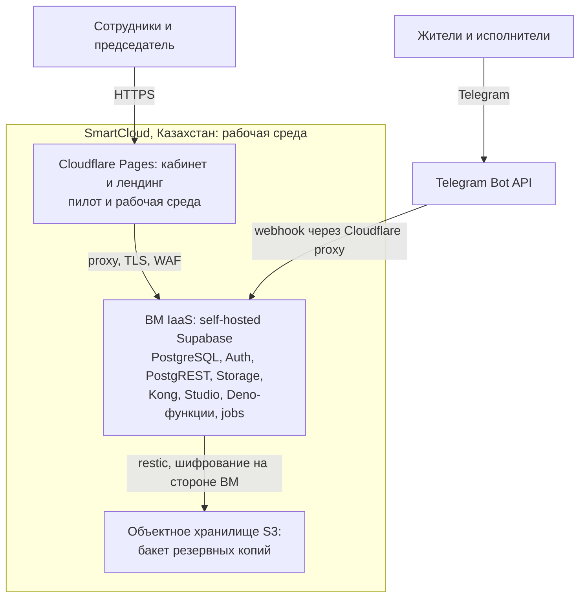

# Инфраструктура продакшена: пилот на Cloudflare → SmartCloud IaaS + S3

Статус: **проект** (черновик для обсуждения, 25.10.2026). Не является ADR: решение о провайдере
оформляется отдельным ADR после получения КП и подтверждения условий SmartCloud
(см. «Открытые вопросы»). Цены проверены по публичным страницам провайдеров 25.10.2026 и могут измениться.

## 1. Цель и связь с принятыми решениями

Документ закрывает открытый пункт [OPS-03](architecture-questions.md) — «Конкретное хранилище,
управление ключами и срок хранения остаются открытыми» — и конкретизирует план размещения
рабочей системы в Казахстане.

| Решение | Связь |
| --- | --- |
| [ADR-002](decisions/002-admin-cloudflare-pages.md) | Кабинет остаётся статикой на Cloudflare Pages; серверные данные и хранилище — в Казахстане |
| [ADR-003](decisions/003-edge-functions-and-environments.md) | Рабочая система — самостоятельно размещённый Supabase в Казахстане; провайдер не был выбран |
| [ADR-005](decisions/005-api-region-near-database.md) | Регион API рядом с БД; в SmartCloud ВМ и БД на одной площадке |
| OPS-03, AUTH-07 | RPO/RTO ≤ 24 ч, зашифрованное хранилище копий в КЗ отдельно от основного сервера, доступ основного и резервного техадминов |

Согласованное направление: **пилот — Cloudflare (Pages + облачный Supabase), рабочая система —
SmartCloud (АО «Казтелепорт») IaaS + объектное хранилище S3**.

## 2. Оценка нагрузки: ЖК на 600 квартир

Оценки консервативные, для выбора конфигурации, не нагрузочный профиль.

| Параметр | Оценка | Обоснование |
| --- | --- | --- |
| Пользователи | 600–1 800 жителей (1–3 на квартиру) + 15–30 сотрудников | Бот и кабинет, MAU реально 10–30 % |
| Пиковая одновременность | 100–300 сессий, 20–50 RPS по API | Дни собраний и голосований |
| Telegram webhook | десятки–сотни update/мин в пики | Очередь уведомлений в БД (лимит Telegram ~30 сообщ/с на бота) |
| База данных | 2–10 ГБ за первый год | 21 прикладная таблица + индексы |
| Вложения (фото, PDF, видео ≤ 20 МБ, FIL-01) | 5–15 ГБ за первый год | Обращения, документы, отчёты |
| Резервные копии | 50–200 ГБ с учётом retention | Сжатые дампы + снапшоты Storage |

Вывод: **4 vCPU / 8 ГБ RAM — комфортный запас**; вертикальное масштабирование в IaaS
покрывает рост до сети ЖК без переезда.

## 3. Целевая архитектура

- Публичный HTTPS — только через Cloudflare proxy (скрытие origin-IP, бесплатный WAF/DDoS,
  продолжение пилота по ADR-002). SSH/RDP — только через VPN, порты не выставлять.
- Telegram webhook и API кабинета приходят на ВМ; исходящие вызовы ботов — напрямую.

## 4. Исследование: S3-хранилища в Казахстане

Проверено 25.10.2026 по сайтам провайдеров.

| Провайдер | Совместимость | Цена | Трафик и операции | Примечания |
| --- | --- | --- | --- | --- |
| [PS.kz / PS Cloud](https://www.ps.kz/ru/hosting/cloud-storage) | S3 + OpenStack Swift | Почасовая оплата за фактический объём; цены — только в калькуляторе/консоли | По факту | Классы: универсальное, холодное, архивное. ДЦ в Алматы; PCI DSS 4.0.1, ISO 27001 |
| [SmartCloud](https://smartcloud.kz/cloud-services/s3/) (АО «Казтелепорт») | S3 (Cloudian) | От **2 668 ₸/мес за 100 ГБ** (~27 ₸/ГБ), минимальный заказ 100 ГБ | **Бесплатно, без лимитов** (спецпредложение) | SLA 99.95 %, Алматы и Астана |
| [Cloud24](https://storage-s3.cloud24.kz) | S3 (Cloudian) | От **15 ₸/ГБ** (от 1 ТБ); 13 ₸/ГБ (5–50 ТБ); 11 ₸/ГБ (от 50 ТБ) | Безлимитно | Алматы, Астана, Шымкент, Караганда; соответствие закону РК о ПДн |
| [Prime Cloud](https://docs.primecloud.kz/storage/s3/) | S3 + Swift (Ceph) | По запросу (квоты по договору) | Внутренняя точка — бесплатно | Только path-style access; rclone/s3cmd работают |
| Яндекс Облако (регион в КЗ) | S3 (Object Storage) | Цены в тенге; страницы не читаются без JS — не проверено | — | Вариант «для проверки», если применим |

Бесплатных тарифов S3 в Казахстане нет.

Мировые провайдеры (в 4–10 раз дешевле, но данные за пределами РК — требованиям OPS-03 для
копий и персональных данных не удовлетворяют; допустимы для неперсональной статики):

| Провайдер | Free tier | Цена | Egress |
| --- | --- | --- | --- |
| [Cloudflare R2](https://developers.cloudflare.com/r2/pricing/) | 10 ГБ + 1 млн записей + 10 млн чтений/мес | $0.015/ГБ-мес | Всегда бесплатно |
| [Backblaze B2](https://www.backblaze.com/cloud-storage/pricing) | 10 ГБ | $6.95/ТБ-мес | Бесплатно до 3× объёма хранилища, далее $0.01/ГБ |
| [IDrive e2](https://www.idrive.com/e2/) | 10 ГБ (проба) | $59.5/год за 1 ТБ (первый год −50 %) | Бесплатно; операции бесплатно |

## 5. Выбор провайдера и обоснование

**SmartCloud** выбран как основной кандидат:

- данные в Казахстане (собственный ЦОД АО «Казтелепорт», заявлен ДЦ TIER 3 в Алматы,
  вторая зона доступности обещана после Q3 2026);
- S3-хранилище с **бесплатным исходящим трафиком и операциями** — восстановление копий
  не порождает расходов за скачивание;
- одна площадка для IaaS и S3 — один договор, одна техподдержка (5151, 24/7);
- IaaS на Proxmox VE 8.4: гибкое изменение ресурсов (у фиксированного VDS размеры менять нельзя);
- прозрачный ценовой якорь: VDS 4 vCPU/8 ГБ/160 ГБ SSD = 23 200 ₸/мес, 4/4/80 = 13 920 ₸/мес.

Резервный вариант — **PS.kz** (архивный класс хранилища для долгосрочных копий, второй
провайдер для георезерва). Cloudflare R2 остаётся для неперсональной статики кабинета
(бесплатные 10 ГБ) — это не конфликтует с OPS-03, если там нет персональных данных.

## 6. Конфигурация SmartCloud

### 6.1. ВМ продакшена (self-hosted Supabase)

| Ресурс | Значение | Комментарий |
| --- | --- | --- |
| Тип | IaaS, HighFreq (CPU от 2,9 ГГц) | Производительность PostgreSQL зависит от частоты |
| vCPU | 4 | PostgreSQL, Auth, PostgREST, Storage API, Kong, Studio, Deno-функции, jobs (pg_cron/pgmq) |
| RAM | 8 ГБ | shared_buffers ≈ 2 ГБ, остальное — стек и ОС |
| Диск | SSD 200 ГБ | Система, Docker-образы, БД и вложения с запасом на 2–3 года |
| Сеть | 1 IPv4, 40 Мбит/с | За Cloudflare proxy; ~5 МБ/с достаточно для оценённой нагрузки |
| ОС | Ubuntu 24.04 LTS | Есть в списке образов провайдера |
| Резервные копии ВМ | Опционально, по цене из калькулятора | Вторая линия защиты; основная — S3 (раздел 7) |

Ориентир стоимости: **14 000–23 000 ₸/мес** по публичным ценам VDS; в IaaS-калькуляторе
конфигурация рассчитывается индивидуально, заявлены скидки до 50 % — получить КП.

### 6.2. Staging (опционально)

- Вариант A (0 ₸): оставить как сейчас — облачный Supabase + Cloudflare Pages preview.
- Вариант B: VDS 4 vCPU/4 ГБ/80 ГБ **HDD** = 9 280 ₸/мес — репетиция обновлений
  self-hosted стека до продакшена. Рекомендуется к моменту переноса рабочей среды.

### 6.3. S3-бакеты

| Назначение | Объём | Цена |
| --- | --- | --- |
| Резервные копии (restic: дампы БД + снапшоты Storage) | 100 ГБ (минимальный блок) | 2 668 ₸/мес |

Вложения Supabase Storage остаются на диске ВМ (5–15 ГБ/год) и попадают в restic-снапшоты;
отдельный бакет под них на старте не нужен. Расширение бакета — по мере роста.

### 6.4. Сводная стоимость (ориентир)

| Компонент | ₸/мес |
| --- | --- |
| ВМ прод (IaaS 4 vCPU HighFreq / 8 ГБ / 200 ГБ SSD / 1 IPv4) | 14 000–23 000 |
| S3 бакет копий, 100 ГБ | 2 668 |
| Staging — вариант A / вариант B | 0 / 9 280 |
| **Итого** | **~17 000–26 000 без staging; ~26 000–35 000 с ним** (~$32–66) |

## 7. Резервное копирование по OPS-03

| Требование OPS-03 (согласовано 16.10.2026) | Решение в конфигурации |
| --- | --- |
| RPO ≤ 24 ч | Ежедневные автоматические копии после пилота + копия перед каждым обновлением |
| RTO ≤ 24 ч | Восстановление из S3 внутри КЗ; замеряется при пробном восстановлении |
| Зашифрованное хранилище | restic/pgBackRest: шифрование на ВМ до отправки; провайдер не имеет ключей |
| Отдельно от основного сервера | Бакет S3 вне ВМ; уточнить локацию кластера S3 — если та же площадка, вторая копия у PS.kz |
| Доступ основного и резервного техадминов | Персональные S3-ключи у обоих; журналирование по AUTH-07 |
| Срок хранения | Пилот — 7 дней (согласовано); после пилота — предложение: ежедневные 30 дней + еженедельные 6 мес + копии перед обновлениями 90 дней. Требует согласования |
| Пробное восстановление | Обязательный гейт перед запуском: полная копия БД и вложений в отдельной среде, фиксация результата |
| Пропуск/ошибка копирования | Уведомление основного техадмина через jobs/уведомления (без автоэскалации — по согласованному решению) |

Ключи шифрования (пароль restic): у основного и резервного техадминов, вне облака —
менеджер секретов + дубликат на физическом носителе в сейфе ОСИ. Управление ключами —
открытый пункт OPS-03, предложение подлежит утверждению.

## 8. Открытые вопросы к SmartCloud

1. **Цена исходящего трафика IaaS** — бесплатно указан только входящий; главный параметр
   стоимости при раздаче вложений (в S3-хранилище трафик бесплатный).
2. Локация кластера S3 относительно ВМ (Алматы/Астана) и выбор локации ВМ — для условия
   «отдельно от основного сервера».
3. SLA на IaaS и статус второй зоны доступности.
4. Скидка при годовой оплате (заявлено до 50 %) и условия КП на конфигурацию из раздела 6.1.
5. Цена снимков ВМ (поле «Резервное копирование» в калькуляторе, до 20 480 ГБ).
6. Возможность расширить канал сверх 40 Мбит/с в IaaS.

## 9. Порядок внедрения

1. Запросить КП по конфигурации 6.1 + ответы на вопросы раздела 8; при подтверждении — оформить ADR (следующий номер после ADR-020) и зафиксировать выбор хранилища по OPS-03 в `architecture-questions.md`.
2. Развернуть ВМ, self-hosted Supabase (Docker Compose), обратный прокси с TLS за Cloudflare proxy.
3. Перевести webhook ботов и рабочие окружения; параметры — как при переезде в Frankfurt по ADR-005 (backup/restore, проверка RLS и числа строк, Auth-сеансы не переносятся).
4. Подключить S3-бакет, настроить restic (шифрование, расписание, retention), уведомления об ошибках.
5. Провести обязательное пробное восстановление (OPS-03), зафиксировать длительность против RTO.
6. Неделя наблюдения (метрики, журнал ошибок `bot_inbound`, копии) — затем переключение пользователей.

## 10. Чек-лист соответствия

- [ ] КП SmartCloud получено, цены подтверждены
- [ ] Ответы на вопросы раздела 8 (egress, локация S3, SLA, зона 2)
- [ ] ADR об инфраструктуре продакшена оформлен
- [ ] ВМ развёрнута, Supabase работает за Cloudflare proxy
- [ ] S3-бакет подключён, restic шифрует и копирует по расписанию
- [ ] Пробное восстановление выполнено, результат зафиксирован (OPS-03)
- [ ] Доступы обоих техадминов к копиям и журналирование настроены (AUTH-07)
- [ ] Срок хранения копий после пилота согласован
