# Как работает ОСИ «Мунар Тау»: процессы в схемах

Путеводитель для жителей, исполнителей, администраторов и председателя. Актуальность: **22 октября 2026 года**.

Здесь описано, **кто, что и в каком порядке делает**, какой результат получает и что происходит при затруднениях. Технические детали вынесены в ссылки на источники.

> Это обзор согласованных процессов, включая будущие возможности. Наличие схемы не означает, что функция уже выпущена. Раздел 2 объясняет границы реализации. Полные условия переходов заданы в [модели процессов](request-lifecycle.md), требования — в [спецификации](requirements-v1.md); актуальные уточнения регистрации, сотрудников и ботов — в ADR-013–017. Схемы упрощают чтение и не добавляют новых разрешений.

## Навигация

| Если нужно… | Читать |
| --- | --- |
| Понять систему за несколько минут | [1. Общая карта](#p01), [2. Готовность](#p02), [3. Участники](#p03) |
| Зарегистрироваться, привязать помещение, пригласить семью | [4. Регистрация](#p04), [5. Помещения и доступы](#p05) |
| Исправить данные, удалить аккаунт, восстановить Telegram | [6. Изменение и восстановление доступа](#p06) |
| Сообщить о проблеме и получить результат | [7. Обращение](#p07), [8. Исключения](#p08), [9. Переписка](#p09) |
| Организовать исполнение, визит или общую работу | [10. Задание](#p10), [11. Визит](#p11), [12. Общая работа](#p12) |
| Сообщить об аварии или отключении | [13. Авария](#p13), [17. Публикации и отключения](#p17) |
| Заказать платную работу, разобраться с оплатой | [14. Платные услуги](#p14) |
| Настроить регулярные работы, документы, отчёты | [15. Регулярные работы](#p15), [16. Документы](#p16), [20. Отчётность](#p20) |
| Провести опрос, предложить улучшение, оспорить модерацию | [18. Опросы](#p18), [19. Инициативы](#p19) |
| Понять сроки и уведомления | [21. Сроки](#p21), [22. Уведомления](#p22) |
| Управлять сотрудниками, реестром и системой | [23. Сотрудники](#p23), [24. Реестр](#p24), [25. Эмуляция и шаблоны](#p25), [26. Сбои и данные](#p26) |

**Как читать схемы:** прямоугольник — шаг или состояние; ромб — вопрос; подпись стрелки — условие или действие. Пунктир — связь или информирование. Цвет не несёт обязательного смысла. Mermaid-схемы отображаются в GitHub и совместимых Markdown-просмотрщиках; под каждой схемой есть пояснение словами.

<a id="p01"></a>
## 1. Общая карта: от проблемы к результату

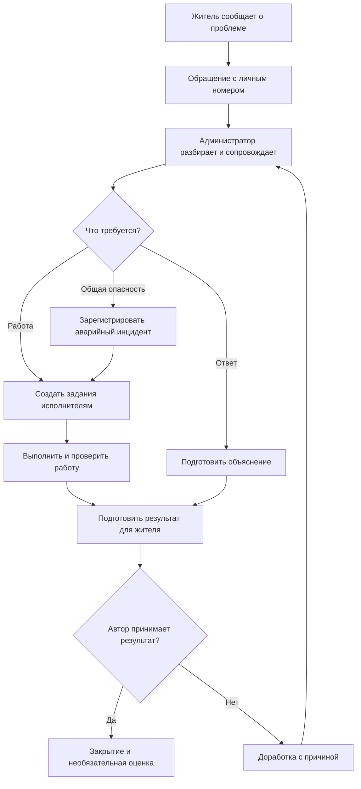

**Главная ответственность:** администратор сопровождает обращение до завершения. Назначить исполнителя или передать вопрос внешней службе недостаточно, чтобы считать проблему решённой.

Четыре объекта, которые важно различать:

| Объект | Простой смысл | Пример |
| --- | --- | --- |
| Обращение | Личный вопрос или проблема конкретного автора | «В моей квартире нет воды» |
| Задание | Конкретная работа конкретному исполнителю | «Проверить и заменить повреждённый участок» |
| Общая работа | Общий объём для нескольких обращений | «Восстановить водоснабжение дома» |
| Аварийный инцидент | Управление общей опасностью и восстановлением | «Повреждение сети: затронуты два дома» |

Одна проблема может породить несколько обращений. У каждого автора сохраняются свой номер, переписка и проверка результата. Общая работа возможна без аварии; авария может поступить без обращения жителя.

Источники: REQ, WRK, EMG; [модель процессов, раздел 1](request-lifecycle.md#1-разделение-объектов).

<a id="p02"></a>
## 2. Что описано и что уже доступно

Путеводитель охватывает весь согласованный объём. Точную готовность конкретного сценария нужно проверять по приёмке и составу развёрнутой версии.

| Область | Состояние по документам проекта |
| --- | --- |
| Основа доступа, регистрация, обращения, задания | Базовые срезы VS-0–VS-4 реализованы; уточнения имеют отдельные документы приёмки |
| Регламенты, уведомления, регулярные запуски | Реализация и границы проверки описаны в [VS-5](vs5-acceptance.md) |
| Аварии и публикации | Реализация и ограничения приёмки — [VS-7](vs7-acceptance.md); наличие кода не заменяет сквозную приёмку |
| Исправление анкет, сотрудники, служебный бот | [Анкеты](registration-management-acceptance.md), [сотрудники](staff-management-acceptance.md), [бот сотрудников](staff-bot-requests-acceptance.md) |
| Платные услуги и расчёты | Целевой процесс VS-6; платный старт в текущем базовом контуре заблокирован до его реализации |
| Полный документооборот, опросы, инициативы, отчётность | Целевой объём VS-8; обязательный акт блокирует приёмку до доступности соответствующего процесса |
| Эксплуатация и приватность | Часть механизмов уже есть; полный срез VS-9 и проверка восстановления — отдельные обязательства |

TOTP для привилегированных ролей предусмотрен после пилота. Облачный стенд предназначен для вымышленных данных; рабочая среда с реальными данными предусмотрена в Казахстане. Этот документ не подтверждает готовность к рабочему запуску.

Источники: [HLD, раздел 27](hld.md#27-декомпозиция-и-следующие-шаги), [правила проекта](../AGENTS.md), документы приёмки выше.

<a id="p03"></a>
## 3. Кто за что отвечает и где работает

| Участник | Основные действия | Интерфейс |
| --- | --- | --- |
| Житель | Регистрация, обращения, согласование визита, проверка результата | Бот жителей |
| Собственник | Дополнительно подтверждает приглашённых и видит документы своей аудитории | Бот жителей |
| Исполнитель задания | Принимает назначение, выполняет работу, сдаёт отчёт | Бот сотрудников, доступные разделы кабинета |
| Администратор / заместитель | Разбор, организация работ, проверка отчётов, сопровождение | Кабинет и доступные действия бота сотрудников |
| Председатель | Управление старшими деловыми полномочиями, контроль, согласования, жалобы на администратора | Кабинет и бот сотрудников |
| Дежурный | Принятие аварийных сигналов и координация реакции | Служебный канал и кабинет в пределах прав |
| Финансовый сотрудник | Сметы и ручная сверка поступлений/возвратов | Кабинет; процесс PAY — после реализации |
| Проверяющий документов | Проверка конкретных версий документов | В пределах выданных полномочий |
| Технический администратор | Настройки, сопровождение, восстановление | Кабинет и технические средства |

Один человек может совмещать роли, но **не принимает собственную работу и не утверждает собственные расходы**. Назначение на задание открывает это задание, а исходное обращение, жалобы и финансовые материалы проверяются отдельно.

Бот жителей — `@munar_tau_user_bot`, сотрудников — `@munar_tau_worker_bot`. В обоих управление строится на кнопках. Сотрудник создаёт обращение в кабинете; служебный бот предназначен для обработки существующих обращений и заданий. Вход через Telegram подтверждает личность, а полномочия выдаются отдельно.

Источники: ROL, AUTH, UI; [ADR-009](decisions/009-two-telegram-bots.md), [ADR-013](decisions/013-task-assignee-any-staff.md), [ADR-014](decisions/014-staff-role-management.md), [ADR-017](decisions/017-staff-bot-request-interaction.md).

<a id="p04"></a>
## 4. Регистрация: сначала человек, затем помещения

**Цель:** получить подтверждённый профиль для обращения в ОСИ. **Действуют:** житель и сотрудник, проверяющий анкету.

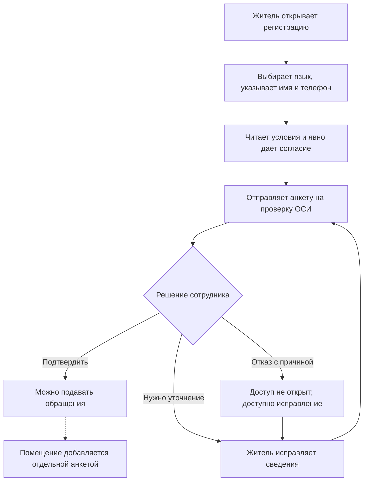

Дом, помещение и роль собственника в основную анкету не входят. После подтверждения можно сообщить о проблеме **без привязки помещения**, указав адрес одной строкой. Такое обращение попадает в общую очередь; сведения о чужих помещениях не открываются.

До согласия и подтверждения доступны общая справка и аварийные контакты. Одна действующая основная анкета соответствует одному Telegram-аккаунту; добавление помещения не создаёт вторую основную анкету.

Источники: REG-01/02/02a, PRV-01; [ADR-015](decisions/015-registration-lite.md), [ADR-016](decisions/016-registration-management.md).

<a id="p05"></a>
## 5. Помещения, семья, арендаторы и споры о доступе

**Цель:** подтвердить, к какому объекту относится человек. Помещением может быть квартира, коммерческое помещение, парковочное место или кладовка; все они входят в состав дома.

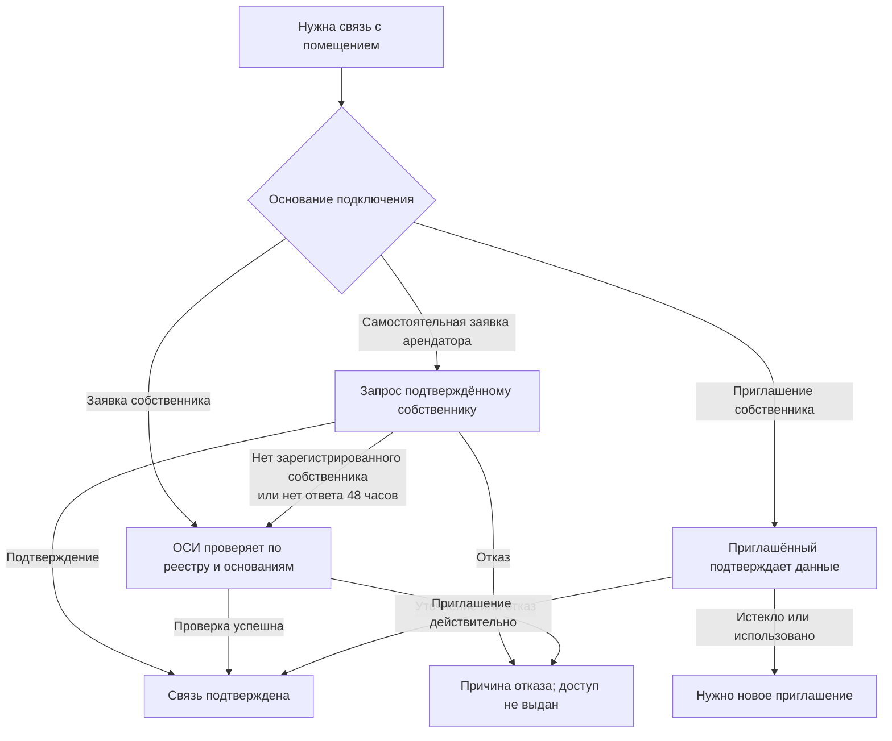

Приглашение одноразовое, начальный срок — **72 календарных часа**. Оно не выдаёт статус собственника. Время ожидания само по себе не предоставляет доступ.

| Ситуация | Что происходит |
| --- | --- |
| Несколько собственников | Для подтверждения проживающего достаточно одного; другой может подать возражение |
| Возражение или спор | Администратор рассматривает основания; может приостановить доступ с причиной. Само возражение доступ не блокирует |
| Собственник отзывает доступ | Может немедленно отозвать только собственное приглашение/подтверждение; чужое оспаривается через ОСИ |
| Продажа помещения или доли | ОСИ подтверждает смену; прекращаются соответствующая прежняя связь и выданные ею доступы/приглашения. Права других собственников сохраняются |
| Есть другие помещения | Связи с ними продолжают действовать независимо |
| Новый собственник | Не получает переписку и платежи прежних жителей |

Спор сопровождается до явного решения. Без реакции он передаётся от администратора заместителю, затем председателю; при отсутствии заместителя — сразу председателю. Если спор касается действий самого администратора, его рассматривает председатель. Начальные интервалы и общий срок — в разделе 21.

Источники: REG-03–08/11–14, CMP-02, SHR-03; [матрица прав](access-matrix.md).

<a id="p06"></a>
## 6. Исправление анкеты, удаление и восстановление

### Исправить имя, телефон или язык

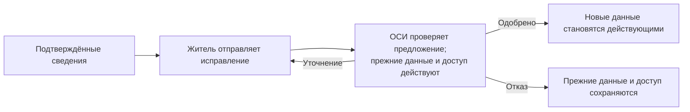

Исправление остаётся в той же основной анкете. Оно не заменяет спор о праве на помещение и не подтверждает новые связи автоматически.

### Удалить аккаунт или вернуться после удаления

Удаление после явного подтверждения **прекращает доступ**: закрываются сеансы, отзываются связи, приглашения и роли, профиль архивируется. Обращения, задания и журнал сохраняются; открытые обязанности передаются явно. Председатель и технический администратор предварительно передают защищённые полномочия.

При повторной подаче используется прежняя основная анкета. Только одобрение ОСИ активирует прежний профиль; старые роли и связи автоматически не возвращаются. Физическое уничтожение персональных данных — отдельная процедура, зависящая от обязательств и утверждённых сроков хранения.

### Потерян Telegram-аккаунт

**Проверка личности уполномоченным сотрудником → подтверждение новой привязки → прекращение прежних прикладных сеансов → доступ через новый аккаунт.** Человек, история и назначения сохраняются. Одного совпадения имени или телефона для переноса недостаточно. Восстановление факторов председателя/техадминистратора имеет отдельный защищённый порядок; его детали требуют эксплуатационной проработки.

Источники: REG-02a, PRV-02/02a, AUTH-01/04–06; [ADR-001](decisions/001-telegram-auth.md), [ADR-016](decisions/016-registration-management.md).

<a id="p07"></a>
## 7. Обращение: основной путь

**Цель:** получить ответ или устранить проблему. **Действуют:** автор, администратор, при необходимости исполнители.

Перед отправкой житель выбирает вид обращения и место, описывает проблему, добавляет файлы и проверяет введённое. Техническую категорию уточняет администратор. Пока это черновик, номера и отсчёта сроков нет. После успешного сохранения выдаётся номер; повтор той же отправки не создаёт дубль.

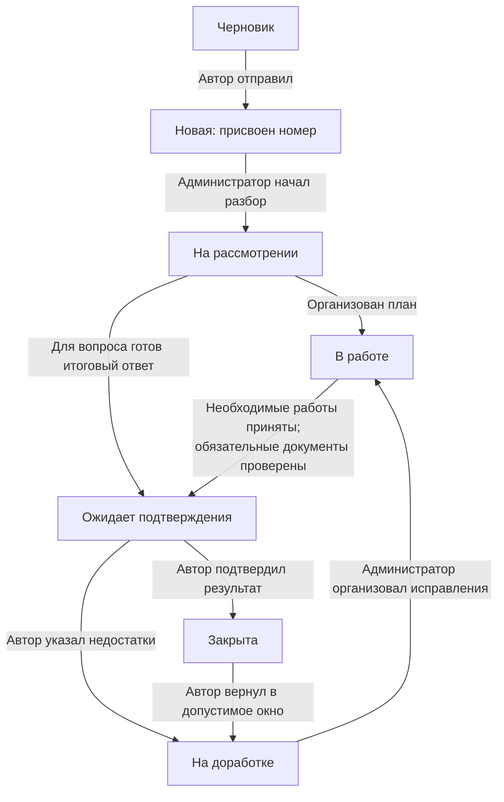

**Что означает результат:** автор подтверждает конкретную версию отчёта или ответа. Внутренний отчёт исполнителя сначала проверяет администратор, затем готовится доступный жителю результат.

После подтверждения можно поставить оценку 1–5 и комментарий. Оценка необязательна; 1–2 уведомляют администратора, но не возвращают обращение в работу автоматически. При доработке прежняя оценка сохраняется в истории и исключается из средней окончательного результата; после новой приёмки предлагается новая оценка.

Источники: REQ-01–09, WRK-01/06–08/16–18, RAT-01–04; [полные переходы](request-lifecycle.md#4-обращение-разрешённые-переходы).

<a id="p08"></a>
## 8. Обращение: если основной путь прервался

| Что случилось | Кто делает следующий шаг | Как продолжается процесс |
| --- | --- | --- |
| Не хватает сведений | Администратор задаёт конкретный вопрос; автор/участник отвечает | «Нужно уточнение» → «На рассмотрении». Молчание не закрывает обращение |
| Сейчас выполнить нельзя | Администратор фиксирует причину, ответственного и дату следующего действия | «Отложена». В дату приходит напоминание; возобновляет сотрудник явно |
| Автор молчит после отчёта | Система напоминает; затем администратор проверяет результат | Автоматического закрытия нет. Обоснованное закрытие сотрудником отмечается отдельно |
| Результат неверный | Автор возвращает с объяснением; администратор организует исправления | Новый цикл доработки; предыдущие отчёты и сроки сохраняются |
| Отмена до начала работ | Автор указывает причину | «Отменена», не считается выполненной |
| Отмена после начала | Автор просит отмену; администратор согласует остановку и обязательства | Запрос не отменяет работу мгновенно; расчёты разбираются отдельно |
| Работа вне ответственности ОСИ | Администратор объясняет основание и известный дальнейший маршрут | «Отказано», не считается выполненной; автор может оспорить у председателя |
| Автор утратил связь с помещением | Администратор разбирает незавершённое обращение | Для обычного неоплачиваемого обращения возможна административная проверка; оплаченный заказ — по отдельным правилам PAY-11 |

**Вопрос:** может завершиться ответом без задания, сохраняя номер и ответственного. FAQ доступен добровольно и не мешает сразу обратиться в ОСИ.

**Жалоба:** на исполнителя идёт администратору, на администратора — председателю. Сотрудник, чьи действия рассматриваются, не получает автоматического доступа и не закрывает жалобу сам. Отдельный маршрут жалоб на председателя не согласован.

Просрочка и полный возраст не обнуляются из-за уточнения, отсрочки, смены исполнителя или нового визита.

Источники: REQ-07, WRK-07–09/13–15, FAQ-01, CMP-01/02; [модель процессов](request-lifecycle.md).

<a id="p09"></a>
## 9. Переписка, совместное участие и файлы

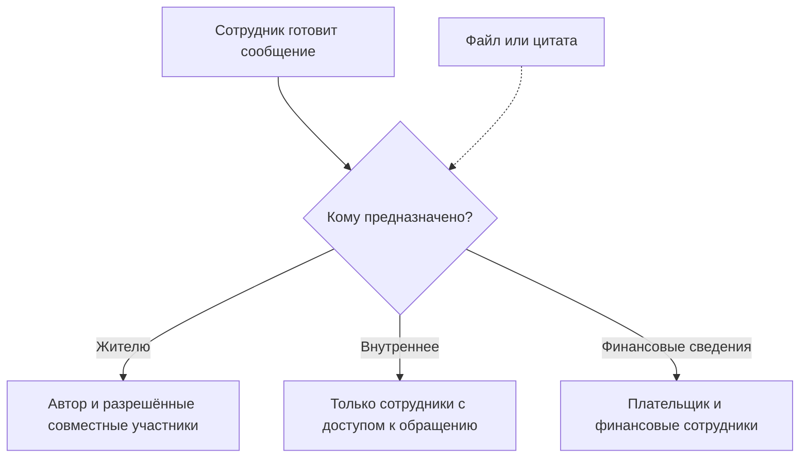

Автор может открыть конкретное обращение подтверждённому жителю того же помещения. Участник читает разрешённую историю, пишет, прикладывает материалы и согласует визит. **Подтвердить результат, отменить обращение и управлять совместным доступом вправе автор.** Плательщик согласует свои финансовые обязательства отдельно.

Собственность сама по себе не открывает обращения семьи или арендаторов. Совместный доступ не открывает внутренние сообщения и квитанции. При отзыве доступа новые открытия и уведомления прекращаются; доставленные копии Telegram гарантированно удалить нельзя.

На одно сообщение — до **10 файлов по 20 МиБ** каждый. Дополнительные материалы можно отправить следующими сообщениями. Ошибка файла не стирает текст и уже принятые вложения; успех подтверждается после сохранения. Номер обращения может быть выдан, пока вложение ещё загружается; незавершённая загрузка отмечается и допускает повтор. Антивирусная проверка в пилот не входит.

Отправленное сообщение не переписывают незаметно: исправление — новым сообщением. Внутренние материалы не копируются жителю автоматически. В служебном боте отметка прочтения ставится явным действием для показанных входящих сообщений; доставка уведомления прочтением не считается.

Источники: SHR-01–04, MSG-01–03, FIL-01–03, PAY-08; [ADR-006](decisions/006-vs3-request-files-and-boundaries.md), [ADR-017](decisions/017-staff-bot-request-interaction.md).

<a id="p10"></a>
## 10. Задание исполнителю: назначить, выполнить, проверить

**Цель:** получить проверенный результат конкретного объёма работы. Назначить можно любого действующего сотрудника ОСИ; отдельная роль исполнителя не обязательна.

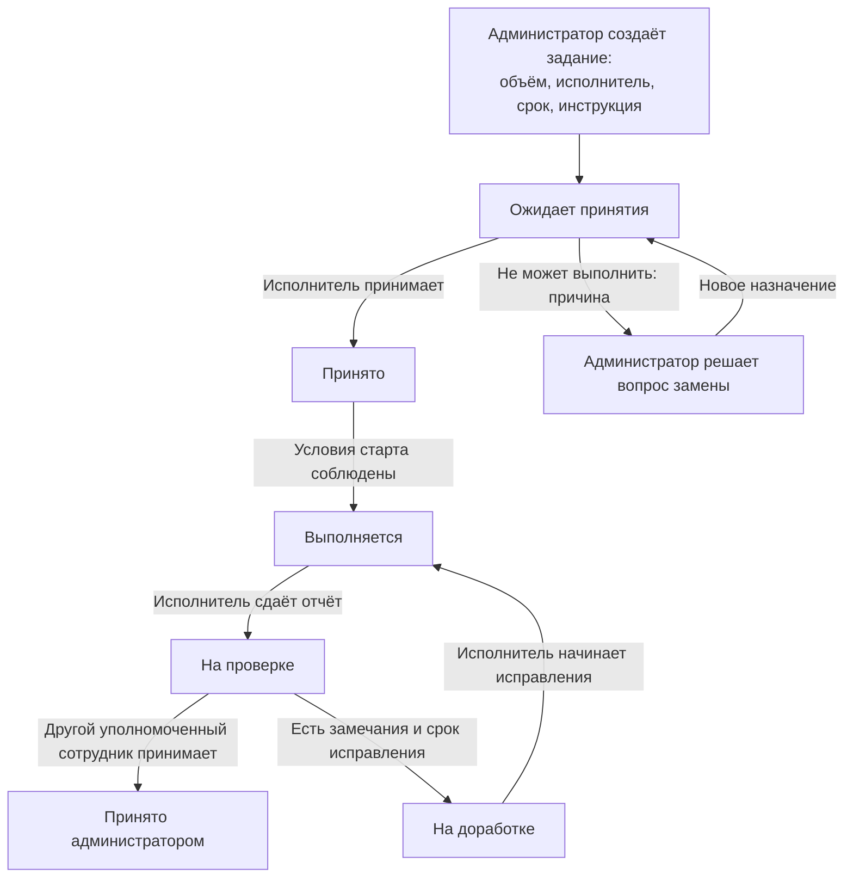

Молчание исполнителя не считается принятием. При отказе или отсутствии реакции администратор организует замену, сохраняя историю и сроки. Приостановку фиксирует администратор с причиной и следующим действием; исполнитель сообщает о препятствии. При опасности он немедленно прекращает небезопасные действия и уведомляет ответственного.

Отчёт содержит объём, время, результат, обязательные доказательства и ограничения. Непредоставленное обязательное доказательство требует объяснения и явного решения; сбой загрузки доказательством не считается. После включения в отчёт материалы задания неизменяемы.

Задание может зависеть от другого задания. Отмена обязательного задания не делает его выполненным: нужна замена либо обоснованное изменение необходимого объёма. Приёмка исполнителем собственного отчёта запрещена даже при совмещении ролей или смене назначения.

Источники: ROL-02d/e, WRK-02/11/16–18; [полные переходы заданий](request-lifecycle.md#5-задания-и-общая-работа), [ADR-013](decisions/013-task-assignee-any-staff.md).

<a id="p11"></a>
## 11. Визит: договорённость должна быть подтверждена

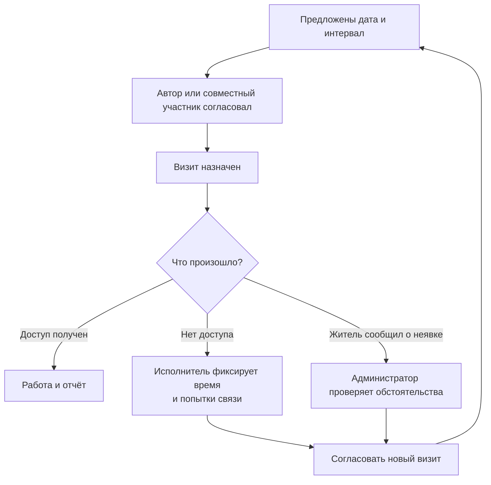

Пока интервал не согласован, визит не считается назначенным. «Нет доступа» и «Исполнитель не пришёл» — события для разбора, а не основание автоматического закрытия. Новый визит не переносит общий срок обращения; перенос оформляет администратор отдельно с причиной.

Источники: WRK-03–05, TIM-06.

<a id="p12"></a>
## 12. Общая работа: одна причина, несколько личных результатов

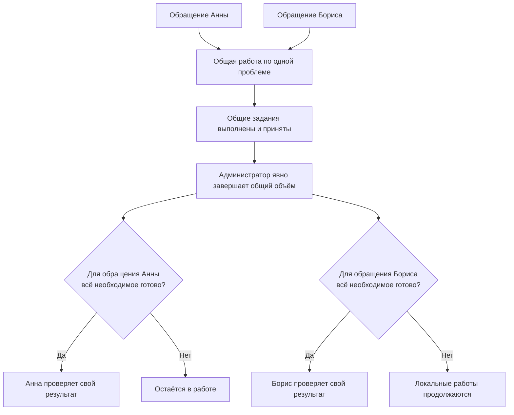

**Пример:** водоснабжение дома восстановлено, но в одной квартире осталось локальное повреждение. Общая работа может завершиться, а конкретное обращение продолжит работу до локального результата.

У каждого автора сохраняются номер, переписка и сроки. Подтверждение Анны не подтверждает результат за Бориса. Отмена одного обращения не останавливает общий объём для остальных. Возврат задания возобновляет общую работу с сохранением прежнего завершения в истории. Отмена общей работы требует разбора всех связанных обращений.

Источники: WRK-10–12, EMG-07; [модель процессов, раздел 5](request-lifecycle.md#5-задания-и-общая-работа).

<a id="p13"></a>
## 13. Авария: от сигнала до проверенного восстановления

**Цель:** устранить общую опасность и информировать затронутых людей. **Действуют:** сообщивший, текущий дежурный/администратор, исполнители или внешняя служба.

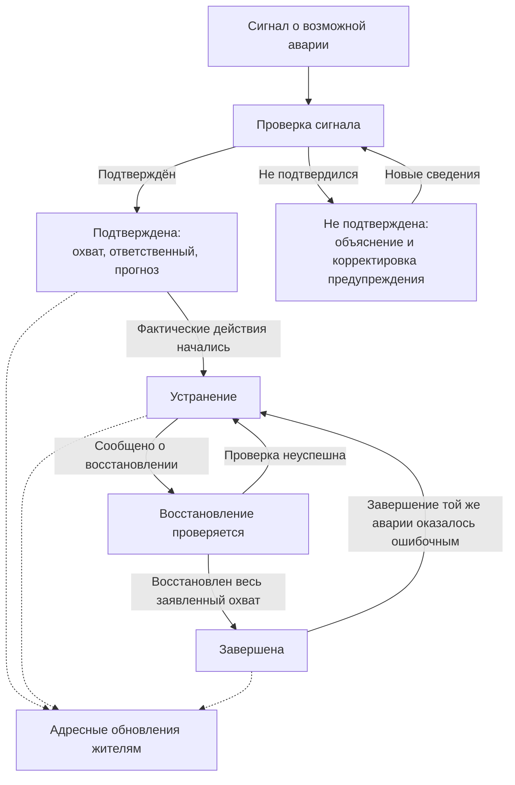

Первичный сигнал не означает подтверждения аварии или выезда. В боте показываются аварийный телефон и действующий порядок обработки. При неизвестном прогнозе сотрудник указывает «Уточняется» и время следующего обновления.

**Дежурство:** если основной дежурный не подтвердил принятие за начальные 10 календарных минут, сигнал передаётся резервному с уведомлением администратора. Ещё через 10 минут без принятия ответственность передаётся администратору, председатель уведомляется. Принять может только текущий ответственный; старые кнопки не возвращают ответственность назад.

Частичное восстановление фиксируется по зонам и не завершает весь инцидент. Плановый срок, молчание жителей и закрытие одного обращения также не завершают аварию. Новая самостоятельная авария получает новый инцидент. После восстановления связанные обращения проходят отдельную проверку результата; остаточные работы сохраняют ответственных и сроки.

Источники: EMG-01–07, TIM-05; [переходы инцидента](request-lifecycle.md#6-общая-авария-переходы).

<a id="p14"></a>
## 14. Платная услуга: договориться, выполнить, сверить деньги

> Целевой процесс VS-6. Схема не означает, что заказ платных услуг уже включён.

**Действуют:** автор обращения, плательщик, администратор, утверждающий стоимость сотрудник, исполнитель и финансовый сотрудник. Автор и плательщик могут быть разными людьми.

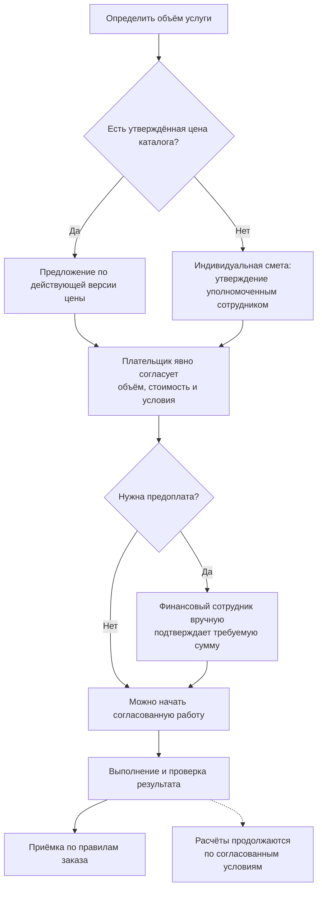

Каталог и его цены утверждает председатель. Индивидуальную смету — председатель или администратор с финансовыми правами. Затем обязательно согласие плательщика. Дополнительные расходы проходят новое утверждение и согласование **до выполнения**. Уже согласованная цена не меняется вслед за обновлением каталога.

### Ручная сверка Kaspi

**Сотрудник направляет запрос оплаты → плательщик отправляет квитанцию → сотрудник проверяет фактическое поступление, сумму и принадлежность заказу → подтверждает платёж или сообщает расхождение.** Автоматическая интеграция с банком и распознавание квитанций не предусмотрены.

| Работа | Деньги |
| --- | --- |
| Исполнитель сдаёт результат, уполномоченный сотрудник проверяет | Финансовый сотрудник сверяет поступление |
| Приёмка относится к результату и документам | Оплата относится к подтверждённым платежам |
| Закрытие не подтверждает оплату | Квитанция не подтверждает качество |

Один заказ имеет одного плательщика, но допускает несколько платежей. При предоплате нужен весь согласованный порог, а не первая произвольная сумма. Суммы — целые тенге; переплата показывается отдельно и не разрешает дополнительные работы. Плательщик без совместного доступа видит отдельную финансовую карточку без остальной переписки.

### Отмена, возврат и смена жильца

При отмене сотрудник фиксирует сделанный объём, расходы и расчёт возврата по согласованным условиям. Возврат выполняется вне системы, затем подтверждается записью, суммой, датой и документом. Возможен возврат частями; общий подтверждённый возврат не превышает подтверждённые поступления. Ошибки исправляются с историей.

После первого подтверждённого платежа плательщика нельзя менять до урегулирования расчётов. Переезд не передаёт обязательства новому жителю. Бывшему плательщику сохраняется ограниченный доступ к своему оплаченному незавершённому заказу и его приёмке; доступ в помещение согласуется с текущим проживающим отдельно.

Источники: PAY-01–14, ROL-02d; [модель процессов, раздел 7](request-lifecycle.md#7-документы-подтверждение-и-расчёты). Детали открытых коммерческих условий не заменяются этой схемой.

<a id="p15"></a>
## 15. Регулярные и внутренние работы

**Цель:** выполнять обслуживание, даже когда никто из жителей не подал обращение.

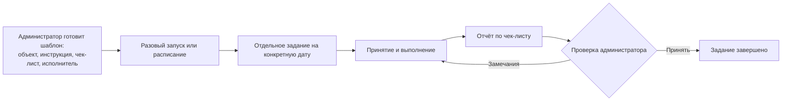

Каждый запуск сохраняет свою дату и снимок инструкции/области. Новый шаблон применяется к будущим заданиям; действующее меняется явно с причиной и уведомлением. Пропущенное задание остаётся незавершённым, даже когда наступил следующий запуск.

Ошибка фонового запуска повторяется ограниченно; после пяти ошибок запуск отмечается как неуспешный (`dead`) и требует явного разбора/повтора. Такой сбой не считается выполненной работой. Если исполнитель обнаружил новую проблему, администратор создаёт или связывает отдельное задание; возможная авария сразу направляется по срочному маршруту.

Источники: JOB-01–06; [приёмка VS-5](vs5-acceptance.md).

<a id="p16"></a>
## 16. Документы и финансовые отчёты

> Полный процесс документов относится к VS-8. Хранение отдельного файла ещё не означает готовности всего документооборота.

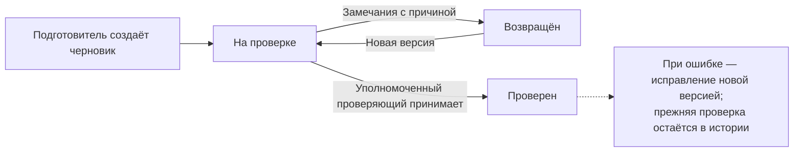

Документ имеет тип, дату, версию, файл и аудиторию; номер и стороны — когда применимо. Подтверждение результата кнопкой в Telegram не называется подписанием юридического акта. Подписанный вне системы экземпляр хранится отдельно от черновика, способ проверки подписи фиксируется.

Если акт обязателен **до приёмки**, без проверенного комплекта результат не отправляют на итоговое подтверждение. Если документ нужен после приёмки, остаётся отдельная обязанность с ответственным и сроком. Финансовые приложения не становятся общедоступными вместе с техническим отчётом.

**Каталог документов:** подготовить разрешённый комплект → определить аудиторию → опубликовать утверждённую версию → прежнюю сохранить в архиве. Общие инструкции, документы собственников, служебные и финансовые материалы имеют разные аудитории. Отсутствующий в боте документ запрашивается по указанному ОСИ порядку.

**Финансовый отчёт:** подготовить вне системы → загрузить отчёт и основания внешних согласований → председатель разрешает публикацию → опубликовать разрешённый комплект собственникам → зафиксировать размещение по обязательным каналам. Это не заменяет официальное утверждение отчёта. Исправление требует новой версии, пояснения и повторного разрешения; сроки подготовки и публикации контролируются отдельно.

Источники: WRK-17/18, DOC-01–03, FIN-01–04, PAY-12.

<a id="p17"></a>
## 17. Публикации, отчёты о работах и плановые отключения

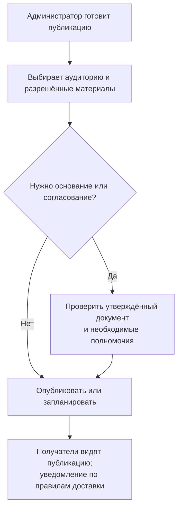

**Отчёт о работе:** после приёмки сотрудник сам выбирает текст и фото/видео для публикации. Внутренняя переписка и квартирные материалы автоматически туда не попадают. По опубликованной работе житель может подать связанное обращение о проблеме.

**Объявление:** обычное или аварийное, для выбранных домов/ЖК. Сообщение о взносах, правилах или решениях сопровождается утверждённым основанием; публикация сама не создаёт решение. Финансовые и документозависимые сценарии имеют ограничения до VS-8.

**Плановое отключение:** сотрудник задаёт услугу, дома, причину, начало/окончание и ответственного → жители получают план → изменения сообщаются → сотрудник отдельно подтверждает фактическое восстановление. Наступление планового окончания не означает восстановления.

Источники: PUB-01–03, NTF-01, EMG-06; [ADR-008](decisions/008-vs7-audience-and-publication-media.md), [приёмка VS-7](vs7-acceptance.md).

<a id="p18"></a>
## 18. Информационный опрос

> Целевой процесс VS-8. Опрос не является юридически значимым решением собрания.

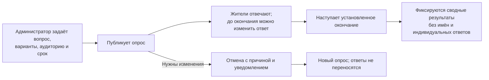

Один человек имеет один актуальный ответ независимо от числа помещений. Если до окончания он утратил все связи, дающие участие, ответ исключается; при восстановлении права нужно ответить заново. Завершённый опрос из-за последующих переездов не пересчитывают.

После публикации вопрос, варианты, аудитория и срок неизменяемы: продление и досрочное подведение итогов запрещены. Отменённый опрос сохраняется в истории, но его результаты не показываются. Администраторы видят сводку, а не ответы конкретных людей; это не обещание необратимой технической анонимности перед владельцем инфраструктуры.

Источники: POL-01–04.

<a id="p19"></a>
## 19. Инициатива жителя и модерация

> Целевые процессы VS-8.

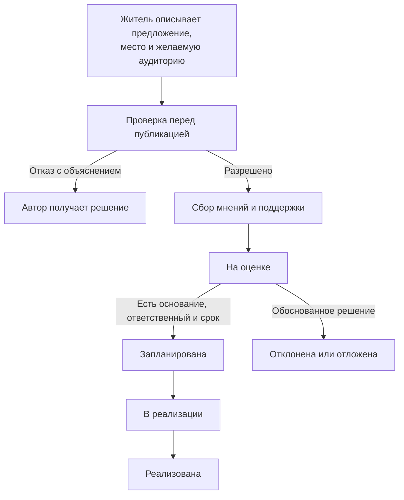

Автор выбирает аудиторию в пределах домов своих подтверждённых связей; публикацию утверждает сотрудник в пределах полномочий. Расширение на весь ЖК разрешает председатель. Поддержка — один раз на человека с возможностью отзыва; она не означает согласия оплатить работу или решение её выполнить. Если нужно решение собственников, прикладывают соответствующий документ.

**Модерация:** сотрудник скрывает нарушающий комментарий с причиной и уведомляет автора; чужой текст не редактирует. При повторных нарушениях может временно ограничить комментарии/инициативы с причиной и сроком. Обращения, аварийные контакты, документы и свои платежи остаются доступны. Житель оспаривает решение у председателя; тот оставляет его, меняет срок или снимает ограничение. По сроку временное ограничение прекращается.

Источники: IDEA-01–03, MOD-01–03.

<a id="p20"></a>
## 20. Отчётность: увидеть, где требуется действие

**Порядок:** выбрать период и доступную область → увидеть показатели → перейти к конкретным незавершённым объектам → при наличии права выгрузить отчёт. Полный целевой объём — VS-8.

| Кто смотрит | Что должен понять |
| --- | --- |
| Исполнитель | Мои назначения, визиты, сроки, просрочки и доработки |
| Администратор | Что новое, без исполнителя, не принято, без ответа или ожидает проверки |
| Председатель | Нагрузка, открытые/выполненные обращения, сроки ответа, просрочки и возвраты |
| Житель | Разрешённые опубликованные работы, планы и сводные показатели своего дома/ЖК |

Отказы и отмены считаются отдельно от выполненных работ; закрытия сотрудником — отдельно от подтверждений автора. Календарный возраст и рабочее время показываются раздельно, циклы доработки сохраняются. Средняя оценка сопровождается числом оценок и долей ответивших; отсутствие оценки не считается положительным ответом.

Операционный Excel содержит номера, категории, состояния, сроки и результаты, без телефонов, переписки и вложений. Персональный реестр выгружается отдельной операцией с отдельной проверкой прав и аудитом.

Источники: REP-01–06, RAT-04, IMP-05.

<a id="p21"></a>
## 21. Сроки: напомнить и передать ответственность

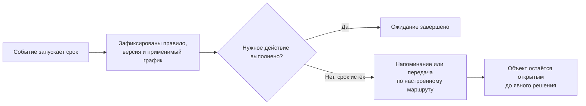

Начальные значения согласованных правил; фактические сроки берутся из действующих версий регламентов.

| Ситуация | Начальное значение | Результат истечения |
| --- | --- | --- |
| Обычная обработка | Ежедневно 08:00–20:00, Алматы | Вне графика сообщается ближайшее начало обработки |
| Первый содержательный ответ | 2 рабочих часа | Контроль реакции; автоматическая квитанция ответом не считается |
| Нет реакции на анкету/спор | По 12 рабочих часов на этапе | Передача заместителю, затем председателю |
| Общий срок решения спора | 36 рабочих часов от поступления | Просрочка и уведомление председателю, без автоматического решения |
| Арендатор ждёт собственника | 48 календарных часов | Передача администратору, без выдачи доступа |
| Одноразовое приглашение | 72 календарных часа | Неиспользованное приглашение истекает |
| Автор молчит после отчёта | 48 календарных часов | Напоминание автору |
| Автор продолжает молчать | 7 календарных дней после отчёта | Проверка администратором, без автоматического закрытия |
| Возврат закрытого обращения | 7 календарных дней после закрытия | Внутри окна — доработка; позднее — новое связанное обращение |
| Изменение оценки | 7 календарных дней после закрытия | После окна действуют ограничения редактирования |
| Аварийное принятие | По 10 календарных минут основному и резервному | Последовательная передача текущей ответственности |

Рабочее время учитывает график; календарное идёт ночью и в выходные. Аварийный маршрут круглосуточный. Возраст обращения идёт с регистрации независимо от графика, после закрытия длительность фиксируется; возвраты учитываются отдельными циклами.

Изменение регламента действует для новых сроков. Начатые сроки сохраняют прежнюю версию. Перенос существующего срока — явная операция с причиной и уведомлением; отсрочка и замена исполнителя его не подменяют. Правовой срок нельзя изменить за установленные границы обычной настройкой.

Источники: TIM-01–07, REG-14, WRK-07–09, REP-06.

<a id="p22"></a>
## 22. Уведомления: событие, доставка, недоставка

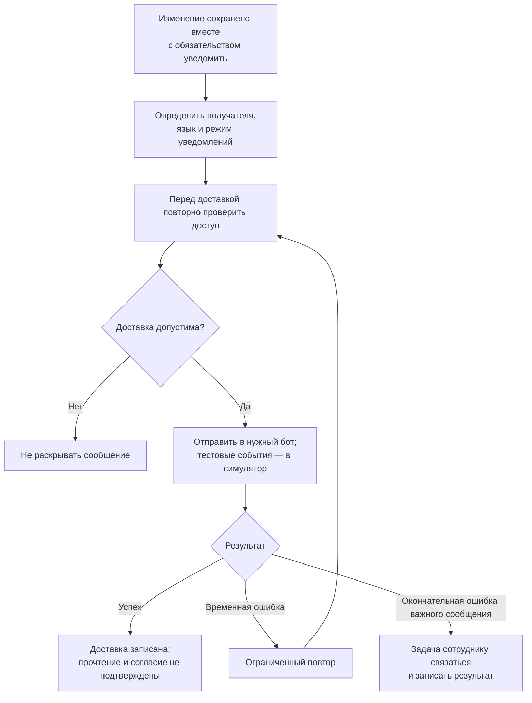

Новости и опубликованные работы можно получать сразу, сводкой или отключить. Начальная ежедневная сводка связана с окончанием смены — сейчас 20:00 Алматы; пустая не отправляется. Запросы уточнения/согласования, итоговый отчёт, отказ/отмена и финансовые события обязательны; аварии по связанным домам отправляются сразу. Обязательность не расширяет аудиторию и не гарантирует доставку при блокировке бота.

Недоставка назначения или аварийного сообщения также запускает предусмотренное информирование резерва; сама по себе не назначает исполнителя и не подтверждает принятие. Повторы доставки не создают повторные задачи на звонок. Сотрудник фиксирует результат контакта явно; закрытая задача на контакт не означает согласия жителя с работой.

Язык ответа — язык профиля, с русским как запасным. Служебные события направляются в бот сотрудников, жительские — в бот жителей, даже если это один человек.

Источники: NTF-01–03; [приёмка VS-5](vs5-acceptance.md), [ADR-009](decisions/009-two-telegram-bots.md).

<a id="p23"></a>
## 23. Сотрудники: выдать роли и передать обязанности

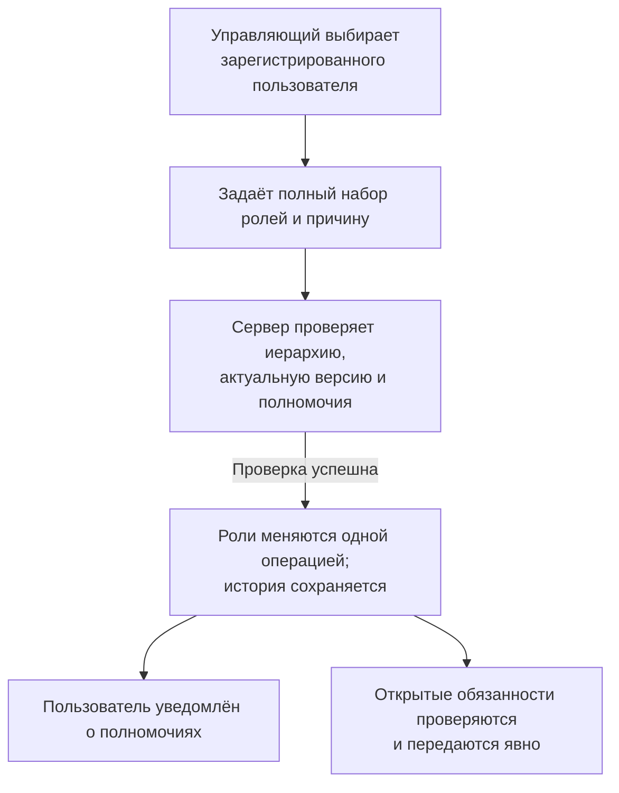

Деловая иерархия: **председатель → администратор → заместитель → исполнитель**. Заместитель и старшие также наследуют дежурного, проверяющего документов и финансовую роль. Технический администратор — отдельная системная роль.

Обычная форма меняет роли другого человека только вниз по иерархии; председателя и технического администратора через неё не назначают и не снимают. Временная служебная область — всё ОСИ; новые назначения бессрочные, исторические ограничения сроков продолжают проверяться.

Первая действующая роль делает пользователя сотрудником, снятие последней прекращает служебный доступ, сохраняя профиль жителя и историю. Даже о снятии последней роли направляется уведомление. Старые задания не исчезают: управляющий организует переназначение. Отзыв одной роли при сохранении другой действующей служебной роли сам по себе не снимает назначение задания.

При смене председателя технический администратор проверяет документ о полномочиях и дату: системный доступ прежнего прекращается, открытые задачи передаются, авторство истории сохраняется. Активация роли не является избранием председателя.

Источники: ROL-01–06; [ADR-014](decisions/014-staff-role-management.md).

<a id="p24"></a>
## 24. Реестр: первоначальная загрузка и дальнейшее ведение

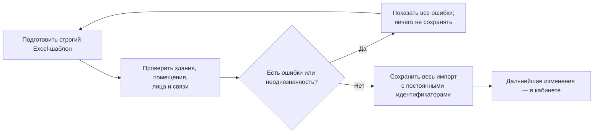

Первичная загрузка включает собственников — физических лиц и их связи. Листы: «Здания», «Помещения», «Лица», «Связи». У человека обязательны ФИО и уникальный нормализованный телефон; ИИН/паспорт в этот импорт не входят. Один человек может иметь несколько помещений, помещение — нескольких собственников. Совпадение ФИО или телефона не разрешает автоматического объединения людей.

Импорт создаёт предварительные записи, **не выдаёт доступ автоматически**. Семья и арендаторы подключаются отдельными процессами. Excel после запуска служит выгрузкой, а актуальные изменения ведутся в кабинете с историей. Изменение телефона не создаёт нового человека и не переносит Telegram автоматически.

В реестре редактируются дома и помещения. Очередь строительства дома — необязательное значение 1–5, она не влияет на права. Удаление дома целиком доступно председателю вне эмуляции и запрещено при активных аварийных сигналах. Удаление помещения/дома снимает связанные доступы и анкеты помещения; обращения сохраняются без удалённой привязки, событие журналируется.

Источники: IMP-01–13, REG-09/11–13; [правила реестра проекта](../AGENTS.md).

<a id="p25"></a>
## 25. Проверка ролей и настройка сообщений

**Эмуляция:** уполномоченный сотрудник выбирает тестовую персону → работает в явно обозначенном режиме → сервер проверяет её права обычным способом → сообщения видны в симуляторе. Тестовые уведомления наружу не уходят. Тестовый житель не получает служебных полномочий; доступ к помещениям требует подтверждённых связей.

Быстрое переключение персоны меняет всю личность и обновляет данные; диалоги разных сеансов не смешиваются. Симулятор показывает кнопки конкретного ответа и отправляет их точные команды. Привилегированные операции, для которых эмуляция запрещена, через неё не выполняются. Выдача ролей не производится быстрым переключателем персон.

**Шаблоны бота:** уполномоченный редактор вне эмуляции выбирает шаблон → готовит русский и казахский варианты и кнопки → проверяет предпросмотр → сохраняет с причиной → новая версия применяется через общий каталог. Изменение глобально. Откат/сброс создаёт новую версию, прежняя не стирается. Пользовательские значения вставляются как текст с экранированием.

Источники: [ADR-010](decisions/010-bot-message-templates.md), [ADR-011](decisions/011-bot-message-scenarios.md), [правила эмуляции](../AGENTS.md).

<a id="p26"></a>
## 26. Сбои, поддержка, персональные данные и журнал

### Если система недоступна

```mermaid
flowchart TB
    A["Сбой мешает приёму или работе"] --> B["Техадминистратор разбирает причину;<br/>при влиянии на ОСИ уведомляется председатель"]
    A --> C["ОСИ принимает обращения<br/>по телефону или лично"]
    C --> D["После восстановления сотрудник<br/>вносит обращение с автором и источником"]
    B --> E["Восстановление и проверка<br/>доступности данных и файлов"]
```

Если отправка дала неопределённый результат, сначала проверяют существующую операцию: повтор не должен создавать дубль. Номер и сообщение об успешной регистрации выдаются после сохранения обращения.

**Резервные копии:** на пилоте — ежедневно и перед обновлениями, база **и** вложения, отдельно от основного сервера, в зашифрованном хранилище в Казахстане. Ежедневные копии — за последние 7 дней. Цели потери данных и восстановления — не более 24 часов каждая. До пилота с реальными данными нужно успешное пробное восстановление в отдельной среде. При сбое/пропуске копирования уведомляется только основной техадминистратор; это специальное правило, без автоматической эскалации. Конкретные средства мониторинга и восстановления требуют отдельной проработки.

**Поддержка:** техническая роль не даёт автоматического прикладного доступа к переписке и финансам. Поддержка запрашивается с причиной, составом данных и сроком, разрешается председателем и прекращается по сроку или отзыву. Инфраструктурный доступ к серверу/копиям регулируется отдельно и не даёт права использовать данные для иных целей.

**Персональные данные:** согласие фиксируется с пользователем, датой и версией текста. Прекращение доступа и уничтожение данных — разные действия; незавершённые обязательства и обязательная история учитываются отдельно. Сроки хранения по категориям ещё должны быть утверждены ОСИ; произвольное автоматическое удаление не вводится.

**Журнал:** фиксирует кто, когда, что изменил и на каком основании — права, назначения, состояния, сроки, цены, документы, экспорт и поддержку. Сотрудники его не редактируют. Просмотр журнала не открывает содержание жалоб, внутреннюю переписку и финансовые файлы без соответствующих прав.

Источники: OPS-01–03, AUTH-07, ROL-06, PRV-01–04, AUD-01/02; [HLD](hld.md).

## Где смотреть подробности

| Нужны подробности | Источник |
| --- | --- |
| Все требования и открытые вопросы | [Требования v1.1](requirements-v1.md) |
| Точные состояния и разрешённые переходы | [Модель процессов](request-lifecycle.md) |
| Кто вправе читать и изменять данные | [Матрица прав](access-matrix.md), уточнения ADR-013–017 |
| Архитектура и очерёдность реализации | [HLD](hld.md) |
| Доказательства проверок и ограничения выпуска | [Индекс документации](README.md), документы приёмки |

При чтении старых разделов учитывайте датированные уточнения: регистрация без помещения — ADR-015; исправление/удаление анкеты — ADR-016; наследование ролей и область всего ОСИ — ADR-014; служебный бот и кнопочное управление — ADR-017. Открытые вопросы не становятся утверждёнными правилами из-за упрощения схемы.
