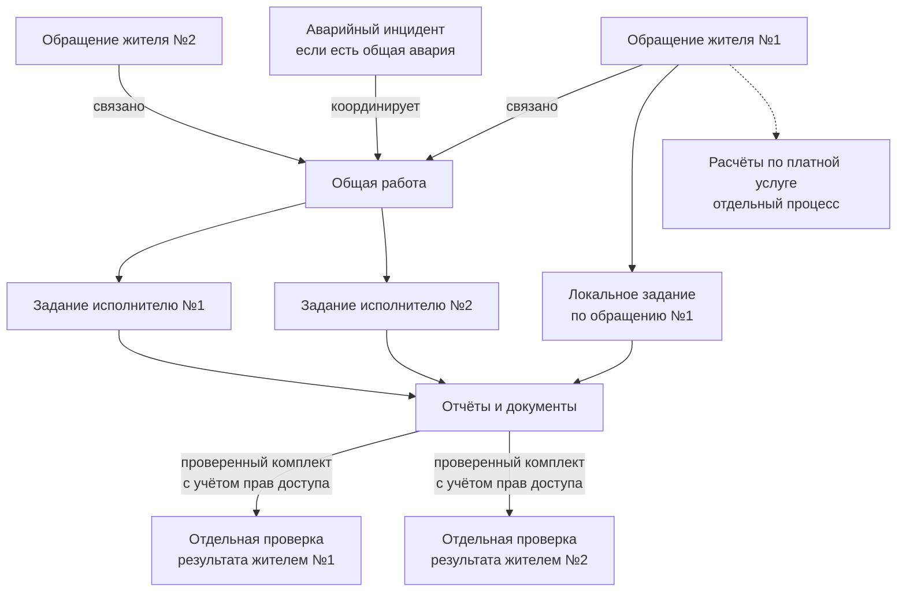
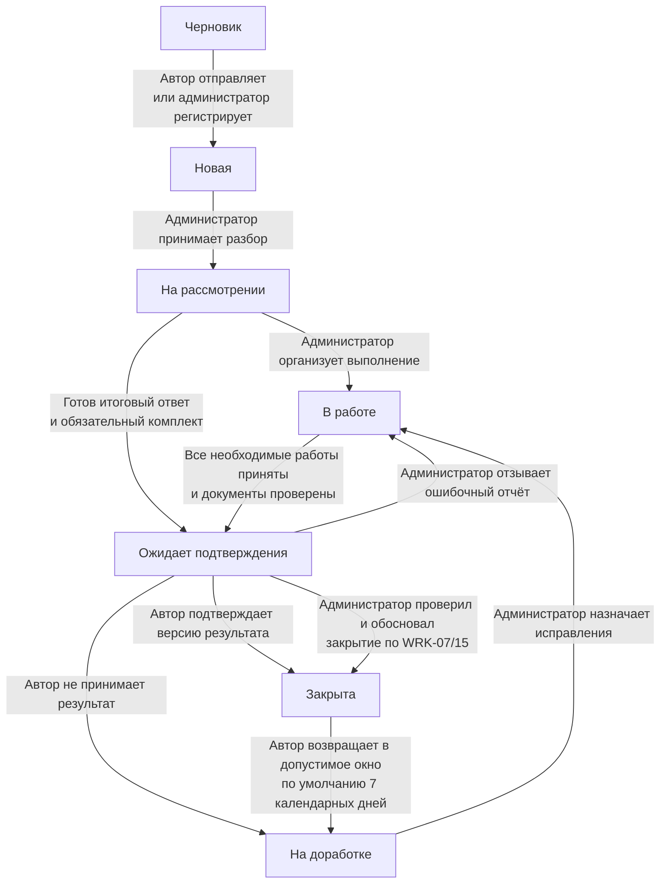
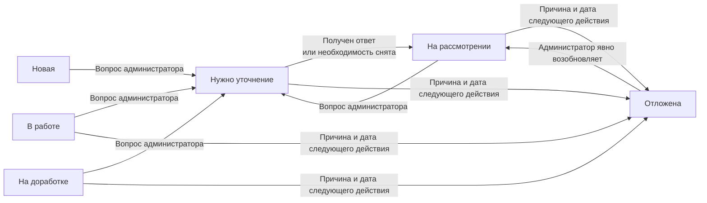
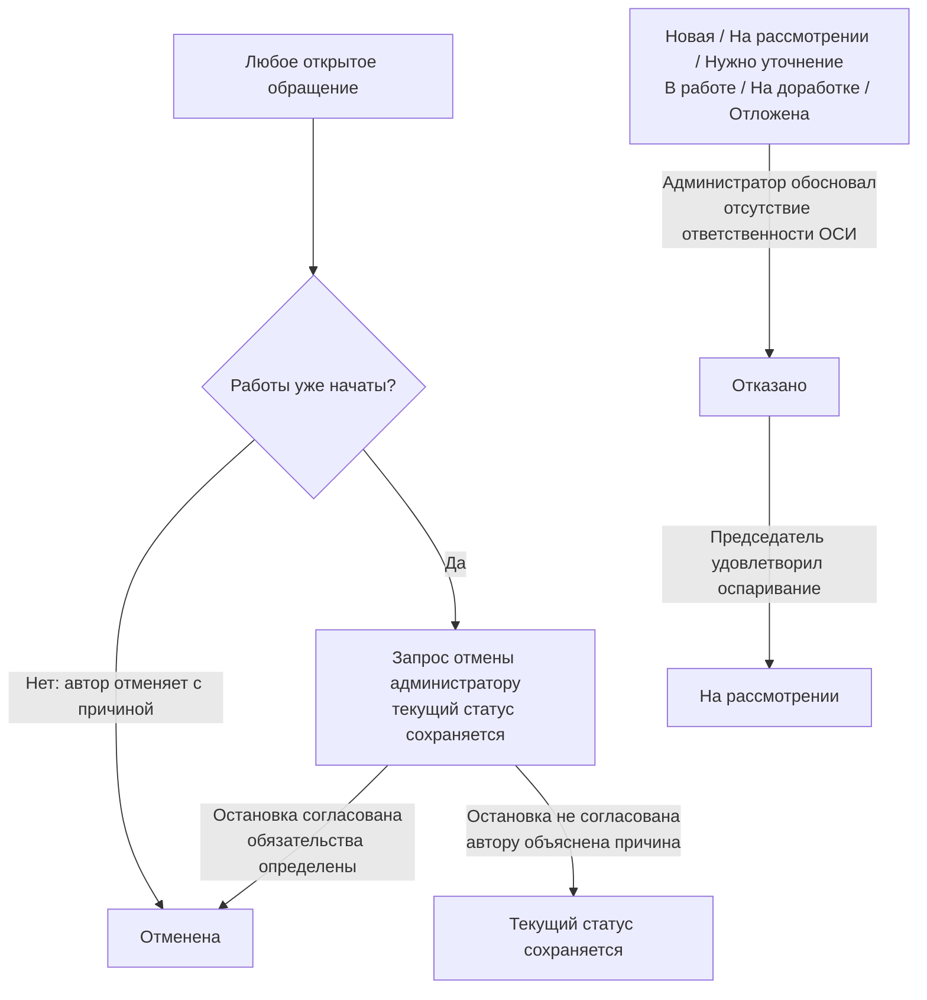
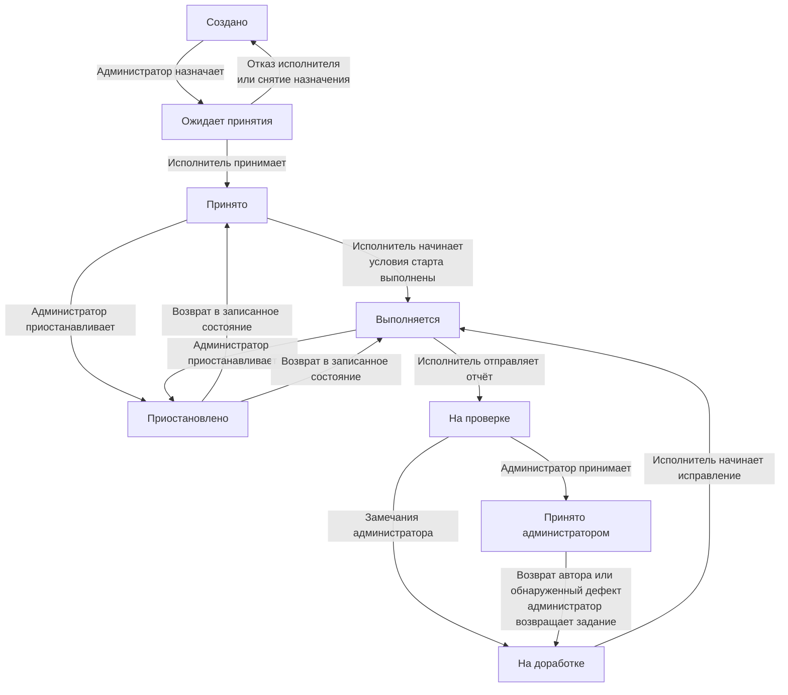
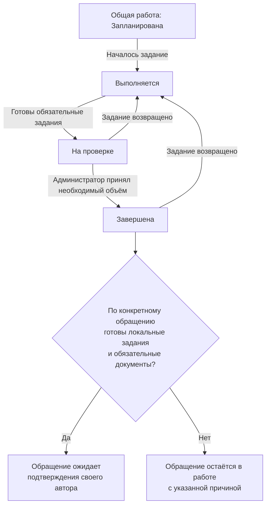
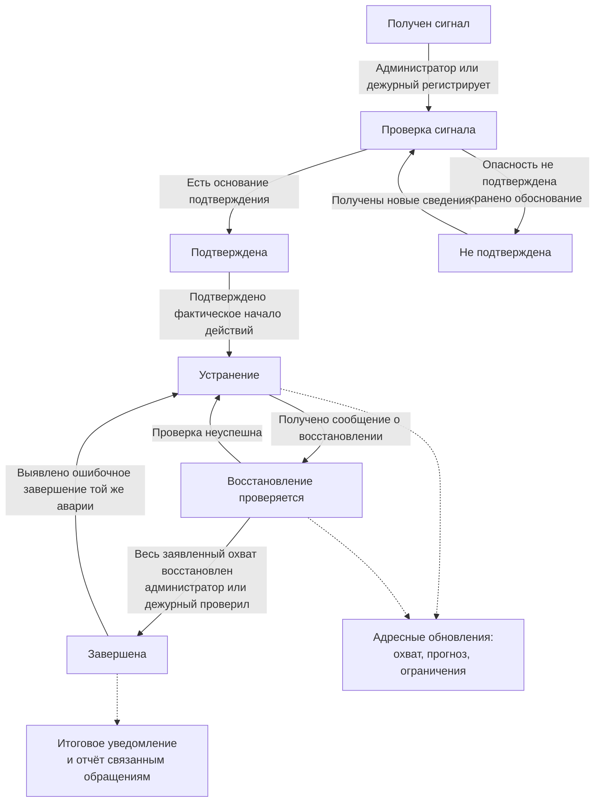
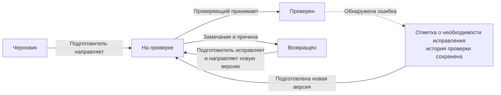
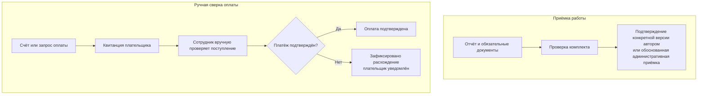

# Модель процессов: обращения, задания и общие аварии

Версия: 1.1. Дата: 16 октября 2026 года.

Нормативное приложение к [требованиям v1.1](requirements-v1.md), детализирующее REQ, WRK, EMG, PAY, MSG и TIM. Длительности, графики и эскалации берутся из декларативных настроек. Здесь задаются условия переходов, а не новые числовые сроки.

Схемы написаны на Mermaid и отображаются в Markdown-просмотрщиках с его поддержкой. Прямоугольники обозначают состояния или объекты, ромбы — проверки; подписи стрелок — действия и условия. Схемы разделены по сценариям для читаемости. Полный перечень разрешённых переходов и исключений задан таблицами; схемы его не расширяют.

## 1. Разделение объектов

| Объект | Назначение | Кто принимает результат |
| --- | --- | --- |
| Обращение | Персональный запрос, вопрос или жалоба с номером, автором и перепиской | Автор; административное закрытие отдельно по WRK-07/15 |
| Задание | Конкретный объём работы одного исполнителя с собственным сроком и зависимостями | Ответственный администратор |
| Общая работа | Набор заданий по одной проблеме для нескольких обращений | Администратор принимает задания; каждый автор отдельно проверяет своё обращение |
| Аварийный инцидент | Координация общей опасности, охвата, восстановления и уведомлений | Администратор/дежурный проверяет восстановление |
| Документ | Отчёт, акт, счёт, квитанция или основание решения с собственной версией и аудиторией | Уполномоченный проверяющий по типу документа |
| Расчёты | Согласование цены, поступление оплаты, расхождения и возвраты | Сотрудник с финансовыми правами |

Обращение может включать локальные задания и быть связано с общей работой. Общая работа может существовать без аварии, а инцидент — поступить без обращения жителя. Статусы «Просрочена», «Нет доступа», «Исполнитель не пришёл», «Ожидает оплаты», «Аварийная» — признаки или события, не замена жизненному циклу обращения.

## 2. Общие правила переходов

**FLOW-01.** Каждый переход проверяется на сервере по текущему состоянию и полномочиям. Сохраняются автор, время, прежнее/новое состояние, причина, версия отчёта/документа и связанные объекты. Недопустимое действие отклоняется с объяснением и актуальным состоянием; повтор одного действия не создаёт повторных событий или уведомлений. При одновременных несовместимых действиях применяется одно, второму участнику предлагается обновить карточку.

**FLOW-02.** У каждого открытого обращения есть ответственный администратор либо настроенная ответственная очередь с маршрутом замещения. Ни отказ исполнителя, ни ожидание жителя, ни передача внешней службе не снимает ответственность ОСИ за сопровождение. Переходы, не перечисленные в таблицах, запрещены. В строках «Любое открытое» имеются в виду все состояния кроме черновика, закрытой, отменённой и отказанной заявки; специальные условия строки имеют приоритет.

**FLOW-03.** Житель получает разрешённое ему сообщение о существенном изменении статуса, назначенном действии, сроке и причине задержки; сотрудник — уведомление в пределах ответственности. Внутренние причины переводятся в отдельное объяснение для жителя без раскрытия служебной переписки. Уведомления финансовой части направляются отдельно плательщику. Правила доставки и предпочтений — NTF; обязательный запрос согласования остаётся видимым в карточке даже при отключённых уведомлениях.

**FLOW-04.** Полный возраст обращения считается от регистрации и не обнуляется. Первый содержательный ответ, срок выполнения, срок задания, ожидание ответа и срок следующего действия — разные показатели. Паузы учитываются отдельно, не скрывают общую длительность и просрочку. Перенос срока — отдельная операция администратора с причиной, прежним/новым значением и уведомлением. Смена статуса сама по себе не продлевает срок.

## 3. Обращение: состояния

| Состояние | Значение |
| --- | --- |
| Черновик | Личный незавершённый ввод; номера и сроков нет |
| Новая | Обращение сохранено, выдан номер, ожидается первичный разбор |
| На рассмотрении | Администратор классифицирует и организует ответ/работу |
| Нужно уточнение | Задан конкретный вопрос, ожидается ответ автора/уполномоченного участника |
| В работе | Есть активный план исполнения или подготавливается ответ; задания могут ожидать принятия/визита |
| Отложена | Администратор зафиксировал причину и дату следующего действия |
| Ожидает подтверждения | Итоговый отчёт/ответ предоставлен автору, обязательные работы и документы готовы |
| На доработке | Автор не принял результат или вернул закрытую заявку в допустимое окно |
| Закрыта | Результат подтверждён автором либо выполнено обоснованное административное закрытие |
| Отменена | Обращение прекращено по процедуре отмены; не считается выполненным |
| Отказано | Администратор установил отсутствие ответственности ОСИ и объяснил основание/маршрут |

«Закрыта» содержит отдельные атрибуты способа закрытия, лица, даты и версии результата. Состояния «Отменена» и «Отказано» не входят в число подтверждённых результатов. Ожидание расчётов/документов после приёмки отображается отдельно даже у закрытого обращения.

## 4. Обращение: разрешённые переходы

### Основной маршрут и доработка

Административное закрытие отмечается отдельно и не считается подтверждением автора. Молчание автора вызывает напоминание и проверку, но не автоматическое закрытие.

### Уточнение и отсрочка

Дата следующего действия вызывает напоминание, а не автоматическое возобновление. Уточнение и отсрочка не обнуляют просрочку.

### Отмена и отказ

Узлы с перечислением обозначают группы исходных состояний, а не дополнительные статусы.

### Полная таблица переходов

| Из → в | Кто / событие | Условия и действия | Сроки и уведомления |
| --- | --- | --- | --- |
| Черновик → Новая | Автор; администратор при внешнем обращении | Проверены обязательные поля; сохранены заявитель, объект и источник; присвоен номер | Начало срока первого ответа и возраста; уведомление автору и очереди |
| Новая → На рассмотрении | Администратор принимает разбор | Назначается конкретный сопровождающий; уточняются категория и срочность | Принятие карточки без ответа жителю не считается первым ответом |
| Новая / На рассмотрении / В работе / На доработке → Нужно уточнение | Администратор | Конкретный вопрос, адресат, причина и предыдущее состояние; действующие задания явно продолжаются либо приостанавливаются отдельно | Уведомление адресату; срок ответа по TIM, без молчаливого продления общего срока |
| Нужно уточнение → На рассмотрении | Автор/совместный участник отвечает; администратор фиксирует ответ по телефону | Ответ сохранён с источником; администратор проверяет достаточность сведений | Уведомление администратору; повторный вопрос — новый цикл ожидания с историей |
| Нужно уточнение → На рассмотрении | Администратор снимает необходимость уточнения | Причина и имеющиеся сведения достаточны для решения | Не считается ответом жителя; общий срок сохранён |
| На рассмотрении → В работе | Администратор | Указаны план, необходимые задания/общая работа либо ответственный за подготовку ответа; для платной работы соблюдены согласование и условия старта | Автору сообщаются план и срок; исполнителям направляются задания |
| На рассмотрении / В работе → Ожидает подтверждения | Администратор; автоматическая подготовка допускается, отправку проверяет администратор | Все обязательные задания приняты и документы проверены; для вопроса/жалобы подготовлен итоговый ответ. Есть версия результата и доступная жителю формулировка | Начало ожидания подтверждения; автор получает отчёт/ответ |
| В работе / На рассмотрении / Нужно уточнение / На доработке → Отложена | Администратор | Причина, дата следующего действия, ответственный и состояние до отсрочки; задания согласованно приостановлены либо продолжаются явно | Уведомление автору, напоминание на дату; просрочка не обнуляется |
| Отложена → На рассмотрении | Администратор возобновляет | Причина снятия отсрочки, проверка актуальности плана | Исходные сроки сохраняются; наступление даты само только напоминает и эскалирует, не имитирует начало работ |
| Ожидает подтверждения → Закрыта | Автор | Явное подтверждение конкретной версии результата | Фиксация подтверждения; предложение оценки, начало окна повторного открытия |
| Ожидает подтверждения → Закрыта | Администратор по WRK-07/15 | После установленного ожидания проведена проверка либо прекращена связь автора по применимому сценарию; записаны основание, способ проверки и материалы | Пометка «Закрыто администратором», уведомление автору при доступности; не входит в KPI подтверждений автора |
| Ожидает подтверждения → На доработке | Автор | Причина несогласия; необязательные материалы; исходный отчёт сохраняется | Уведомление администратору, цикл подтверждения завершён без принятия |
| Закрыта → На доработке | Автор в течение настроенного окна, по умолчанию 7 календарных дней | Причина; авторство, способ прежнего закрытия и оценка остаются в истории | Результат больше не считается окончательным; ранее оценка исключается из текущей средней |
| На доработке → В работе | Администратор | План исправления, задания, исполнители и сроки; повторное назначение явно принимается | Срок доработки фиксируется отдельно; первоначальные сроки и просрочки сохраняются |
| Любое открытое → Отменена | Автор до начала работ; администратор по запросу после начала | Причина; проверены фактически начатые задания, согласована остановка, определены обязательства по расчётам. Для общей работы отменяется только участие данного обращения | Уведомления автору/затронутым исполнителям; финансовые обязательства не исчезают |
| Новая / На рассмотрении / Нужно уточнение / В работе / На доработке / Отложена → Отказано | Администратор | Установлено отсутствие ответственности ОСИ; объяснение и известный дальнейший маршрут. Уже начатые локальные работы согласованно остановлены; расчёты урегулируются отдельно | Уведомление автору с возможностью оспорить; не учитывается как выполнение |
| Отказано → На рассмотрении | Председатель при удовлетворении оспаривания | Сохранены обращение автора, решение и основание пересмотра; назначен администратор | Новый этап рассмотрения с историей прежних сроков; уведомление автору |
| Ожидает подтверждения → В работе | Администратор обнаружил ошибочный/неполный результат до принятия | Причина отзыва отчёта, уведомление автора, задания исправления; отчёт не удаляется | Старое ожидание прекращается; после нового отчёта начинается новый цикл |

Удаление личного черновика не является отменой зарегистрированного обращения. По истечении окна повторного открытия создаётся новое связанное обращение, а не меняется закрытая запись. Отменённая заявка не возобновляется: при новой потребности создаётся связанная. Оспаривание отказа регистрируется как действие в том же обращении; до решения председателя статус «Отказано» сохраняется. Неудовлетворённая жалоба с подготовленным содержательным ответом не равна отказу по отсутствию ответственности.

Запрос отмены после начала работы — отдельное ожидающее решение, не мгновенная смена статуса. Администратор подтверждает отмену или объясняет отказ/невозможность остановки; действующий статус и ответственный сохраняются. Совместный участник не подтверждает результат, не отменяет и не возвращает закрытую заявку; он может сообщить о проблеме автору/администратору.

## 5. Задания и общая работа

### Задание исполнителя

Из любого незавершённого состояния администратор также может переназначить задание с возвратом в «Создано» или отменить его с причиной. Эти общие переходы вынесены за схему, чтобы не перегружать её линиями; их условия приведены в таблице.

### Общая работа и персональная приёмка

Отмена общей работы выполняется отдельно с разбором всех связанных обращений и не отменяет их автоматически.

### Полная таблица переходов задания

| Из → в | Кто | Условия и последствия |
| --- | --- | --- |
| Создано → Ожидает принятия | Администратор назначает | Исполнитель — любой действующий сотрудник ОСИ независимо от роли и домов (ROL-02e); объём, срок, зависимости, инструкция и необходимые доказательства определены |
| Ожидает принятия → Принято | Исполнитель | Явное принятие; начало работы ещё не подтверждено |
| Ожидает принятия → Создано | Исполнитель отказывается либо администратор снимает назначение | Причина, уведомление администратору; история назначений сохраняется |
| Принято → Выполняется | Исполнитель | Предшествующие обязательные задания приняты, согласован доступ при необходимости, выполнены условия старта платной услуги |
| Принято / Выполняется → Приостановлено | Администратор; исполнитель сообщает причину и запрашивает остановку | Причина, следующее действие и дата, состояние возврата; «Нет доступа» сохраняется отдельным событием. При опасности исполнитель прекращает небезопасные действия немедленно и уведомляет ответственного |
| Приостановлено → Принято / Выполняется | Администратор | Проверены условия возобновления; возвращается записанное состояние, исполнитель уведомлён |
| Выполняется → На проверке | Исполнитель | Представлен отчёт и комплект обязательных доказательств либо явно запрошено решение по недостающим материалам |
| На проверке → Принято администратором | Администратор | Проверены результат, чек-лист и документы; недостающие обязательные доказательства обработаны по WRK-16 |
| На проверке → На доработке | Администратор | Перечень замечаний и ожидаемый результат, срок исправления |
| На доработке → Выполняется | Исполнитель | Замечания приняты, условия старта выполнены; при замене сначала новое назначение |
| Принято администратором → На доработке | Администратор | Связанный возврат автора либо обнаруженный дефект; прежняя приёмка сохранена, влияние на зависимые задания явно разобрано |
| Любое незавершённое → Создано | Администратор переназначает | Предыдущему исполнителю сообщено снятие, сохранены выполненный объём/материалы; новое назначение проходит принятие. Снятие не стирает срок |
| Любое незавершённое → Отменено | Администратор | Причина, проверка остановки и зависимых работ; для общей работы проверено влияние на всех заявителей |

Здесь незавершённые состояния задания: «Создано», «Ожидает принятия», «Принято», «Выполняется», «Приостановлено», «На проверке», «На доработке». Отменённое обязательное задание не считается выполненным: администратор создаёт замену или явно изменяет необходимый объём с основанием и согласованием, если меняются обязательства перед жителем/плательщиком.

Общая работа использует агрегированные состояния «Запланирована / Выполняется / На проверке / Завершена / Отменена». Начало любого задания означает выполнение; готовность обязательных заданий — проверку; администратор завершает её после приёмки всего необходимого объёма. Возврат задания возобновляет работу и сохраняет прежнюю дату завершения в истории. Отмена общей работы допускается только администратором с разбором всех связанных обращений; они не отменяются автоматически. При каждом переходе проверяются локальные невыполненные задания каждого обращения.

## 6. Общая авария: переходы

Пунктирные стрелки показывают уведомления, а не смену состояния. Частичное восстановление не завершает инцидент; новая самостоятельная авария получает новый номер. Связанные обращения проходят собственную проверку результата по схеме раздела 5.

| Из → в | Кто / условие | Обязательное действие |
| --- | --- | --- |
| Нет инцидента → Проверка сигнала | Администратор/дежурный регистрирует сигнал | Время первого сигнала, источник, место, предполагаемый охват, ответственный; срочное уведомление и связь с обращениями |
| Проверка сигнала → Подтверждена | Администратор/дежурный по проверке | Основание подтверждения, фактический охват, срочные меры, прогноз либо «Уточняется», время следующего обновления; сообщение аудитории |
| Проверка сигнала → Не подтверждена | Администратор/дежурный | Основание, ответ заявителям; если предупреждение опубликовано — корректирующее сообщение той же аудитории; обычные работы продолжаются отдельно |
| Подтверждена → Устранение | Администратор/дежурный | Подтверждён исполнитель/внешняя служба и фактическое начало действий; одно уведомление или отправка заявки внешней службе не считается выездом |
| Устранение → Восстановление проверяется | Исполнитель сообщает; администратор/дежурный фиксирует | Что и когда восстановлено, материалы/подтверждение внешней службы, ограничения и способ проверки |
| Восстановление проверяется → Устранение | Администратор/дежурный | Проверка неуспешна; причина, задания, обновлённый прогноз и сообщение жителям |
| Восстановление проверяется → Завершена | Администратор/дежурный | Подтверждено восстановление по всему заявленному охвату, записаны фактическое время, способ проверки и итоговый отчёт; уведомление аудитории |
| Не подтверждена → Проверка сигнала | Администратор/дежурный получает новые сведения | Новое основание, сохранение прежнего решения и времени сигналов |
| Завершена → Устранение | Администратор/дежурный установил ошибочное завершение той же аварии | Причина возобновления, актуальный охват, ответственные и уведомления; прежняя история сохраняется |

При самостоятельной новой аварии создаётся новый связанный инцидент, даже если место совпадает. Частичное восстановление фиксируется по зонам/услугам: уведомляются соответствующие пользователи, инцидент в целом остаётся активным до полного восстановления. Если остаётся опасность, её нельзя скрыть отметкой о завершении; остаточные неаварийные работы выделяются в задания с ответственными и сроками.

Переходы проверки и подтверждения могут выполняться подряд без ожидания, но каждое событие сохраняется. Отсутствие ответа сотрудника вызывает эскалацию, не подтверждает и не снимает аварию автоматически. Инцидент нельзя завершить обычным таймером, оплатой или массовым подтверждением за жителей.

## 7. Документы, подтверждение и расчёты

### Проверка документа

Пунктир обозначает фиксацию ошибки в проверенном документе, а не удаление прежней версии или её проверки.

### Независимые результаты работы и оплаты

Между ветвями нет автоматического перехода: квитанция не подтверждает качество, приёмка не подтверждает поступление денег. Порядок предоплаты или оплаты после выполнения задаётся условиями услуги. Схема не определяет открытые правила частичных платежей и возвратов.

Документ работы проходит «Черновик → На проверке → Проверен» либо «На проверке → Возвращён → На проверке». Подготовитель направляет новую версию, уполномоченный проверяющий принимает или возвращает с причиной. Ошибочно проверенный документ помечается как требующий исправления с основанием и новой версией; прежняя отметка остаётся в истории. Аудитория определяется типом документа, а не только доступом к обращению.

При передаче отчёта автору сохраняется снимок комплекта и его версии. Подтверждение относится только к этому комплекту. Изменение существенного результата до подтверждения требует отзыва по таблице переходов и нового цикла проверки. Для нового отчёта после доработки напоминание и срок передачи администратору отсчитываются заново; первоначальные циклы остаются в отчётах. Отказ в приёмке нельзя заменить положительной оценкой или сверкой оплаты.

Для платной услуги цена, разрешение на начало, подтверждение работы, проверка квитанции и возврат независимы. В MVP деньги проверяет сотрудник вручную. Частичная оплата, несколько платежей и принятие оплаченной работы после смены жильца остаются открытыми в OQ-07; приложение не устанавливает за них новые коммерческие правила.

## 8. Проверяемые сценарии

| Сценарий | Ожидаемый результат |
| --- | --- |
| Житель/совместный участник открывает внутреннее вложение по прямой ссылке | Доступ запрещён; файл не попадает в уведомления и экспорт жителя |
| Исполнитель не принял назначение | Задание ждёт принятия, администратор получает эскалацию, нет ложного начала работ |
| Одновременно поступили подтверждение и новый отчёт | Система не принимает подтверждение устаревшего комплекта; второй участник видит актуальное состояние |
| Автор молчит после выполнения | Напоминание и проверка администратора, без автоматического закрытия |
| Автор вернул результат | Отдельный цикл доработки, прежние сроки/оценки/отчёты сохранены |
| Участник общего инцидента отменил обращение | Его обращение отменено по правилам; работы и остальные обращения продолжаются |
| Авария устранена только в одном из двух домов | Частичное восстановление и адресное уведомление; общий инцидент остаётся активным |
| Общая работа завершена, локальное задание не выполнено | Конкретное обращение не отправляется на итоговое подтверждение |
| Номер квартиры совпал с номером кладовки | Два разных объекта; доступы, связи и импорт не смешиваются |
| Квитанция принята, акт не готов | Оплата подтверждена; обязательная документальная проверка остаётся незавершённой |
| Изменён правовой срок за допустимую границу | Обычное изменение отклонено; требуется процедура обновления правового регламента |

Это проектные критерии приёмки, а не результат выполненных программных тестов. Они дополняют раздел 15 спецификации и не изменяют согласованные исключения ACC-02.

## Исправление основной анкеты и прекращение доступа (21.10.2026)

REG-02a/PRV-02a, ADR-016: подтверждённая анкета при исправлении переходит в pending_review с `confirmed_draft`; прежние person/profile и доступ сохраняются. Одобрение применяет предложение и возвращает approved; отказ восстанавливает прежний draft и approved, уточнение оставляет предложение в need_clarification. Споры о связи с помещением не заменяются исправлением персональных данных.

Удаление отзывает анкеты, архивирует person/profile, прекращает сеансы/эмуляции/связи/приглашения/роли, сохраняя обращения, задания и аудит. После повторной подачи основная запись используется повторно с reactivating; до одобрения ОСИ архивный аккаунт закрыт. Одобрение активирует прежние идентификаторы, не восстанавливая роли и связи.

## Уточнение VS-8 (24.10.2026)

Обязательный акт проверяется через документальную обязанность, точную approved-версию и неизменяемый файл. Подтверждение результата сверяет серверный снимок отчётов и документов; needs_fix, новый отчёт или возврат делают прежний снимок непригодным. Обязанность после приёмки сохраняется независимо от закрытия обращения. Фон напоминает и эскалирует, не публикует документ и не принимает результат автоматически.

Отчётность не меняет жизненный цикл: closed→closed и accepted_admin→accepted_admin не создают новую дату завершения. Возврат/повторное открытие создаёт новый цикл; ожидание подтверждения и рабочие таймеры учитываются отдельно. Первый ответ — конкретное содержательное служебное сообщение resident; автоматические уведомления, назначение и внутренняя переписка ответом не являются.
